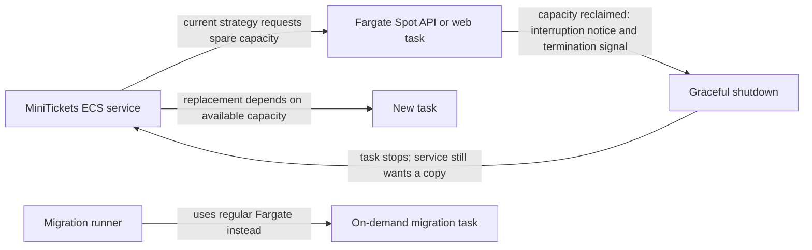

# Fargate Spot

History: see [CHANGELOG.md](../CHANGELOG.md) or run `pnpm docs:history`

Area: AWS Compute · Status: ✅ built · Step doc: [17 ECS api](../../17-infra-ecs-api.md) (section 3.3)

<!-- interview-card: v2 -->

## 1. What is it?

Fargate Spot runs containers on spare AWS capacity at a discounted rate. AWS can reclaim that capacity, so applications must tolerate interruption and unavailable replacements.

## 2. Why do we need it?

MiniTickets is a low-traffic learning environment where saving compute cost is useful. Accepting interruptions is a deliberate trade-off; the same choice would need stronger safeguards for a busy ticket sale.

## 3. How does it work?

1. The service requests Spot capacity for replaceable application tasks.
2. An interruption triggers bounded shutdown and target removal.
3. ECS attempts replacement; capacity and startup time can still cause an outage.

## 4. How do we use it in MiniTickets?

API and web use Spot without an on-demand base. A single interrupted task can leave its service unavailable. Dedicated migrations use regular Fargate to avoid Spot reclamation risk, although that does not make them immune to all failures.

## 5. Interview-ready answer

“MiniTickets deliberately uses Fargate Spot for development API and web tasks. It reduces compute cost but spare capacity can disappear or be unavailable when replacement is needed. We support graceful shutdown and shared session state, yet one copy still means interruption risk. Migrations use on-demand capacity. A stronger production design would choose a dependable baseline and treat Spot as interruptible extra capacity.”

## 6. Important follow-up questions

- **Does the warning guarantee uninterrupted service?** No. One copy, shutdown timing and unavailable replacement capacity can all interrupt requests.
- **Why use regular Fargate for migrations?** It avoids Spot reclamation, but task, network or application failures can still happen.
- **Does process replacement log everyone out?** Not by itself when shared sessions survive; requests can still fail during the gap.
- **What if no Spot capacity exists?** Tasks may remain unplaced; inspect service events and provide an appropriate capacity strategy.

## 7. Advanced details

Technical reference

### Strategy, signal handling and inspection

`infra/src/compute/cluster.ts` attaches `FARGATE_SPOT` and `FARGATE`; API/web service strategies each use Spot weight 1 with no on-demand base. `scripts/run-migrations.sh` uses `--launch-type FARGATE`. On interruption AWS provides a two-minute warning/SIGTERM path; actual process shutdown allowance and network drain ordering must not be equated with two guaranteed minutes of healthy service.

`apps/api/src/server.ts` closes Fastify, relay/reconciliation and data clients. Normal deployment drain and Spot interruption need not have identical signal order; precise ordering and any proposed after-signal wait remain unmeasured acceptance work. Replacement starts only when capacity/startup/health permit.

Inspect capacity with `aws ecs describe-tasks --profile ticketlite --cluster minitickets-dev --tasks <task-arn> --query 'tasks[0].capacityProviderName'`; service events/stopped reason may show `Your Spot Task was interrupted`. An owner-only `aws ecs stop-task` exercise can test a termination/replacement path but does not reproduce actual Spot capacity reclamation; no task was stopped here.

### Cost and alternatives

Old figures of about **70%**, **$0.003 versus $0.010/hour**, **$0.005/hour public IPv4**, and **1–2 minute gaps** are historical estimates, not current pricing or measured recovery guarantees. Spot prices/capacity vary. Production alternatives include an on-demand base plus Spot extra, all on-demand for critical small fleets, or Savings Plans for eligible steady usage. Regular Fargate reduces one interruption cause; it does not guarantee migration completion.

### Code anchors

- Anchor: `infra/src/compute/cluster.ts` · `capacityProviders`: attaches `FARGATE_SPOT` (and `FARGATE`) to the cluster.
- Anchor: `infra/src/compute/service.ts` · `capacityProviderStrategies`: the api runs 100% on `FARGATE_SPOT`.
- Anchor: `infra/src/compute/web-service.ts` · `capacityProviderStrategies`: so does web.
- Anchor: `scripts/run-migrations.sh` · step 6, `--launch-type FARGATE`: migrations deliberately do **not** use Spot.

### Related reading

[zero-downtime-deploys](zero-downtime-deploys.md) · [cluster](ecs-cluster.md) · [target groups](target-groups.md) · [services](ecs-service.md) · [high availability](high-availability.md)

[Open this concept in the city explorer](../guides/infra-explorer.html?concept=fargate-spot#chapter=8&piece=ecs).

## Where it appears in the story

- [Infra story: 4. ECS: cluster, service, task definition, task, Spot](../infra-story.md#4-ecs-cluster-service-task-definition-task-spot)
- [Big picture: 4. Components](../00-big-picture.md#4-components)

