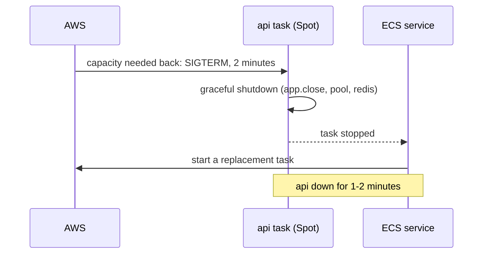

# Fargate Spot

History: see [CHANGELOG.md](../CHANGELOG.md) or run `pnpm docs:history`

Area: AWS Compute · Status: ✅ built · Step doc: [17 ECS api](../../17-infra-ecs-api.md) (section 3.3)

## 1. In one line

**Fargate Spot** runs tasks on AWS's spare capacity for about 70% less, but AWS can take it back at
any time with a 2-minute warning.

## 2. Real-life comparison

A cheap standby airline seat. You fly for a fraction of the price, but if a full-fare passenger
turns up, you get off the plane, and the airline puts you on the next flight.

## 3. Picture it



## 4. Where in our code

- Anchor: `infra/src/compute/cluster.ts` · `capacityProviders`: attaches `FARGATE_SPOT` (and `FARGATE`) to the cluster.
- Anchor: `infra/src/compute/service.ts` · `capacityProviderStrategies`: the api runs 100% on `FARGATE_SPOT`.
- Anchor: `infra/src/compute/web-service.ts` · `capacityProviderStrategies`: so does web.
- Anchor: `scripts/run-migrations.sh` · step 6, `--launch-type FARGATE`: migrations deliberately do **not** use Spot.

Step by step:

1. The cluster must have the provider attached before a service can use it.
2. Each service: `[{ capacityProvider: "FARGATE_SPOT", weight: 1 }]`, no `base` on FARGATE.
3. On interruption, the task gets SIGTERM; our api's `shutdown` in `apps/api/src/server.ts` closes
   the server, then the pool and Redis. With the ALB, ECS also deregisters the task from its target
   group ([zero-downtime-deploys](zero-downtime-deploys.md)). On a normal deploy draining comes
   first (verified from AWS's task lifecycle docs). On a Spot interruption AWS's docs say the
   two-minute warning is sent "as a SIGTERM signal to the running task" and do not say the task is
   deregistered first, so the two may overlap (the exact order is still unsure; not measured). That
   is why a short **wait after SIGTERM** before closing is planned (see
   [zero-downtime-deploys](zero-downtime-deploys.md), "Planned improvement").
4. The service sees the missing task and starts a new one.
5. The migration uses on-demand: a migration stopped halfway is worse than paying a fraction of a
   cent more.

## 5. See it yourself

```bash
aws ecs describe-tasks --profile ticketlite --cluster minitickets-dev \
  --tasks $(aws ecs list-tasks --profile ticketlite --cluster minitickets-dev --service-name minitickets-dev-api --query 'taskArns[0]' --output text) \
  --query "tasks[0].capacityProviderName"     # FARGATE_SPOT
```

An interruption shows as stopped reason `Your Spot Task was interrupted`. You cannot trigger one
yourself; `aws ecs stop-task` gives a similar SIGTERM-then-replace flow.

## 6. How it connects

- **Uses ←** the [cluster](ecs-cluster.md); graceful shutdown in the api (Phase 3 card
  `graceful-shutdown`); draining in the [target groups](target-groups.md).
- **Gives →** cheap [services](ecs-service.md); the reason [high availability](high-availability.md)
  matters more in production.

## 7. Our settings and WHY

| Workload | Capacity | Why |
| -------- | -------- | --- |
| api service | FARGATE_SPOT | Dev can accept 1-2 minute gaps. |
| web service | FARGATE_SPOT | Same. |
| migration task | FARGATE | Must not be interrupted halfway. |

## 8. Trade-offs

- **Pros:** about 70% cheaper (our api: ~$0.003 vs ~$0.010 an hour).
- **Cons:** interruptions; with one task, an interruption is an outage. Spot capacity can also be
  unavailable for a while.

## 9. Alternatives and when to choose them

- **On-demand base + Spot extra** (`base: 2` on FARGATE, the rest Spot by weight): production web
  services.
- **All on-demand:** critical services with few tasks.
- **Savings Plans:** steady usage at a lower on-demand price, without interruptions.

## 10. What breaks, and how we'd notice

- Interruption: `Your Spot Task was interrupted` in the stopped reason; 503 at the ALB until the
  replacement is healthy.
- No Spot capacity: tasks cannot be placed; service events say so.

## 11. Reach / Allowed / Password

Same as normal Fargate; only the price and the risk of interruption differ.

## 12. Cost

About $0.003 an hour per task on Spot ARM vs ~$0.010 on-demand; Spot prices move
([docs/17](../../17-infra-ecs-api.md), section 3.16). Note: each task's public IPv4 address
($0.005 an hour) costs more than the Spot task itself.

## 13. Interview answers at 3 levels

- **Simple:** Spot is cheap spare capacity that AWS can take back.
- **Senior:** Both our services run 100% on FARGATE_SPOT. On interruption the task gets SIGTERM with
  two minutes' notice; ECS deregisters it from the ALB, the api shuts down gracefully, and the service starts a
  replacement. The migration runs on on-demand Fargate so it cannot be cut off.
- **Lead:** Spot is fine for stateless, horizontally scaled services that handle SIGTERM well. In
  production I'd keep an on-demand base across two AZs and put the extra capacity on Spot.

## 14. Follow-up questions interviewers ask

- *What must an app do to be Spot-friendly?* Be stateless, handle SIGTERM, start quickly.
- *Why not Spot for migrations?* Half-applied migrations are dangerous.

## 15. Say it in 30 seconds

"Both services run on Fargate Spot, about 70% cheaper. On interruption the task gets SIGTERM, ECS
takes it out of the ALB, the api shuts down cleanly, and the service starts a new one. Migrations use on-demand
so they can't be interrupted; production would add an on-demand base."

## 16. Status

✅ built for dev. Production needs an on-demand base (see [high-availability](high-availability.md)).

## Where it appears in the story

- [Infra story: 4. ECS: cluster, service, task definition, task, Spot](../infra-story.md#4-ecs-cluster-service-task-definition-task-spot)
- [Big picture: 4. Components](../00-big-picture.md#4-components)
