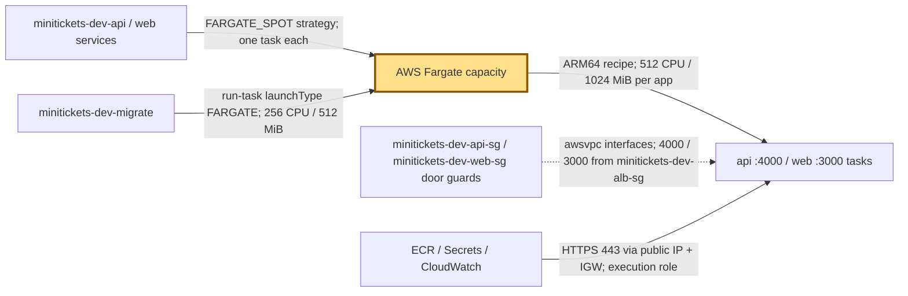
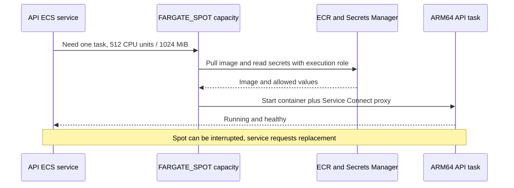

# Fargate: the city’s hired work crews

History: see [CHANGELOG.md](../CHANGELOG.md) or run `pnpm docs:history`
Area: AWS Compute · Status: ✅ built · Step doc: [17 ECS api](../../17-infra-ecs-api.md) (section 3.2)
<!-- interview-card: v1 -->

## 1. In one line

MiniTickets asks [Fargate](../glossary.md#fargate) for a sized worker; AWS supplies and maintains its hidden host machine.

## 2. Where it sits

[Open this piece in the city explorer](../guides/infra-explorer.html?concept=fargate#chapter=8&piece=api-task).

## 3. How it works

## 4. What happens in MiniTickets

1. API and web task recipes require `FARGATE`, `awsvpc` networking and ARM64 images.
2. Current services choose cheaper `FARGATE_SPOT`; each task gets 0.5 vCPU and 1 GiB including the private-call proxy.
3. Each task receives a network interface, a public IP for outgoing calls and its own security group.
4. The migration job uses regular Fargate with 0.25 vCPU and 512 MiB.

## 5. Reach / Allowed / Password

**Reach:** task interface, subnet routes, public IP and door guard.

**Allowed:** execution role starts the worker; task role authorizes app AWS calls.

**Password:** ECS injects the task’s allowed secrets.

## 6. In our code

`infra/src/compute/task.ts` → `createApiTask`; `infra/src/compute/web-task.ts` → `createWebTask`.

`infra/src/compute/service.ts` → `createApiService`.

## 7. In the AWS console

`us-east-1` → ECS → Clusters → `minitickets-dev` → Tasks → task → Configuration / Networking. Expect ARM64, resource size and capacity provider `FARGATE_SPOT`. Migration shows `FARGATE`. Live values not inspected.

## 8. Good / Bad

**Good:** No host patching. Each task has its own network guard.

**Bad:** Less host control. Spot loss plus one copy can stop service.

## 9. Other choices

- ECS on EC2: pick it when steady use makes packing owned machines worthwhile.
- Lambda: pick it for short triggered work, like our email jobs.

## 10. Connected to

| Neighbor | Direction | What allows it | Console check |
| --- | --- | --- | --- |
| [Cluster](ecs-cluster.md) | In ← | Attached FARGATE providers | ECS → cluster → Infrastructure |
| [Task recipe](task-definition.md) | In ← | Compatible size, ARM64, awsvpc | ECS → Task definitions |
| [Service](ecs-service.md) | Out → | Capacity strategy + desired count | ECS → cluster → Services |

## 11. When it breaks

Cannot start → stopped-task reason → check valid CPU/memory pairing, ARM64 image and HTTPS route to AWS services.

## 12. Say it in 30 seconds

“Fargate supplies the machine behind each MiniTickets task. We manage container code, resource size, networking and roles. Today the API and web use half a vCPU and one GiB on Spot because their private-call proxies share the task. Migrations use regular Fargate. We still own availability and application security.”

## 13. Likely follow-ups

- Can you SSH to its host? No; API debugging uses ECS Exec inside the container.
- Is serverless free when idle? Running tasks still cost while waiting.

## 14. Remember it

A hired crew removes host maintenance, not responsibility for the work.

## 15. More detail

Settings, limits and deeper interview notes

- Anchor: `infra/src/compute/task.ts` · `requiresCompatibilities: ["FARGATE"]`, `networkMode: "awsvpc"`: the api runs on Fargate.
- Anchor: `infra/src/compute/web-task.ts` · same fields: the web app runs on Fargate.

Fargate requires `awsvpc`: each task has its own network interface. There is no shared host network for us to configure. CPU/memory pairs must be valid Fargate sizes; a quarter vCPU with 4096 MiB, for example, is not a valid recipe.

API and web run in public subnets because this dev VPC has no NAT gateway or private AWS endpoints. The public IP plus internet-gateway route provides outgoing access to ECR, Secrets Manager and logs. Inbound app ports still admit only their load-balancer group; separate Service Connect rules admit the peer group on 14000/13000. Production could use private subnets plus NAT or VPC endpoints.

ECS Exec runs through an agent inside the task, with Systems Manager channels authorized by the task role. No access to the hidden host is provided. ECS on EC2 offers more host control and hardware choices; EKS fits a Kubernetes requirement; App Runner offers another managed web-service path.

Costs depend on region, CPU architecture, memory, duration and public IPv4. Old quarter-vCPU estimates do not price today’s larger app tasks. No current AWS quote was checked. Spot discounts and available capacity vary; do not turn an approximate discount into an availability promise.

[Official Fargate networking](https://docs.aws.amazon.com/AmazonECS/latest/developerguide/fargate-task-networking.html).

## Where it appears in the story

- [Infra story: 4. ECS: cluster, service, task definition, task, Spot](../infra-story.md#4-ecs-cluster-service-task-definition-task-spot)
- [Big picture: 4. Components](../00-big-picture.md#4-components)
