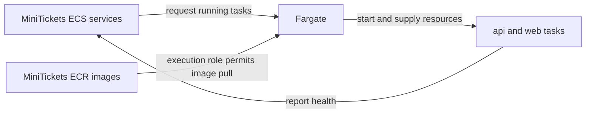

# Fargate: the city’s hired work crews

History: see [CHANGELOG.md](../CHANGELOG.md) or run `pnpm docs:history`
Area: AWS Compute · Status: ✅ built · Step doc: [17 ECS api](../../17-infra-ecs-api.md) (section 3.2)
<!-- interview-card: v2 -->

## 1. What is it?

[Fargate](../glossary.md#fargate) runs our containers while AWS maintains the machines underneath them. We still choose what runs and how it connects.

## 2. Why do we need it?

MiniTickets needs a web app and API running all day. Fargate lets us run those apps without choosing servers, installing their operating systems or patching their hosts.

## 3. How does it work?

1. ECS, our container manager, asks for tasks using our recipes.
2. Fargate supplies resources and starts the containers.
3. ECS checks health and requests replacements when needed.

## 4. How do we use it in MiniTickets?

API and web run as ECS services. A separate migration task runs database changes before a release. Their networking, permissions and secrets remain our responsibility; Fargate does not make an unhealthy app healthy.

## 5. Interview-ready answer

“Fargate lets MiniTickets run containers without managing host machines. ECS decides how many tasks we need, and Fargate supplies their resources. We still manage images, permissions, networking and availability. Our dev services use interruptible Spot capacity, so replacement capacity and downtime remain real concerns.”

## 6. Important follow-up questions

- **What if a host disappears?** ECS requests a replacement; one running copy can leave an outage during recovery.
- **Does Fargate secure our code?** AWS maintains hosts; we maintain images, application security and access rules.
- **Why use Lambda too?** Lambda suits our short email and ticket jobs; ECS keeps our HTTP apps running.
- **Can we inspect the host?** No. ECS Exec can inspect an authorized running container.

## 7. Advanced details

Technical reference

### Configuration and security

API and web tasks request 512 CPU units and 1024 MiB each; their Service Connect proxies share that budget. App ingress permits TCP 4000/3000 from `minitickets-dev-alb-sg` into `minitickets-dev-api-sg` / `minitickets-dev-web-sg`. Migration uses `launchType: FARGATE`, not the service Spot strategy.

Migration requests 256 CPU units (0.25 vCPU) and 512 MiB. App tasks use `FARGATE_SPOT`; API and web recipes require `FARGATE`, `awsvpc` and ARM64. Subnet routes, public IP and security groups provide reach; execution roles pull images and read allowed secrets, while task roles authorize application AWS calls. Running tasks are billed even while waiting.

### Implementation and operational limits

- Anchor: `infra/src/compute/task.ts` · `requiresCompatibilities: ["FARGATE"]`, `networkMode: "awsvpc"`: the api runs on Fargate.
- Anchor: `infra/src/compute/web-task.ts` · same fields: the web app runs on Fargate.

Fargate requires `awsvpc`: each task has its own network interface. There is no shared host network for us to configure. CPU/memory pairs must be valid Fargate sizes; a quarter vCPU with 4096 MiB, for example, is not a valid recipe.

API and web run in public subnets because this dev VPC has no NAT gateway or private AWS endpoints. The public IP plus internet-gateway route provides outgoing access to ECR, Secrets Manager and logs. Inbound app ports still admit only their load-balancer group; separate Service Connect rules admit the peer group on 14000/13000. Production could use private subnets plus NAT or VPC endpoints.

ECS Exec runs through an agent inside the task, with Systems Manager channels authorized by the task role. No access to the hidden host is provided. ECS on EC2 offers more host control and hardware choices; EKS fits a Kubernetes requirement; App Runner offers another managed web-service path.

Costs depend on region, CPU architecture, memory, duration and public IPv4. Old quarter-vCPU estimates do not price today’s larger app tasks. No current AWS quote was checked. Spot discounts and available capacity vary; do not turn an approximate discount into an availability promise.

[Official Fargate networking](https://docs.aws.amazon.com/AmazonECS/latest/developerguide/fargate-task-networking.html).

### Source references

`infra/src/compute/task.ts` → `createApiTask`; `infra/src/compute/web-task.ts` → `createWebTask`.

`infra/src/compute/service.ts` → `createApiService`.

### Console and troubleshooting

`us-east-1` → ECS → Clusters → `minitickets-dev` → Tasks → task → Configuration / Networking. Expect ARM64, resource size and capacity provider `FARGATE_SPOT`. Migration shows `FARGATE`. Live values not inspected.

Cannot start → stopped-task reason → check valid CPU/memory pairing, ARM64 image and HTTPS route to AWS services.

### Trade-offs and related concepts

- ECS on EC2: pick it when steady use makes packing owned machines worthwhile.
- Lambda: pick it for short triggered work, like our email jobs.

| Neighbor | Direction | What allows it | Console check |
| --- | --- | --- | --- |
| [Cluster](ecs-cluster.md) | In ← | Attached FARGATE providers | ECS → cluster → Infrastructure |
| [Task recipe](task-definition.md) | In ← | Compatible size, ARM64, awsvpc | ECS → Task definitions |
| [Service](ecs-service.md) | Out → | Capacity strategy + desired count | ECS → cluster → Services |

[Open this piece in the city explorer](../guides/infra-explorer.html?concept=fargate#chapter=8&piece=api-task).

## Where it appears in the story

- [Infra story: 4. ECS: cluster, service, task definition, task, Spot](../infra-story.md#4-ecs-cluster-service-task-definition-task-spot)
- [Big picture: 4. Components](../00-big-picture.md#4-components)

