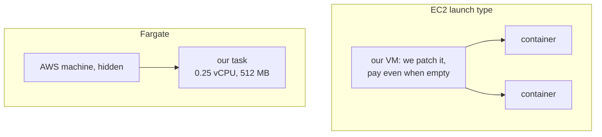

# Fargate: containers without managing servers

History: see [CHANGELOG.md](../CHANGELOG.md) or run `pnpm docs:history`

Area: AWS Compute · Status: ✅ built · Step doc: [17 ECS api](../../17-infra-ecs-api.md) (section 3.2)

## 1. In one line

**Fargate** runs each ECS task on a machine AWS picks and hides from us; we only say how much CPU
and memory the task needs, and pay per second for that.

## 2. Real-life comparison

Ordering a taxi instead of owning a car. You say "one passenger, small bag"; a car arrives. No
servicing, no parking, no paying while it waits in the garage.

## 3. Picture it



## 4. Where in our code

- Anchor: `infra/src/compute/task.ts` · `requiresCompatibilities: ["FARGATE"]`, `networkMode: "awsvpc"`: the api runs on Fargate.
- Anchor: `infra/src/compute/web-task.ts` · same fields: the web app runs on Fargate.

Step by step:

1. `requiresCompatibilities: ["FARGATE"]` makes the recipe valid for Fargate.
2. `networkMode: "awsvpc"` is required: each task gets its own network interface in our subnet.
3. `cpu: "256"`, `memory: "512"`: one of Fargate's allowed size combinations.
4. The service picks Fargate or Fargate Spot through the capacity provider strategy
   ([fargate-spot](fargate-spot.md)); the migration task uses `--launch-type FARGATE`.
5. ECS Exec works on Fargate through an agent AWS adds to the task ([ecs-exec](ecs-exec.md)).

## 5. See it yourself

```bash
TASK=$(aws ecs list-tasks --profile ticketlite --cluster minitickets-dev --service-name minitickets-dev-api --query 'taskArns[0]' --output text)
aws ecs describe-tasks --profile ticketlite --cluster minitickets-dev --tasks "$TASK" \
  --query "tasks[0].[launchType,capacityProviderName,platformVersion,cpu,memory]"
```

**Break it on purpose (thought experiment):** set `cpu: "256"` with `memory: "4096"`. That is not
an allowed Fargate combination, so registering the task definition fails.

## 6. How it connects

- **Uses ←** [cluster](ecs-cluster.md) capacity providers, [subnets](subnets.md).
- **Gives →** running [tasks](task-definition.md) for the [services](ecs-service.md).

## 7. Our settings and WHY

| Choice | Why |
| ------ | --- |
| Fargate, not EC2 | One small container does not fill a VM; nothing to patch, nothing idle. |
| Smallest size | Dev traffic is tiny. |

## 8. Trade-offs

- **Pros:** no servers, per-second billing, per-task isolation and security groups.
- **Cons:** higher price per vCPU than well-packed EC2; no GPUs; less control over the host; slower
  task start than an already-running VM.

## 9. Alternatives and when to choose them

- **ECS on EC2:** steady, large workloads where packing many containers onto reserved machines is
  cheaper.
- **EKS:** a Kubernetes requirement.
- **Lambda:** short, event-driven work with idle periods; no always-on process.
- **App Runner:** a simpler managed web service.

## 10. What breaks, and how we'd notice

- Invalid CPU/memory pair: the task definition is rejected.
- No route to ECR/Secrets Manager: task fails before the container starts.

## 11. Reach / Allowed / Password

Fargate gives every task its own ENI: **Reach** is decided per task by its security group. The
execution role is the **Allowed** part of starting it.

## 12. Cost

¼ vCPU + 512 MB on ARM: about $0.010 an hour on normal Fargate, about $0.003 on Spot
([docs/17](../../17-infra-ecs-api.md), section 3.16).

## 13. Interview answers at 3 levels

- **Simple:** Fargate runs our containers without us managing servers.
- **Senior:** Our task definitions require FARGATE with `awsvpc`, ARM64, ¼ vCPU and 512 MB. Each
  task gets its own ENI and security group; the services run them on Fargate Spot.
- **Lead:** Fargate trades a higher unit price for zero host operations. I'd revisit EC2 capacity
  once utilisation is steady and high enough that packing pays for the ops work.

## 14. Follow-up questions interviewers ask

- *Can you SSH into a Fargate host?* No; use ECS Exec into the container.
- *Why `awsvpc` only?* Fargate gives every task its own network interface; there is no shared host
  network.

## 15. Say it in 30 seconds

"Both apps run on Fargate: we declare a quarter vCPU and 512 MB on ARM64, and AWS supplies the
machine. Every task gets its own network interface and security group, and we pay per second."

## 16. Status

✅ built.

## Where it appears in the story

- [Infra story: 4. ECS: cluster, service, task definition, task, Spot](../infra-story.md#4-ecs-cluster-service-task-definition-task-spot)
- [Big picture: 4. Components](../00-big-picture.md#4-components)
