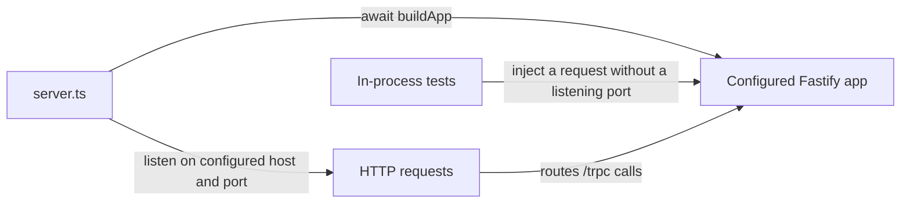

# Fastify app: "build" apart from "listen"

History: see [CHANGELOG.md](../CHANGELOG.md) or run `pnpm docs:history`

Area: API · Status: ✅ built · Step doc: [01 setup](../../01-setup.md), [02 errors](../../02-errors.md)
<!-- interview-card: v2 -->

## 1. What is it?

Fastify is the HTTP server around MiniTickets’ API. Building its routes and plugins is separate from starting the process that listens for network requests.

## 2. Why do we need it?

Tests need to exercise request behaviour without fighting over a port. Operations also need one clear place for startup, shutdown and process failures.

## 3. How does it work?



1. Build the logger, plugins, policies and routes.
2. The process entry point opens the configured listening socket.
3. On shutdown, stop accepting work and close owned resources.

## 4. How do we use it in MiniTickets?

`buildApp` registers browser-access rules, cookies, error handling, health routes and tRPC. `server.ts` owns listening and signals. Small focused tests use Fastify injection; importing the full application still requires valid environment configuration.

## 5. Interview-ready answer

“MiniTickets separates application composition from process lifecycle. Fastify setup lives in buildApp, while server.ts listens and handles signals. That makes request behaviour testable without a real port and keeps operational ownership obvious. It does not remove configuration dependencies or network deployment requirements, such as listening on a reachable container interface.”

## 6. Important follow-up questions

- **What if the configured port is occupied?** Startup logs the failure and exits; use a separate free test port.
- **What if a container binds only localhost?** External health checks and ALB calls cannot reach it even if an internal probe works.
- **What does inject test?** It simulates an HTTP request inside Fastify without opening a network listener.
- **Why does plugin order matter?** Routes need the expected registered features and scope; an incorrect order can omit behaviour.

## 7. Advanced details

<details>
<summary>Technical reference</summary>

### Current reading notes

Current app also enforces mutation admission and correlated logging. Host/port, trustProxy, CORS, cookies, health checks and tRPC remain configured at this boundary. The old same-port collision exercise below is a thought experiment only: never start a test server on owner ports 3000/4000 or stop an owner process.

### Implementation reference

- Anchor: `apps/api/src/app.ts` · `buildApp`: the whole configuration, in order.
- Anchor: `apps/api/src/server.ts` · `app.listen`: starts the server; exits with code 1 if the port is taken.

Step by step (inside `buildApp`):

1. `Fastify({ logger: { redact }, trustProxy })`: structured JSON logs with passwords redacted
   ([structured-logging](structured-logging.md), [log-redaction](log-redaction.md)); real client IP
   behind proxies ([trust-proxy](trust-proxy.md)).
2. `app.register(cors, …)`: only `WEB_ORIGIN` may call with cookies ([cors](cors.md)).
3. `app.register(cookie)`: `req.cookies` and `reply.setCookie`.
4. `app.setErrorHandler(…)`: errors on plain routes ([error-handling](error-handling.md)).
5. `GET /health` and `GET /ready` ([health-checks](health-checks.md)).
6. `app.register(fastifyTRPCPlugin, { prefix: "/trpc", … })`: every `/trpc/*` request goes to
   `appRouter` with `createContext`.
7. `server.ts` then: `await buildApp()` → `app.listen({ port: env.PORT, host: env.HOST })` →
   SIGINT/SIGTERM handlers ([graceful-shutdown](graceful-shutdown.md)).

Production runs the esbuild bundle `node dist/server.js` (`apps/api/build.mjs`); development runs
`tsx watch` on the TypeScript.

### Inspection and historical evidence

```bash
pnpm --filter @minitickets/api dev          # or your running pnpm dev
curl -s localhost:4000/health               # {"status":"ok"}
```

`apps/api/src/config/trust-proxy.test.ts` shows the "no port" idea: it builds a tiny Fastify app
and calls `app.inject(...)` ([in-process-api-tests](in-process-api-tests.md)).

**Break it on purpose:** start a second api on the same port
(`PORT=4000 pnpm --filter @minitickets/api start` while `pnpm dev` runs). `listen` fails with
`EADDRINUSE`, the error is logged, and the process exits 1.

### Settings and reasoning

| Setting | Value | Why |
| ------- | ----- | --- |
| `HOST` | `127.0.0.1` default; `0.0.0.0` in Docker/ECS | Locally only this machine; in a container the port must be reachable. |
| `PORT` | 4000 | Fixed in `.env`, Dockerfile, task definition and target group. |
| Fastify 5 | `^5.12.5` | Fast, schema-friendly, good logging (pino) built in. |

### Trade-offs

- **Pros:** testable without a network; one obvious entry point; plugins keep each concern small.
- **Cons:** `buildApp` is async and imports `env` (which validates at import), so even a test that
  imports `app.ts` needs valid env vars. Our in-process tests avoid `app.ts` for this reason.

### Alternatives and scaling

- **Express:** huge ecosystem, slower, weaker typing.
- **Hono:** tiny, runs on edge runtimes too.
- **NestJS:** batteries-included structure with dependency injection; heavier.
- **Next.js route handlers only:** one deployable, but the api would share the web app's lifecycle.

### Failure diagnosis

- Port taken: exits 1 at start (logged).
- A plugin registered after routes that need it: routes miss the feature; Fastify's encapsulation
  rules decide. Tests and e2e catch it.
- `HOST=127.0.0.1` in a container: health checks fail; ECS replaces the task. The Dockerfile sets
  `0.0.0.0`.

### Further questions

- *Why Fastify over Express?* Built-in structured logging, faster, plugin encapsulation, Fastify 5
  is actively maintained.
- *What does `inject` do?* Simulates an HTTP request in memory (light-my-request).

### Related reading

- [config-validation](config-validation.md)
- [trpc-context](trpc-context.md)
- [target-groups](target-groups.md)

[Open this piece in the city explorer](../guides/infra-explorer.html?concept=fastify-app#chapter=0&piece=laptop-api).

## Where it appears in the story

- [App story: 4. Fastify: CORS, trustProxy, cookie](../app-story.md#4-fastify-cors-trustproxy-cookie)

</details>
