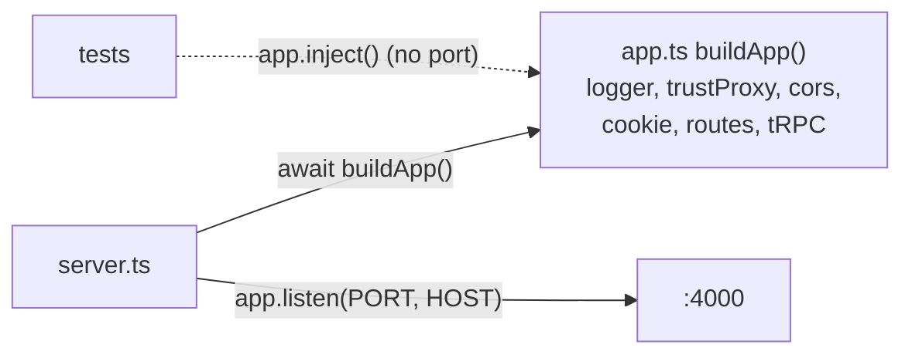

# Fastify app: "build" apart from "listen"

History: see [CHANGELOG.md](../CHANGELOG.md) or run `pnpm docs:history`

Area: API · Status: ✅ built · Step doc: [01 setup](../../01-setup.md), [02 errors](../../02-errors.md)

## 1. In one line

`buildApp()` creates and configures the Fastify server (plugins, routes, tRPC) **without** opening a
port; `server.ts` is the only file that calls `listen` and handles shutdown.

## 2. Real-life comparison

Building a car in the factory versus driving it on the road. Tests can inspect and start the car in
the factory (in-process) without taking it onto the motorway (a real port).

## 3. Picture it



## 4. Where in our code

- Anchor: `apps/api/src/app.ts` · `buildApp`: the whole configuration, in order.
- Anchor: `apps/api/src/server.ts` · `app.listen`: starts the server; exits with code 1 if the port is taken.

Step by step (inside `buildApp`):

1. `Fastify({ logger: { redact }, trustProxy })`: structured JSON logs with passwords redacted
   ([structured-logging](structured-logging.md), [log-redaction](log-redaction.md)); real client IP
   behind proxies ([trust-proxy](trust-proxy.md)).
2. `app.register(cors, …)`: only `WEB_ORIGIN` may call with cookies ([cors](cors.md)).
3. `app.register(cookie)`: `req.cookies` and `reply.setCookie`.
4. `app.setErrorHandler(…)`: errors on plain routes ([error-handling](error-handling.md)).
5. `GET /health` and `GET /ready` ([health-checks](health-checks.md)).
6. `app.register(fastifyTRPCPlugin, { prefix: "/trpc", … })`: every `/trpc/*` request goes to
   `appRouter` with `createContext`.
7. `server.ts` then: `await buildApp()` → `app.listen({ port: env.PORT, host: env.HOST })` →
   SIGINT/SIGTERM handlers ([graceful-shutdown](graceful-shutdown.md)).

Production runs the esbuild bundle `node dist/server.js` (`apps/api/build.mjs`); development runs
`tsx watch` on the TypeScript.

## 5. See it yourself

```bash
pnpm --filter @minitickets/api dev          # or your running pnpm dev
curl -s localhost:4000/health               # {"status":"ok"}
```

`apps/api/src/config/trust-proxy.test.ts` shows the "no port" idea: it builds a tiny Fastify app
and calls `app.inject(...)` ([in-process-api-tests](in-process-api-tests.md)).

**Break it on purpose:** start a second api on the same port
(`PORT=4000 pnpm --filter @minitickets/api start` while `pnpm dev` runs). `listen` fails with
`EADDRINUSE`, the error is logged, and the process exits 1.

## 6. How it connects

- **Uses ←** [config-validation](config-validation.md) (`env`), the pool and Redis client.
- **Gives →** the HTTP entry point for [trpc-context](trpc-context.md) and every procedure; the
  target of the ALB on AWS ([target-groups](target-groups.md)).

## 7. Our settings and WHY

| Setting | Value | Why |
| ------- | ----- | --- |
| `HOST` | `127.0.0.1` default; `0.0.0.0` in Docker/ECS | Locally only this machine; in a container the port must be reachable. |
| `PORT` | 4000 | Fixed in `.env`, Dockerfile, task definition and target group. |
| Fastify 5 | `^5.12.5` | Fast, schema-friendly, good logging (pino) built in. |

## 8. Trade-offs

- **Pros:** testable without a network; one obvious entry point; plugins keep each concern small.
- **Cons:** `buildApp` is async and imports `env` (which validates at import), so even a test that
  imports `app.ts` needs valid env vars. Our in-process tests avoid `app.ts` for this reason.

## 9. Alternatives and when to choose them

- **Express:** huge ecosystem, slower, weaker typing.
- **Hono:** tiny, runs on edge runtimes too.
- **NestJS:** batteries-included structure with dependency injection; heavier.
- **Next.js route handlers only:** one deployable, but the api would share the web app's lifecycle.

## 10. What breaks, and how we'd notice

- Port taken: exits 1 at start (logged).
- A plugin registered after routes that need it: routes miss the feature; Fastify's encapsulation
  rules decide. Tests and e2e catch it.
- `HOST=127.0.0.1` in a container: health checks fail; ECS replaces the task. The Dockerfile sets
  `0.0.0.0`.

## 13. Interview answers at 3 levels

- **Simple:** One file builds the server, another starts it.
- **Senior:** `buildApp` registers the logger with redaction, `trustProxy`, CORS, cookies, the error
  handler, health routes and the tRPC plugin; `server.ts` listens and owns signals. Tests can use
  `inject` without a port.
- **Lead:** Separating composition from process concerns (ports, signals) keeps the app testable and
  lets the same app run under different hosts. Next step would be making config injectable so even
  `buildApp` can be tested without real env vars.

## 14. Follow-up questions interviewers ask

- *Why Fastify over Express?* Built-in structured logging, faster, plugin encapsulation, Fastify 5
  is actively maintained.
- *What does `inject` do?* Simulates an HTTP request in memory (light-my-request).

## 15. Say it in 30 seconds

"app.ts builds the Fastify app: JSON logger with redaction, trustProxy, CORS, cookies, error handler,
health routes, and tRPC mounted at /trpc. server.ts only listens and handles shutdown signals. That
split keeps the app testable without a real port."

## 16. Status

✅ built.
