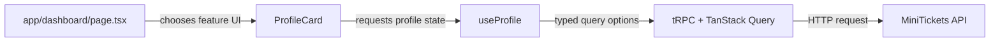

# Feature folders: components use hooks, never tRPC

History: see [CHANGELOG.md](../CHANGELOG.md) or run `pnpm docs:history`

Area: Frontend · Status: ✅ built · Step doc: [04 signup form](../../04-signup-form.md), [09 dashboard](../../09-dashboard.md)
<!-- interview-card: v2 -->

## 1. What is it?

Feature folders keep related UI and data code together. A component asks its feature hook for data instead of calling the API transport itself.

## 2. Why do we need it?

MiniTickets profile needs loading, errors and expired-session handling. Keeping those rules in useProfile means every component using that data gets the same behaviour.

## 3. How does it work?



1. Let the route compose the feature entry component.
2. Keep presentation and interaction in components.
3. Put query, invalidation and API error rules in feature hooks.

## 4. How do we use it in MiniTickets?

Web features include auth, account, events, bookings and others. Shared visual primitives live outside features; feature helpers and server-prefetch code stay near their owner. App routes remain focused on routing and composition.

## 5. Interview-ready answer

“MiniTickets groups web code by feature, then separates components from data hooks. Components render and respond to users; hooks own API access, caching and related error rules. A one-line hook can still provide a useful seam for future policy. The cost is some wrappers, and cross-feature imports need deliberate ownership.”

## 6. Important follow-up questions

- **Why wrap a simple query in a hook?** It gives data policy one home when invalidation or error handling grows.
- **Where should useMe live?** In auth, the feature that owns the identity data, even when other features consume it.
- **What if a component calls tRPC directly?** It bypasses the hook boundary and can duplicate or omit its rules.
- **Would another folder layout be wrong?** No. Feature slices or kind-based folders can work; clear ownership matters more than the spelling.

## 7. Advanced details

<details>
<summary>Technical reference</summary>

### Current reading notes

Existing small auth/account/landing tables below are historical examples, not the complete current feature inventory. EventList now uses useEventSearch; useEvents remains a legacy list hook. The no-direct-tRPC convention applies to components; server-only feature prefetch helpers deliberately use the typed server client.

### Implementation reference

- Anchor: `apps/web/src/features/account/hooks/use-profile.ts` · `useProfile`: the only code in `account` that knows about tRPC.
- Anchor: `apps/web/src/features/auth/hooks/use-signup.ts` · `useSignup`: "wraps the signup mutation so components never call tRPC directly".
- Anchor: `apps/web/src/features/landing/components/landing-page.tsx` · `LandingPage`: a feature's entry component, rendered by `app/page.tsx`.
- Anchor: `apps/web/src/features/events/hooks/use-events.ts` · `useEvents`: the only code in `events` that knows about tRPC; `EventList` and `EventCard` stay free of it.

Step by step:

1. `app/<route>/page.tsx` imports one component from a feature.
2. Components live in `features/<feature>/components/`; they render and handle events.
3. Hooks live in `features/<feature>/hooks/`; they call `useTRPC()` and TanStack Query.
4. Shared UI (no feature): `components/ui/` (`Button`, `Input`, `Container`).
5. Plain helpers for a feature: `features/auth/lib/` (`getSafeNext`).

Today's map:

| Feature | Components | Hooks |
| ------- | ---------- | ----- |
| `auth` | `LoginForm`, `SignupForm`, `HeaderNav` | `useLogin`, `useLogout`, `useMe`, `useSignup` |
| `account` | `ProfileCard` | `useProfile` |
| `landing` | `LandingPage`, `Hero`, `FeaturesList` | (uses `auth`'s `useMe`) |

### Inspection and historical evidence

```bash
grep -rl "useTRPC" apps/web/src --include="*.tsx" # prints nothing: no component calls tRPC
grep -rl "useTRPC" apps/web/src                   # only the five hooks and lib/trpc/client.ts
```

**Break it on purpose:** call `useTRPC()` inside `ProfileCard`. Nothing fails today: the rule is a
convention from `CLAUDE.md`, not a lint rule. That is a gap (see section 16).

### Settings and reasoning

Folders by feature, then by kind (`components/`, `hooks/`, `lib/`). WHY: a feature's files change
together; hooks give one seam for caching, invalidation and error rules; components stay easy to
test and read.

### Trade-offs

- **Pros:** easy to find things; data rules in one place; features can be moved or deleted whole.
- **Cons:** small hooks that only wrap one call (`useSignup`) feel like boilerplate; cross-feature
  use (`Hero` uses `auth`'s `useMe`) needs judgement.

### Alternatives and scaling

- **Folders by kind** (`components/`, `hooks/` at the top): fine for very small apps.
- **Feature-Sliced Design:** stricter layers and import rules for large teams.
- **Lint-enforced boundaries** (`eslint-plugin-boundaries`, `no-restricted-imports`): when the team
  grows.

### Failure diagnosis

A component calling tRPC directly skips the hook's rules (invalidation, 401 handling). Today only a
code review notices.

### Further questions

- *Why wrap a one-line call in a hook?* The seam: the day it needs invalidation or error handling,
  no component changes.
- *Where do shared hooks go?* In the feature that owns the data (`useMe` in `auth`).

### Status and remaining work

✅ built (as a convention). **To make it production-grade:** enforce "no tRPC in components" with a
`no-restricted-imports` lint rule.

### Related reading

- [app-router](app-router.md)
- [tanstack-query](tanstack-query.md)
- [ui-error-handling](ui-error-handling.md)

[Open this piece in the city explorer](../guides/infra-explorer.html?concept=feature-folders#chapter=24&piece=code-component).

## Where it appears in the story

- [App story: 1. Browser → Next.js: layout, server vs client components, proxy guard](../app-story.md#1-browser--nextjs-layout-server-vs-client-components-proxy-guard)

</details>
