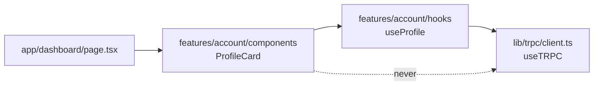

# Feature folders: components use hooks, never tRPC

History: see [CHANGELOG.md](../CHANGELOG.md) or run `pnpm docs:history`

Area: Frontend · Status: ✅ built · Step doc: [04 signup form](../../04-signup-form.md), [09 dashboard](../../09-dashboard.md)

## 1. In one line

Web code is grouped by **feature** (`features/auth`, `features/account`, `features/landing`), and
inside each feature, components get data only through that feature's hooks.

## 2. Real-life comparison

A restaurant with stations: the pastry station has its own fridge, tools and recipes. Waiters
(components) never go into the storeroom (the api) themselves; they ask the station's runner (a
hook).

## 3. Picture it



## 4. Where in our code

- Anchor: `apps/web/src/features/account/hooks/use-profile.ts` · `useProfile`: the only code in `account` that knows about tRPC.
- Anchor: `apps/web/src/features/auth/hooks/use-signup.ts` · `useSignup`: "wraps the signup mutation so components never call tRPC directly".
- Anchor: `apps/web/src/features/landing/components/landing-page.tsx` · `LandingPage`: a feature's entry component, rendered by `app/page.tsx`.
- Anchor: `apps/web/src/features/events/hooks/use-events.ts` · `useEvents`: the only code in `events` that knows about tRPC; `EventList` and `EventCard` stay free of it.

Step by step:

1. `app/<route>/page.tsx` imports one component from a feature.
2. Components live in `features/<feature>/components/`; they render and handle events.
3. Hooks live in `features/<feature>/hooks/`; they call `useTRPC()` and TanStack Query.
4. Shared UI (no feature): `components/ui/` (`Button`, `Input`, `Container`).
5. Plain helpers for a feature: `features/auth/lib/` (`getSafeNext`).

Today's map:

| Feature | Components | Hooks |
| ------- | ---------- | ----- |
| `auth` | `LoginForm`, `SignupForm`, `HeaderNav` | `useLogin`, `useLogout`, `useMe`, `useSignup` |
| `account` | `ProfileCard` | `useProfile` |
| `landing` | `LandingPage`, `Hero`, `FeaturesList` | (uses `auth`'s `useMe`) |

## 5. See it yourself

```bash
grep -rl "useTRPC" apps/web/src --include="*.tsx" # prints nothing: no component calls tRPC
grep -rl "useTRPC" apps/web/src                   # only the five hooks and lib/trpc/client.ts
```

**Break it on purpose:** call `useTRPC()` inside `ProfileCard`. Nothing fails today: the rule is a
convention from `CLAUDE.md`, not a lint rule. That is a gap (see section 16).

## 6. How it connects

- **Uses ←** [app-router](app-router.md) (pages pick features), [tanstack-query](tanstack-query.md).
- **Gives →** one place per feature to change data access (e.g. the 401 redirect in `useProfile`,
  [ui-error-handling](ui-error-handling.md)).

## 7. Our settings and WHY

Folders by feature, then by kind (`components/`, `hooks/`, `lib/`). WHY: a feature's files change
together; hooks give one seam for caching, invalidation and error rules; components stay easy to
test and read.

## 8. Trade-offs

- **Pros:** easy to find things; data rules in one place; features can be moved or deleted whole.
- **Cons:** small hooks that only wrap one call (`useSignup`) feel like boilerplate; cross-feature
  use (`Hero` uses `auth`'s `useMe`) needs judgement.

## 9. Alternatives and when to choose them

- **Folders by kind** (`components/`, `hooks/` at the top): fine for very small apps.
- **Feature-Sliced Design:** stricter layers and import rules for large teams.
- **Lint-enforced boundaries** (`eslint-plugin-boundaries`, `no-restricted-imports`): when the team
  grows.

## 10. What breaks, and how we'd notice

A component calling tRPC directly skips the hook's rules (invalidation, 401 handling). Today only a
code review notices.

## 13. Interview answers at 3 levels

- **Simple:** Each feature keeps its own components and data hooks in one folder.
- **Senior:** `features/<name>/{components,hooks}`; components never call tRPC, they use the
  feature's hook, so caching, invalidation and the 401 redirect live in one place. `app/` only
  routes; shared UI is in `components/ui`.
- **Lead:** The point is change locality and a single seam for data access. I'd enforce it with a
  lint rule once more people work on it, and watch cross-feature imports as a design smell.

## 14. Follow-up questions interviewers ask

- *Why wrap a one-line call in a hook?* The seam: the day it needs invalidation or error handling,
  no component changes.
- *Where do shared hooks go?* In the feature that owns the data (`useMe` in `auth`).

## 15. Say it in 30 seconds

"Web code is organised by feature. Each feature has components and hooks, and components never call
tRPC directly; they use the feature's hook. So caching, invalidation and error rules live in one
place, and app/ is just routing."

## 16. Status

✅ built (as a convention). **To make it production-grade:** enforce "no tRPC in components" with a
`no-restricted-imports` lint rule.

## Where it appears in the story

- [App story: 1. Browser → Next.js: layout, server vs client components, proxy guard](../app-story.md#1-browser--nextjs-layout-server-vs-client-components-proxy-guard)
