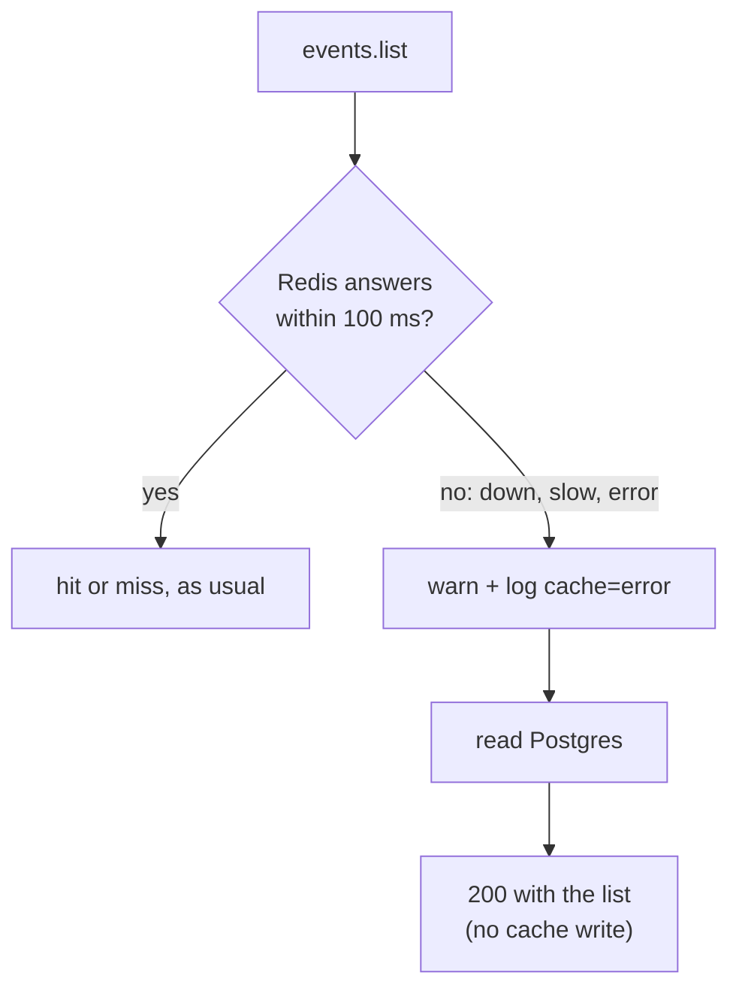

# Graceful degradation

History: see [CHANGELOG.md](../CHANGELOG.md) or run `pnpm docs:history`

Area: Reliability · Status: ✅ built (`events.list` without Redis) · Step doc: [24 events cache](../../24-events-cache.md)

## 1. In one line

When a helper part fails, keep working in a reduced way instead of failing: if Redis is down or
slow, `events.list` reads Postgres (slower, but correct) and logs a warning.

## 2. Real-life comparison

A shop whose card machine breaks. It does not close; it says "cash only" and keeps selling.
Customers notice a small inconvenience, not a closed door.

## 3. Picture it



## 4. Where in our code

- Anchor: `apps/api/src/services/events.ts` · `listUpcomingEvents`: `try`/`catch` around the cache read; the write is also wrapped.
- Anchor: `apps/api/src/queries/events-cache.ts` · `CACHE_TIMEOUT_MS`, `withTimeout`: the 100 ms deadline.

Step by step:

1. Redis is an **optimisation** here, not the source of truth, so its failure must not fail the request.
2. The cache read has a 100 ms deadline (`withTimeout`). Down is already fast ([fail-fast](fail-fast.md));
   slow is the case the deadline is for.
3. Any error is caught in the service, logged with `log.warn`, and the status becomes `error`.
4. Postgres answers. The write to the cache is skipped, so a sick Redis adds no second wait.
5. A failed cache *write* (after a miss) is also caught and logged; the visitor already has the list.
6. The request log line carries `"cache":"error"`, so you can count how often it happens.

**Not everything may degrade.** If Postgres is down, `events.list` fails (it is the source of truth).
Sessions in Redis are the opposite case: with Redis down a logged-in request cannot be checked, so
it fails ([fail-fast](fail-fast.md)). Graceful degradation is a per-feature decision.

## 5. See it yourself

Do not stop shared containers. Start your own api on another port, pointing at a port where nothing listens:

```bash
cd apps/api && PORT=4011 REDIS_URL=redis://localhost:6399 ./node_modules/.bin/tsx --env-file=.env src/server.ts &
PID=$!; sleep 3
curl -s -o /dev/null -w '%{http_code} in %{time_total}s\n' localhost:4011/trpc/events.list   # 200
kill $PID
```

The log shows `events cache read failed, falling back to Postgres` and `"cache":"error"`.

**Break it on purpose:** remove the `try`/`catch` around the read: the same call returns a 500.

## 6. How it connects

- **Uses ←** [fail-fast](fail-fast.md) (the client errors quickly when disconnected), [cache-aside](cache-aside.md),
  [structured-logging](structured-logging.md), [error-handling](error-handling.md).
- **Gives →** an api that stays up through Redis outages; a pattern for later helpers (rate limits, queues).

## 7. Our settings and WHY

100 ms deadline: a healthy Redis answers in about 1 ms, so 100 ms is generous, and still short enough
that nobody feels it. No retry: the next request tries again by itself.

## 8. Trade-offs

- **Pros:** Redis outages do not become site outages; users get correct data.
- **Cons:** during an outage every request hits Postgres, so Postgres must survive the full load
  (capacity planning!); failures can go unnoticed because users see no error, so you need an alert
  on the warning/`cache=error` rate. A circuit breaker ([circuit-breaker](circuit-breaker.md)) would
  stop even trying Redis for a while.

## 9. Alternatives and when to choose them

- **Fail closed** (return an error): right when the helper is required for correctness, such as a lock or session.
- **Serve stale data:** keep an old copy and use it when the source fails; good for read-mostly data.
- **Circuit breaker:** stop calling a failing dependency for a short time.

## 10. What breaks, and how we'd notice

- **Silent degradation:** nothing tells you Redis has been down for hours. Today: only the log
  (`cache=error`). Needed: metric + alarm ([alerting](alerting.md)).
- **Postgres overload** when the cache disappears under traffic.
- **A slow Redis** that is just under 100 ms on every call still costs you up to 100 ms per request.

## 13. Interview answers at 3 levels

- **Simple:** If the cache breaks, the site still works, just a bit slower.
- **Senior:** The cache read has a deadline; errors and timeouts are caught, logged, and the service
  reads Postgres. The write is skipped after a read error. The response is a normal 200.
- **Lead:** Decide per dependency: required (fail), optional (degrade). Degraded mode moves load to the
  database, so size for it, make it observable (alarm on the error rate) and consider a breaker.

## 14. Follow-up questions interviewers ask

- *Graceful degradation vs fail fast?* Fail fast is *how quickly* we notice a failure; graceful degradation is *what we do next*. We use both.
- *Why skip the cache write after an error?* It would add another wait, and Redis is likely still unwell.
- *Why not retry?* More latency for the same request; the next request is a natural retry.

## 15. Say it in 30 seconds

"Redis is only a speed-up for events.list, so its failure must not fail the request. The read has a
100 ms deadline; on any error we log a warning, read Postgres and return 200. I tested it with the
api pointed at a dead Redis port. The trade-off is that Postgres takes the full load, so it needs an alarm."

## 16. Status

✅ built for `events.list`. **Not built:** circuit breaker, alarm on `cache=error`.

## Where it appears in the story

- [App story: 10b. Reading events](../app-story.md#10b-reading-events)
