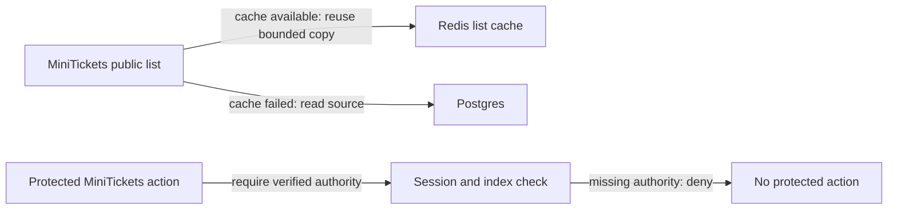

# Graceful degradation

History: see [CHANGELOG.md](../CHANGELOG.md) or run `pnpm docs:history`

Area: Reliability · Status: ✅ built in repository; live acceptance is separate

<!-- interview-card: v2 -->

## 1. What is it?

Graceful degradation keeps useful behavior available when an optional part fails. It changes the fallback deliberately without weakening a correctness or security rule.

## 2. Why do we need it?

If MiniTickets’ public-list cache is unavailable, visitors can still browse from Postgres. If login authority is unavailable, however, guessing that a visitor is authenticated would be unsafe.

## 3. How does it work?

1. Classify whether a dependency provides an optimization or authority.
2. Choose a fallback that preserves the required guarantee.
3. Bound waiting and stale age; expose degraded behavior for investigation.

## 4. How do we use it in MiniTickets?

The legacy public list falls back from Redis to SQL and can use bounded stale-if-error. Search bypasses that list cache. The inventory hint can fall back because Postgres still enforces seats; session authority and abuse-protection policies have stricter failure behavior.

## 5. Interview-ready answer

“MiniTickets chooses fallback per responsibility. Losing a rebuildable public cache can send reads to Postgres, and a bounded older list can help during a short outage. Losing authentication authority must deny protected work. Inventory hints can fail open only because the database still decides seats. Graceful degradation means preserving useful service within explicit limits, not treating every dependency failure as safe to ignore.”

## 6. Important follow-up questions

- **Why not fail open everywhere?** Some dependencies enforce identity, quotas or ownership; bypassing them changes the guarantee.
- **Can stale listings authorize a purchase?** No. The transaction checks authoritative stock.
- **What can fallback overload?** The database can receive cache-miss traffic it normally avoids.
- **How do we avoid stale data forever?** Keep original age, enforce hard limits and never renew age on failed refresh.

## 7. Advanced details

Technical reference

### Current fallback boundaries

`apps/api/src/services/events.ts` handles Redis list read/write failures and fresh/stale/error windows. `apps/api/src/queries/events-cache.ts` bounds cache operations at **100 ms**. Redis failure falls back to Postgres for legacy `events.list`; current `events.search` bypasses the list cache. Bounded stale-if-error serves a previous good public result, never authoritative seats or roles.

Authentication requires both session record and index membership and fails closed. Rate limiting has its own fail-closed unavailable policy. Advisory inventory can fall back to Postgres because the same durable booking transaction remains final authority.

### Cache layers, evidence and growth

`apps/web/src/features/events/server/cached-events.ts` and `apps/web/src/features/events/hooks/use-events.ts` have independent clocks. P10 disables shared HTML caching while retaining explicit public-data caches. Admin writes do not instantly refresh every open tab. Staleness can compound, and failed refresh must not make old data fresh.

`pnpm test` has fake-clock stale/error cases; no new run/live acceptance is claimed. Track hit/age/fallback rates and database pressure. Larger deployments may consolidate redundant layers and define an end-to-end freshness budget rather than extend TTLs independently.

### Code anchors

- Anchor: `apps/api/src/services/events.ts` · `listUpcomingEvents`: `try`/`catch` around the cache read; the write is also wrapped.
- Anchor: `apps/api/src/queries/events-cache.ts` · `CACHE_TIMEOUT_MS`, `withTimeout`: the 100 ms deadline.

### Related reading

[current system](../00-big-picture.md) · [scenario](../guides/interview-scenarios.md#swr-caches) · [explorer tour](../guides/infra-explorer.html?tour=search)

[Open this concept in the city explorer](../guides/infra-explorer.html?concept=graceful-degradation#chapter=5&piece=valkey).

## Where it appears in the story

- [App story: 10b. Reading events](../app-story.md#10b-reading-events)

