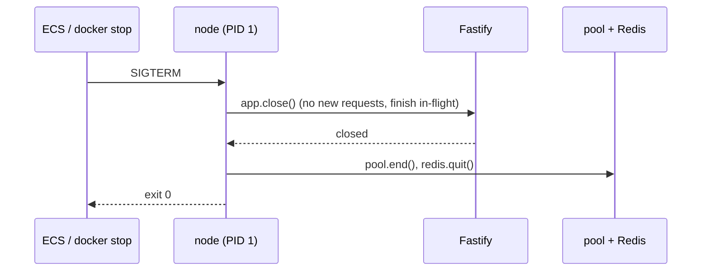

# Graceful shutdown (and PID 1 signals)

History: see [CHANGELOG.md](../CHANGELOG.md) or run `pnpm docs:history`

Area: Reliability · Status: ✅ built (a "wait after SIGTERM" improvement is planned) · Step doc: [05 database](../../05-database.md), [11 docker](../../11-docker.md)

## 1. In one line

On `SIGTERM` (or Ctrl+C) the api stops accepting new requests, lets the ones in flight finish, then
closes the database pool and Redis, and exits 0, instead of dying mid-request.

## 2. Real-life comparison

A shop at closing time: lock the door to new customers, serve the ones already inside, then cash up
and turn off the lights. Not: cut the power while people are at the till.

## 3. Picture it



## 4. Where in our code

- Anchor: `apps/api/src/server.ts` · `shutdown`: the order of closing, and the guard against a second signal.
- Anchor: `apps/api/Dockerfile` · step 17, `CMD ["node", "dist/server.js"]`: exec form, so node is PID 1 and receives the signal.
- Anchor: `apps/web/Dockerfile` · step 17, `CMD ["node", "server.js"]`: the same for the web server.
- Anchor: `infra/src/entry/target-groups.ts` · `deregistrationDelay: 30`: the ALB drains before ECS sends SIGTERM.

Step by step:

1. `process.on("SIGTERM" | "SIGINT", …)` calls `shutdown(signal)`; a second signal is ignored
   (`shuttingDown`).
2. `await app.close()`: Fastify stops accepting connections and waits for in-flight requests.
   While closing, a request that still arrives gets **503** and idle keep-alive connections are
   closed (verified in Fastify 5.12.5's docs: `return503OnClosing` default `true`,
   `forceCloseConnections` default `"idle"`).
3. Only then `pool.end()` and `redis.quit()` (falls back to `disconnect()` if Redis is already
   gone): requests may need the stores until they finish.
4. Log "shutdown complete…", exit 0. Any error: log and exit 1.
5. **PID 1:** in exec form, `node` is the container's main process, so `docker stop` and ECS deliver
   SIGTERM to it. In shell form (`CMD node …`) or through `pnpm start`, the shell or pnpm would be
   PID 1 and would not pass the signal on (the Dockerfile comment explains this).
6. On ECS: the ALB stops sending new requests and drains for up to 30 s, **then** ECS sends SIGTERM
   (verified from AWS's task lifecycle docs: deregistration in `DEACTIVATING`, stop signal in
   `STOPPING`). If the process is still alive 30 s after SIGTERM (`stopTimeout` default, verified),
   ECS sends SIGKILL.
7. The api task definition also sets `initProcessEnabled: true` for ECS Exec; the init process
   passes signals on to node ([ecs-exec](ecs-exec.md)).

### Planned improvement: wait a few seconds after SIGTERM before closing

**Not in our app yet (planned).** Today `app.close()` runs the moment SIGTERM arrives. Plan: wait a
few seconds (for example 5) while still serving normally, then close.

**Why:** SIGTERM does not always come after draining. On a Fargate **Spot interruption**, AWS's docs
say the two-minute warning is sent "as a SIGTERM signal to the running task" and do not say the
task is deregistered from the target group first, so the ALB may still send new requests for a
moment (the exact order is not documented; not measured). With today's code those requests would
get Fastify's 503 (or the ALB's 502 for a closed connection). A short wait lets routing stop first.
On a normal deploy, draining already happens before SIGTERM, so the wait only adds a few seconds.

**Where it would go:** step 3 of `shutdown`, before `app.close()`, with the delay from a validated
env var (0 locally so Ctrl+C stays instant). Budget: wait + finish + close must fit inside
`stopTimeout` (30 s). Full reasoning with sources: [zero-downtime-deploys](zero-downtime-deploys.md).

## 5. See it yourself

Done while writing this card, with my own api instance on a spare port (never the owner's
`pnpm dev`), stopped by its PID:

```bash
cd apps/api && PORT=4401 ./node_modules/.bin/tsx --env-file=.env src/server.ts > /tmp/api.log 2>&1 &
PID=$!; sleep 3; kill -TERM $PID; sleep 2; tail -2 /tmp/api.log
# {"level":30,…,"signal":"SIGTERM","msg":"shutting down"}
# {"level":30,…,"msg":"shutdown complete: server closed, database pool and redis closed"}
```

**Break it on purpose:** change the api Dockerfile's last line to
`CMD ["sh", "-c", "node dist/server.js; echo exited"]` (now `sh` is PID 1 and must stay alive to
run the `echo`, so it does not hand the signal to node), run `pnpm app:up`, then
`docker compose stop api`: it takes about 10 seconds (Docker's default before SIGKILL, as the
Dockerfile comment says) and "shutting down" never appears in `docker compose logs api`. (Expected
from how PID 1 works; not run while writing this card.)

## 6. How it connects

- **Uses ←** [fastify-app](fastify-app.md), [connection-pooling](connection-pooling.md), the Redis
  client, [target-groups](target-groups.md) draining.
- **Gives →** [zero-downtime-deploys](zero-downtime-deploys.md), safe
  [fargate-spot](fargate-spot.md) interruptions, clean `docker stop`.

## 7. Our settings and WHY

| Setting | Value | Why |
| ------- | ----- | --- |
| Close order | server → pool → Redis | In-flight requests still need the stores. |
| Exec-form `CMD` | both images | node is PID 1 and gets the signal. |
| `deregistrationDelay` | 30 s | Our requests take milliseconds; the 300 s default would slow deploys. |
| `stopTimeout` | not set (30 s default) | Enough for our short requests. |

## 8. Trade-offs

- **Pros:** no cut-off requests on deploys; clean connections on the database side.
- **Cons:** no wait-after-SIGTERM yet (Spot edge case above); no maximum time inside `shutdown`
  itself, so a hung request is ended only by SIGKILL.

## 9. Alternatives and when to choose them

- **`close-with-grace` / `@fastify/under-pressure`:** packaged shutdown with a timeout.
- **`tini` / `--init`:** an init as PID 1 when the start command must be a shell script.
- **preStop sleep** (Kubernetes): the same idea as our planned wait.

## 10. What breaks, and how we'd notice

- Shell-form `CMD`: SIGTERM never reaches node; containers take 10 s (Docker) or 30 s (ECS) to stop
  and die with SIGKILL; no "shutting down" log line.
- Closing the pool before the server: in-flight requests fail with "pool ended" errors.
- Spot interruption without the planned wait: possible 503/502s for a moment (not measured).

## 13. Interview answers at 3 levels

- **Simple:** When asked to stop, the api finishes what it's doing before it turns off.
- **Senior:** On SIGTERM, `shutdown` awaits `app.close()` (new requests refused, in-flight ones
  finish), then ends the pg pool and quits Redis, and exits 0. The Dockerfiles use exec-form `CMD`
  so node is PID 1. On ECS the ALB drains for 30 s before SIGTERM, and ECS kills after 30 s.
- **Lead:** Graceful shutdown is a contract between the app, the container runtime and the load
  balancer. The weak spot is when SIGTERM and deregistration overlap, as on Spot; the fix is a short
  wait before closing, within the stop timeout, plus a hard timeout inside the app.

## 14. Follow-up questions interviewers ask

- *Why does PID 1 matter?* Signals go to PID 1; a shell there may not forward them, and PID 1 has
  no default signal handlers in Linux.
- *Why wait after SIGTERM if the ALB drains?* SIGTERM can arrive while the ALB still routes to you
  (Spot); closing at once turns those requests into 503s.

## 15. Say it in 30 seconds

"On SIGTERM the api closes Fastify first, so new requests are refused and in-flight ones finish,
then ends the Postgres pool and Redis, and exits 0. Exec-form CMD makes node PID 1 so it actually
gets the signal. On ECS the ALB drains 30 seconds before SIGTERM. Planned: a few seconds' wait
before closing, for Spot interruptions where SIGTERM comes before routing stops."

## 16. Status

✅ built. **Planned:** the wait-after-SIGTERM delay and a hard timeout inside `shutdown`.
