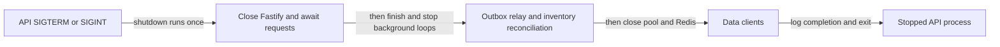

# Graceful shutdown (and PID 1 signals)

History: see [CHANGELOG.md](../CHANGELOG.md) or run `pnpm docs:history`

Area: Reliability · Status: ✅ built in repository; live AWS acceptance is separate

<!-- interview-card: v2 -->

## 1. What is it?

Graceful shutdown stops new work and lets current work finish before closing its resources. It reduces avoidable failures when a process is replaced or stopped.

## 2. Why do we need it?

A MiniTickets deployment may stop an API task while a booking or outbox publish is running. Closing the database first could cut that work off even though a short wait would let it finish.

## 3. How does it work?

1. Handle the termination signal once and stop accepting requests.
2. Wait for active request work and stop background loops before closing their dependencies.
3. Close data clients and exit; bounded downstream work limits waiting.

## 4. How do we use it in MiniTickets?

`server.ts` closes Fastify, then the outbox relay and inventory reconciliation, then Postgres and Redis. Container signal handling must reach the process. Actual load-balancer draining and interruption timing still need deployed acceptance; graceful code cannot guarantee every request completes.

## 5. Interview-ready answer

“MiniTickets shuts down in dependency order: stop accepting HTTP work, finish requests and background work, then close stores. Repeated signals do not start another cleanup. Some operations have timeouts, but shutdown has no overall deadline and can stall. Forced termination can interrupt work, so durable state and safe retries still matter. Live load-balancer drain timing remains separate acceptance work.”

## 6. Important follow-up questions

- **Why close stores last?** Requests and background loops may still need them while finishing.
- **What if another signal arrives?** The shutdown guard prevents running cleanup twice.
- **Does draining guarantee no lost response?** No. Forced termination and ambiguous outcomes still require durable recovery and safe retries.
- **Why care about the container’s first process?** Signal forwarding and child-process cleanup determine whether shutdown code actually runs.

## 7. Advanced details

Technical reference

### Exact current order and signal boundary

`apps/api/src/server.ts` registers SIGINT/SIGTERM, guards `shuttingDown`, logs start, awaits `app.close()`, `stopOutboxRelay()`, `stopInventoryReconciliation()`, `pool.end()`, then `redis.quit()` with disconnect fallback. Success/failure logs precede exit 0/1. Redis is not closed while the relay still needs the database. API/web Dockerfiles define container entry behavior; ECS API init handling supports signal/child cleanup.

`infra/src/entry/target-groups.ts` sets **30-second deregistration delay**. Normal task retirement and Spot interruption must not be assumed to have identical signal/drain ordering. There is no overall shutdown deadline: `app.close()` waits for requests, and `redis.quit()` can wait for pending replies. Its disconnect fallback runs on rejection, not after a timer. Selected SQL/cache/SNS budgets help, but do not guarantee shutdown finishes. Real deployed drain/forced-stop behavior remains owner acceptance.

### Evidence and related boundary facts

`pnpm test` covers service/API and relay lifecycle paths; it was not rerun here. The old card mixed shutdown with adjacent architecture facts: `apps/api/src/queries/bookings.ts` → `listByUser` joins bookings/events once; `apps/api/src/trpc/init.ts` handles auth/error translation. SQL stays in queries, web imports only router types, and GraphQL/tRPC do not prevent N+1 automatically. Those remain valid neighboring concerns, not shutdown steps.

Future checks include connection budgets, dependency deadlines and authorized drain experiments. Liveness should remain distinct from dependency readiness to avoid restart storms.

### Code anchors

- Anchor: `apps/api/Dockerfile` — `module configuration`; follow the numbered comments at this boundary.
- Anchor: `apps/api/src/server.ts` — `shutdown`; follow the numbered comments at this boundary.
- Anchor: `apps/web/Dockerfile` — `module configuration`; follow the numbered comments at this boundary.
- Anchor: `infra/src/entry/target-groups.ts` — `shared`; follow the numbered comments at this boundary.

### Related reading

[current system](../00-big-picture.md) · [scenario](../guides/interview-scenarios.md#api-n-plus-one) · [explorer tour](../guides/infra-explorer.html?tour=booking)

[Open this concept in the city explorer](../guides/infra-explorer.html?concept=graceful-shutdown#chapter=8&piece=api-task).

## Where it appears in the story

- [app-story: 9b. A booking reaches its transaction](../app-story.md#9b-a-booking-reaches-its-transaction)

