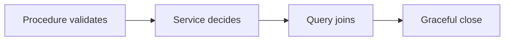

# Graceful shutdown (and PID 1 signals)

History: see [CHANGELOG.md](../CHANGELOG.md) or run `pnpm docs:history`

Area: Reliability · Status: ✅ built in repository; live AWS acceptance is separate

## 1. In one line

Shutdown closes Fastify and background relay, waits for bounded in-flight work and closes Redis/Postgres. A stuck downstream is bounded by its timeout; real ALB drain timing still needs deployment acceptance.

## 2. Real-life comparison

Two clerks cannot promise the same last seat: one holds the ledger until the reservation is recorded.

## 3. Picture it

## 4. Where in our code

- Anchor: `apps/api/Dockerfile` — `module configuration`; follow the numbered comments at this boundary.
- Anchor: `apps/api/src/server.ts` — `shutdown`; follow the numbered comments at this boundary.
- Anchor: `apps/web/Dockerfile` — `module configuration`; follow the numbered comments at this boundary.
- Anchor: `infra/src/entry/target-groups.ts` — `shared`; follow the numbered comments at this boundary.

`apps/api/src/queries/bookings.ts` → `listByUser` joins bookings/events once. `apps/api/src/trpc/init.ts` handles auth/error translation. `apps/api/src/server.ts` closes relay/Fastify/Redis/Postgres. Run `pnpm test` for API/service and relay lifecycle coverage; live ALB drain timing remains acceptance.

## 5. See it yourself

Run `pnpm test` and inspect the asserted outcome described above.

Failure thought experiment: Can the web import the API database module? No; only its router type crosses that boundary. Do not change a live stack to demonstrate it.

## 6. How it connects

Uses the [current system](../00-big-picture.md); gives a concrete decision to the [scenario](../guides/interview-scenarios.md#api-n-plus-one) and [explorer tour](../guides/infra-explorer.html?tour=booking).

## 7. Our settings and WHY

Shutdown closes Fastify and background relay, waits for bounded in-flight work and closes Redis/Postgres. A stuck downstream is bounded by its timeout; real ALB drain timing still needs deployment acceptance. Layer boundaries make code understandable; bounded work makes deployment safer.

## 8. Trade-offs

Joining everything can overfetch; pagination and projection still matter. GraphQL/tRPC do not automatically prevent N+1. Liveness that depends on every store can cause restart storms.

## 9. Alternatives and when to choose them

10x: paginate My tickets/bookings and inspect plans. 100x: per-dependency deadlines, connection budgets and task drain experiments.

## 10. What breaks and how we notice

Can the web import the API database module? No; only its router type crosses that boundary.

## 13. Interview answers at 3 levels

- **Simple:** Shutdown closes Fastify and background relay, waits for bounded in-flight work and closes Redis/Postgres.
- **Senior:** Keep input validation in procedures, business rules in services and storage in queries. Fetch related records in one intentional query rather than looping through requests. On shutdown stop accepting new work, finish bounded in-flight work, stop the relay and close clients. Health checks must distinguish liveness from dependency readiness.
- **Lead:** 10x: paginate My tickets/bookings and inspect plans. 100x: per-dependency deadlines, connection budgets and task drain experiments.

## 14. Follow-up questions with answers

Can the web import the API database module? No; only its router type crosses that boundary.

Where does SQL belong? **Queries.**

## 15. Say it in 30 seconds

Keep input validation in procedures, business rules in services and storage in queries. Fetch related records in one intentional query rather than looping through requests. On shutdown stop accepting new work, finish bounded in-flight work, stop the relay and close clients. Health checks must distinguish liveness from dependency readiness.

## 16. Status and production work

Repository implementation and local evidence are described above. Live AWS/CI execution remains owner acceptance. 10x: paginate My tickets/bookings and inspect plans. 100x: per-dependency deadlines, connection budgets and task drain experiments.

## Where it appears in the story

- [app-story: 9b. A booking reaches its transaction](../app-story.md#9b-a-booking-reaches-its-transaction)
