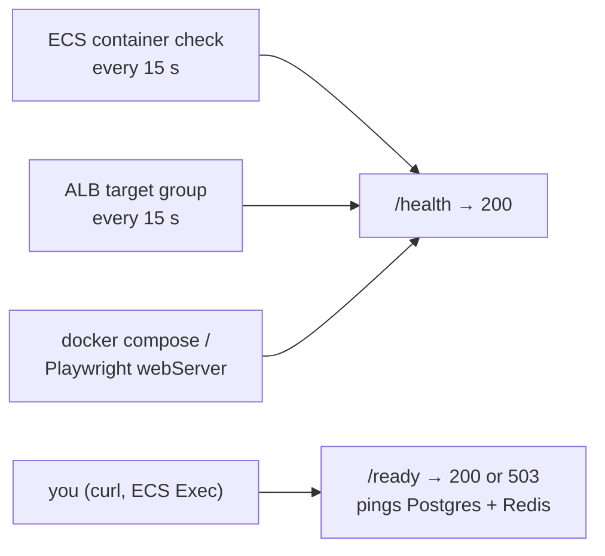

# Health checks: liveness vs readiness

History: see [CHANGELOG.md](../CHANGELOG.md) or run `pnpm docs:history`

Area: Reliability · Status: ✅ built · Step doc: [05 database](../../05-database.md), [17 ECS api](../../17-infra-ecs-api.md), [18 ALB + web](../../18-infra-alb-web.md)

## 1. In one line

**Liveness** (`/health`) asks "is the process alive?" and never touches the database;
**readiness** (`/ready`) asks "can it do real work?" and pings Postgres and Redis. Orchestrators use
liveness to decide restarts.

## 2. Real-life comparison

Liveness: "is the shop open?" (lights on, someone at the counter). Readiness: "can I buy bread
now?" (the delivery arrived). You don't close and rebuild the shop because a delivery is late.

## 3. Picture it



## 4. Where in our code

- Anchor: `apps/api/src/app.ts` · `GET /health` (always 200), `GET /ready` (`Promise.allSettled([pingDb(), pingRedis()])`).
- Anchor: `apps/api/src/queries/health.ts` · `pingDb` (`select 1`), `pingRedis` (`PING`).
- Anchor: `infra/src/compute/task.ts` · `healthCheck`: ECS runs node inside the container to call `/health`.
- Anchor: `infra/src/entry/target-groups.ts` · `healthCheckTiming`, `healthCheck: { path: "/health" }` (api), `"/"` (web).
- Anchor: `docker-compose.yml` · api `healthcheck`: the same node one-liner.
- Anchor: `scripts/stack/data-checks.ts` · `checkPostgres`, `checkRedis`: the same idea for the laptop (`pnpm stack:check`): log in + migrations + sample events, Redis `PING`, each failure with its fix.

Step by step:

1. `/health` answers `{"status":"ok"}` whenever the server can answer at all.
2. `/ready` pings both stores with `allSettled` (one failure never hides the other in the logs) and
   returns 503 `{"status":"unavailable"}` if either fails.
3. ECS container check: every 15 s, 5 s timeout, 3 failures in a row → unhealthy → replaced;
   first 15 s ignored (`startPeriod`). The slim image has no curl, so `node -e "fetch(...)"`.
4. ALB: every 15 s, 2 passes → healthy (gets traffic), 3 failures → unhealthy; plus a 60 s grace
   period in the ECS service ([target-groups](target-groups.md)).
5. Web: the ALB checks `/`, a static page that needs neither api nor database.
6. **Why liveness for the ALB and ECS**: a short database hiccup must not make ECS kill healthy api
   tasks or the ALB remove all of them at once (the comments in `task.ts` and `target-groups.ts`
   say so). `/ready` is for humans and for later.

## 5. See it yourself

Recorded with local api instances on spare ports:

```bash
curl -s localhost:4000/health                         # {"status":"ok"}
curl -s -w ' %{http_code}\n' localhost:4000/ready     # {"status":"ready"} 200
# an instance started with REDIS_URL=redis://localhost:6399 (nothing listening):
# /health → {"status":"ok"}   /ready → {"status":"unavailable"} 503
```

**Break it on purpose:** point the ALB health check at `/ready` and stop Redis: every api task fails
the check, the ALB has no healthy targets, and all of `/trpc/*` goes down, even `auth.me` for
logged-out users who didn't need Redis.

## 6. How it connects

- **Uses ←** [connection-pooling](connection-pooling.md), the Redis client,
  [http-status-codes](http-status-codes.md) (503).
- **Gives →** [target-groups](target-groups.md), [ecs-service](ecs-service.md) replacement,
  [zero-downtime-deploys](zero-downtime-deploys.md), [circuit-breaker](circuit-breaker.md), CI
  start-up (`playwright.config.ts` waits for `/health`).

## 7. Our settings and WHY

| Check | Path | Timing | Why |
| ----- | ---- | ------ | --- |
| ECS container (api) | `/health` | 15 s / 5 s / 3 / start 15 s | Restart only a dead process. |
| ALB api | `/health` | 15 s / 5 s / 2 up / 3 down | Don't drop all tasks on a DB blip. |
| ALB web | `/` | same | A page that needs nothing else. |
| `/ready` | manual | on demand | See dependency health without side effects. |

## 8. Trade-offs

- **Pros:** no restart storms from dependency outages; clear signals.
- **Cons:** a task whose database connection is broken still gets traffic (and returns 500s); nobody
  alarms on `/ready` yet.

## 9. Alternatives and when to choose them

- **Readiness in the load balancer** (Kubernetes readiness probes): right when *one* task's
  dependency path can be broken while others are fine.
- **Deep health with thresholds** (fail readiness only after N seconds): avoids flapping.
- **Synthetic checks** (CloudWatch Synthetics): from outside, through CloudFront.

## 10. What breaks, and how we'd notice

- `HOST=127.0.0.1` in a container: health checks fail; ECS cycles tasks; service events say "failed
  container health checks".
- A slow start beyond the grace period: tasks killed before ready.

## 13. Interview answers at 3 levels

- **Simple:** One endpoint says "I'm running", another says "I can reach my databases".
- **Senior:** `/health` is liveness and is what ECS, the ALB, compose and Playwright check;
  `/ready` pings Postgres and Redis with `allSettled` and returns 503 when either fails. We
  deliberately don't use readiness for the ALB, so a database hiccup doesn't take every task out.
- **Lead:** Liveness drives restarts, readiness drives routing; mixing them causes cascades. With
  more tasks and per-task failures I'd use readiness for routing with hysteresis, and alarm on
  readiness and 5xx rates.

## 14. Follow-up questions interviewers ask

- *Why not check the database in liveness?* A DB outage would restart every healthy api task, which
  doesn't fix the DB and adds load.
- *Why `allSettled`?* Both failures are logged, not just the first.

## 15. Say it in 30 seconds

"Two endpoints: /health is liveness, always 200 if the process answers; /ready pings Postgres and
Redis and returns 503 if either fails. ECS, the ALB, compose and CI all use /health on purpose, so a
database blip never restarts or removes healthy tasks. /ready is for humans today."

## 16. Status

✅ built.

## Where it appears in the story

- [App story: 4. Fastify: CORS, trustProxy, cookie](../app-story.md#4-fastify-cors-trustproxy-cookie)
