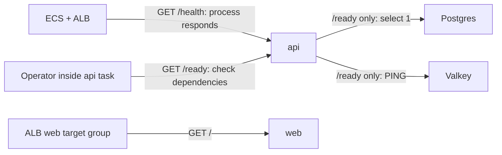

# Health checks: asking the worker two different questions

History: see [CHANGELOG.md](../CHANGELOG.md) or run `pnpm docs:history`

Area: Reliability · Status: ✅ built · Step doc: [05 database](../../05-database.md), [17 ECS api](../../17-infra-ecs-api.md), [18 ALB + web](../../18-infra-alb-web.md)
<!-- interview-card: v2 -->

## 1. What is it?

A [health check](../glossary.md#health-check) asks whether a component can do a small piece of work. MiniTickets separates “is api answering?” from “[can it reach its stores?](../glossary.md#r)”

## 2. Why do we need it?

A frozen process needs replacement. A shared database outage needs database recovery; restarting every API task could add disruption without solving the cause.

## 3. How does it work?

1. `/health` answers without calling the stores.
2. `/ready` checks Postgres and Redis together.
3. Either failed store produces an unavailable response and a log identifying the failure.

## 4. How do we use it in MiniTickets?

ECS and ALB use api liveness, meaning the process answers. Operators can separately inspect readiness. Web's ALB check calls its landing page. No automatic external readiness monitor is configured.

## 5. Interview-ready answer

“MiniTickets keeps restart checks independent of shared dependencies. API liveness proves Fastify answers; readiness checks both Postgres and Redis. That avoids replacing every task during one shared outage. The trade-off is that green liveness does not prove bookings work, so dependency errors and real user failures need separate monitoring.”

## 6. Important follow-up questions

- **Why inspect both store results?** We can log both failures rather than hide the second behind the first.
- **Local probe passes but ALB fails?** Check the app's listening address and ALB-to-task network access.
- **Could readiness control routing?** Yes, when failures differ by task and healthy alternatives exist; shared outages can cause removal churn.
- **Does readiness prove a booking will succeed?** No. It checks basic store access, not a full transaction or email delivery.

## 7. Advanced details

Technical reference

### Source and operational view

`apps/api/src/app.ts` → `buildApp` defines both routes; `apps/api/src/queries/health.ts` → `pingDb`, `pingRedis` accesses the stores. `infra/src/compute/task.ts` → `createApiTask` defines the container probe. `/health` is `200 {"status":"ok"}`. `/ready` returns 200/`ready` only when both pass; otherwise 503/`unavailable`, logging the errors.

ECS → Clusters → `minitickets-dev` → Tasks → Containers shows container health; Service → Events explains replacements. EC2 → Target Groups → api group → Targets shows separate ALB health; ALB Resource map → Unhealthy Target Map helps locate failed paths. `/ready` is not an automatic console probe. Live health was not checked.

ALB probes need `minitickets-dev-api-sg` 4000 or web group 3000 from `minitickets-dev-alb-sg`. Readiness needs RDS 5432 and Valkey 6379 from api's group, TLS and configured password/token. Local probes need no IAM; invoking ECS Exec is separately authorized. If `/ready` returns 503, inspect the named store and its network/credentials rather than restart every task. Web has no ECS container health check.

- Anchor: `apps/api/src/app.ts` · `GET /health` (always 200), `GET /ready` (`Promise.allSettled([pingDb(), pingRedis()])`).
- Anchor: `apps/api/src/queries/health.ts` · `pingDb` (`select 1`), `pingRedis` (`PING`).
- Anchor: `infra/src/compute/task.ts` · `healthCheck`: ECS runs node inside the container to call `/health`.
- Anchor: `infra/src/entry/target-groups.ts` · `healthCheckTiming`, `healthCheck: { path: "/health" }` (api), `"/"` (web).
- Anchor: `docker-compose.yml` · api `healthcheck`: the same node one-liner.
- Anchor: `scripts/stack/data-checks.ts` · `checkPostgres`, `checkRedis`: the same idea for the laptop (`pnpm stack:check`): log in + migrations + sample events, Redis `PING`, each failure with its fix.

### Probe layers are different

Container liveness can drive ECS replacement; ALB target health controls routing and service replacement after grace. Docker compose's API healthcheck and Playwright's API startup wait also use `/health`. The slim runtime has no curl; ECS runs `node -e` with `fetch('http://localhost:4000/health')`, exiting zero for an OK response and one for failure. A container listening only on localhost can pass that internal probe but fail ALB traffic. API must bind `HOST=0.0.0.0`; web uses `HOSTNAME=0.0.0.0`.

ALB settings are 15-second interval, 5-second timeout, matcher 200, three failures to unhealthy and two successes to recover. Initial registration needs only one pass under AWS's documented rule. The separate ECS start period is 15 seconds; the service ALB grace period is 60 seconds. None is a guaranteed upper bound for application recovery.

`/health` returns `{"status":"ok"}`. `/ready` runs `Promise.allSettled([pingDb(), pingRedis()])`; queries alone access stores. `pingDb` executes `select 1` through the pool; `pingRedis` sends `PING`. It logs both failures if both fail, then returns only `{"status":"unavailable"}` to the caller. Success is `{"status":"ready"}`. It does not claim a full booking transaction or email delivery will succeed.

Earlier local spare-port experiments recorded `/health` staying 200 when Redis was pointed at an unused port while `/ready` returned 503. They are historical evidence, not tests rerun for this rewrite. `pnpm stack:check` complements API probes: `scripts/stack/data-checks.ts` → `checkPostgres`, `checkRedis` inspect login/migrations/sample data and cache access with concrete fixes.

If ALB checked `/ready`, a shared Redis failure could mark every API target unhealthy and create replacement churn. [ALB can fail open](https://docs.aws.amazon.com/elasticloadbalancing/latest/application/target-group-health-checks.html) to all unhealthy registered targets, so this does not reliably “turn off” all traffic either. Keep independent observability for dependency failures; no automatic external `/ready` monitor is configured. Existing application/ALB symptom alarms do not change that fact.

Slow startup beyond grace can cause repeated replacement. Per-task connection failures can justify readiness-based routing when enough other tasks remain healthy. Thresholds reduce flapping. A CloudWatch Synthetics journey could test from outside the current ALB path (or optional CDN); it is not built. Probes themselves add a small amount of normal compute/request work.

### Related reading

- [Target groups](target-groups.md)
- [ECS service](ecs-service.md)
- [RDS](rds-postgres.md)
- [Valkey](elasticache-valkey.md)

[Open this piece in the city explorer](../guides/infra-explorer.html?concept=health-checks#chapter=24&piece=api-task).

## Where it appears in the story

- [App story: 4. Fastify: CORS, trustProxy, cookie](../app-story.md#4-fastify-cors-trustproxy-cookie)

