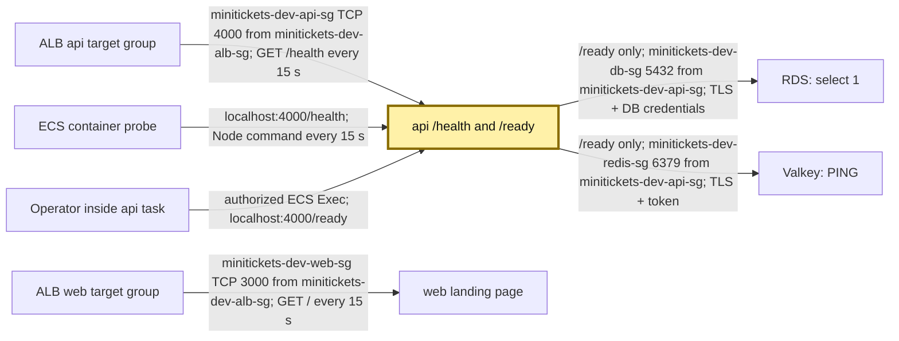
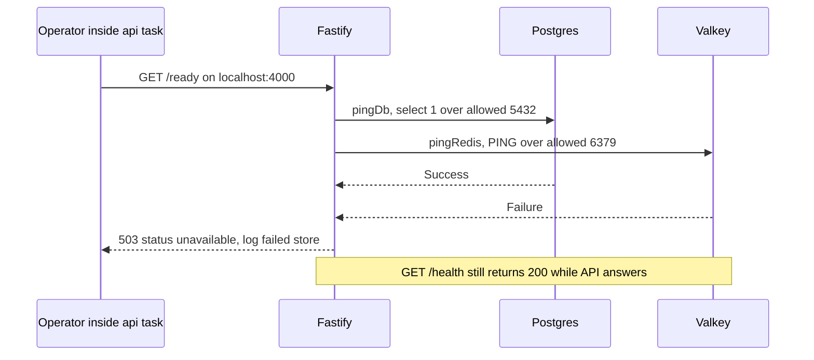

# Health checks: asking the worker two different questions

History: see [CHANGELOG.md](../CHANGELOG.md) or run `pnpm docs:history`

Area: Reliability · Status: ✅ built · Step doc: [05 database](../../05-database.md), [17 ECS api](../../17-infra-ecs-api.md), [18 ALB + web](../../18-infra-alb-web.md)
<!-- interview-card: v1 -->

## 1. In one line

MiniTickets [liveness](../glossary.md#health-check) asks “can api answer?” at `/health`; [readiness](../glossary.md#r) asks “can it reach both stores?” at `/ready`.

## 2. Where it sits

[Open this piece in the city explorer](../guides/infra-explorer.html?concept=health-checks#chapter=24&piece=api-task).

## 3. How it works

## 4. What happens in MiniTickets

1. `/health` returns `200 {status: "ok"}` without touching data.
2. `/ready` runs `pingDb` and `pingRedis` together and waits for both outcomes.
3. Both pass: `200 {status: "ready"}`. Either fails: `503 {status: "unavailable"}` and errors are logged.
4. ECS checks `/health` every `15 s`: `5 s` timeout, three retries, `15 s` start period.
5. ALB uses `/health` for api and `/` for web. The service ignores failed ALB checks for its first `60 s`.

## 5. Reach / Allowed / Password

**Reach:** container checks use localhost; ALB checks need app-port security-group rules.

**Allowed:** no IAM needed to answer HTTP; ECS Exec access is separately authorized.

**Password:** `/health` needs none; `/ready` exercises configured store credentials.

## 6. In our code

`apps/api/src/app.ts` → `buildApp` (`/health`, `/ready`).

`apps/api/src/queries/health.ts` → `pingDb`, `pingRedis`.

`infra/src/compute/task.ts` → `createApiTask` (`healthCheck`).

## 7. In the AWS console

ECS → Clusters → `minitickets-dev` → Tasks → task → Containers shows container health; Service → Events explains replacement. EC2 → Target Groups → api group → Targets shows ALB health separately. ALB Resource map → Unhealthy Target Map shows affected routes. `/ready` is not an automatic console probe. Live health was not checked.

## 8. Good / Bad

**Good:** shared-store outages do not restart healthy processes; readiness identifies both store failures.

**Bad:** liveness alone can look green while bookings fail; a shallow web check cannot prove every page works.

## 9. Other choices

- Pick readiness-based routing when one task's dependency path can fail independently.
- Pick a timed threshold when brief failures would otherwise cause constant removal.
- Pick synthetic checks when testing the whole visitor journey is needed.

## 10. Connected to

| Neighbor | Direction | What allows it | Console check |
| --- | --- | --- | --- |
| [Target groups](target-groups.md) | ALB → api/web | HTTP 200; SG 4000/3000 | Target group → Health checks |
| [ECS service](ecs-service.md) | Failed task → replacement | Container health / service policy | Service → Events |
| [RDS](rds-postgres.md) | `/ready` → DB | API source, 5432, TLS/password | RDS → Connectivity & security |
| [Valkey](elasticache-valkey.md) | `/ready` → cache | API source, 6379, TLS/token | ElastiCache → Connectivity |

## 11. When it breaks

- ALB fails but local check passes → task bind address and source rules → listen on all interfaces and restore allowed path.
- `/ready` is 503 → api logs name failed store → repair that store/path, not every worker.

## 12. Say it in 30 seconds

“Our restart question is deliberately small: can Fastify answer /health? /ready asks both data stores and reports 503 if either fails. ECS and ALB use liveness so a database outage does not trigger a restart storm. We still need user-error monitoring because a live process can fail real work.”

## 13. Likely follow-ups

- **Why `allSettled`?** Both outcomes are inspected and each failure logged.
- **Does web have an ECS container check?** No; its ALB check calls `/`.

## 14. Remember it

An awake worker and a worker able to finish a booking are different facts.

## 15. More detail

Reference notes, source anchors and earlier useful detail

- Anchor: `apps/api/src/app.ts` · `GET /health` (always 200), `GET /ready` (`Promise.allSettled([pingDb(), pingRedis()])`).
- Anchor: `apps/api/src/queries/health.ts` · `pingDb` (`select 1`), `pingRedis` (`PING`).
- Anchor: `infra/src/compute/task.ts` · `healthCheck`: ECS runs node inside the container to call `/health`.
- Anchor: `infra/src/entry/target-groups.ts` · `healthCheckTiming`, `healthCheck: { path: "/health" }` (api), `"/"` (web).
- Anchor: `docker-compose.yml` · api `healthcheck`: the same node one-liner.
- Anchor: `scripts/stack/data-checks.ts` · `checkPostgres`, `checkRedis`: the same idea for the laptop (`pnpm stack:check`): log in + migrations + sample events, Redis `PING`, each failure with its fix.

### Probe layers are different

Container liveness can drive ECS replacement; ALB target health controls routing and service replacement after grace. Docker compose's API healthcheck and Playwright's API startup wait also use `/health`. The slim runtime has no curl; ECS runs `node -e` with `fetch('http://localhost:4000/health')`, exiting zero for an OK response and one for failure. A container listening only on localhost can pass that internal probe but fail ALB traffic. API must bind `HOST=0.0.0.0`; web uses `HOSTNAME=0.0.0.0`.

ALB settings are 15-second interval, 5-second timeout, matcher 200, three failures to unhealthy and two successes to recover. Initial registration needs only one pass under AWS's documented rule. The separate ECS start period is 15 seconds; the service ALB grace period is 60 seconds. None is a guaranteed upper bound for application recovery.

`/health` returns `{"status":"ok"}`. `/ready` runs `Promise.allSettled([pingDb(), pingRedis()])`; queries alone access stores. `pingDb` executes `select 1` through the pool; `pingRedis` sends `PING`. It logs both failures if both fail, then returns only `{"status":"unavailable"}` to the caller. Success is `{"status":"ready"}`. It does not claim a full booking transaction or email delivery will succeed.

Earlier local spare-port experiments recorded `/health` staying 200 when Redis was pointed at an unused port while `/ready` returned 503. They are historical evidence, not tests rerun for this rewrite. `pnpm stack:check` complements API probes: `scripts/stack/data-checks.ts` → `checkPostgres`, `checkRedis` inspect login/migrations/sample data and cache access with concrete fixes.

If ALB checked `/ready`, a shared Redis failure could mark every API target unhealthy and create replacement churn. ALB can fail open to all unhealthy registered targets, so this does not reliably “turn off” all traffic either. Keep independent observability for dependency failures; no automatic external `/ready` monitor is configured. Existing application/ALB symptom alarms do not change that fact.

Slow startup beyond grace can cause repeated replacement. Per-task connection failures can justify readiness-based routing when enough other tasks remain healthy. Thresholds reduce flapping. A CloudWatch Synthetics journey could test from outside the current ALB path (or optional CDN); it is not built. Probes themselves add a small amount of normal compute/request work.

## Where it appears in the story

- [App story: 4. Fastify: CORS, trustProxy, cookie](../app-story.md#4-fastify-cors-trustproxy-cookie)
