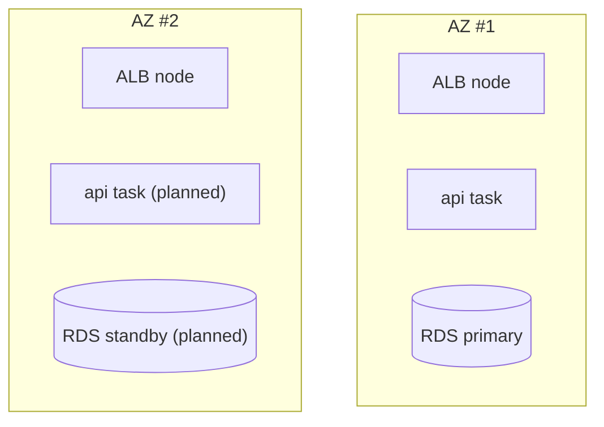

# High availability across availability zones

Area: Reliability · Status: 🟡 partial (multi-AZ shape, single copies) · Step docs: [12 network](../../12-infra-network.md) (section 3.9), [14 data](../../14-infra-data.md) (section 3.3)

## 1. In one line

**High availability (HA)** means the system keeps working when one part fails, which on AWS means a
copy of every tier in at least two AZs; we have the two-AZ shape but run one copy of each tier.

## 2. Real-life comparison

Two buildings, but only one staffed. The second building has desks and phone lines ready; if the first
burns down, nobody is there to answer the phone yet.

## 3. Picture it



Today only the ALB is truly in both AZs. The task, RDS and Valkey each exist once.

## 4. Where in our code

- Anchor: `infra/src/network.ts` · `azNames`: 2 AZs, a public and a private subnet in each.
- Anchor: `infra/src/compute/service.ts` · `desiredCount: 1`: one api task.
- Anchor: `infra/src/data/postgres.ts` · `multiAz: false`: no standby.
- Anchor: `infra/src/data/cache.ts` · `numCacheClusters: 1`, `automaticFailoverEnabled: false`: one node.

| Tier | Dev today | HA version |
| ---- | --------- | ---------- |
| ALB | 2 AZs | 2 AZs (already) |
| api, web | 1 Spot task each | 2+ tasks across AZs, on-demand base |
| RDS | single-AZ | Multi-AZ (standby takes over in about a minute) |
| Valkey | 1 node | primary + replica, automatic failover, Multi-AZ |

## 5. See it yourself

```bash
aws ecs describe-tasks --profile ticketlite --cluster minitickets-dev \
  --tasks $(aws ecs list-tasks --profile ticketlite --cluster minitickets-dev --query 'taskArns' --output text) \
  --query "tasks[].[group,availabilityZone]" --output table
aws rds describe-db-instances --profile ticketlite --db-instance-identifier minitickets-dev-db \
  --query "DBInstances[0].[MultiAZ,AvailabilityZone]"
```

## 6. How it connects

- **Uses ←** [regions-and-azs](regions-and-azs.md), [scaling](scaling.md), [rds-postgres](rds-postgres.md),
  [elasticache-valkey](elasticache-valkey.md), [fargate-spot](fargate-spot.md).
- **Gives →** the answer to "what happens if an AZ fails?"; pairs with [backups-dr](backups-dr.md).

## 7. Our settings and WHY

Single copies everywhere except the ALB: Multi-AZ RDS doubles its price, a cache replica doubles the
cache, and a second task per service doubles compute. Dev can be down for a while.

## 8. Trade-offs

- **Pros:** cheapest possible dev; the multi-AZ shape means HA is a config change, not a redesign.
- **Cons:** any AZ failure, Spot interruption or instance failure is an outage today.

## 9. Alternatives and when to choose them

- **Full multi-AZ** (table above): any production system.
- **Multi-region active/passive:** when a regional outage is unacceptable; needs data replication.
- **Aurora:** faster failover than RDS Multi-AZ, storage replicated across 3 AZs.

## 10. What breaks, and how we'd notice

| Failure | Effect today |
| ------- | ------------ |
| api task dies | ALB 503 for ~1-2 min until replaced |
| RDS AZ fails | `/ready` 503, logins 500, until AWS recovers it |
| Valkey node fails | Everyone logged out; `/ready` 503 |

## 11. Reach / Allowed / Password

Not a connection. Failover keeps the same DNS names (RDS endpoint, Valkey primary endpoint), so the
api's settings do not change.

## 12. Cost

Multi-AZ RDS and a cache replica each run a second machine, so the data layer's hourly price
(~$0.033 today, [docs/14](../../14-infra-data.md)) would roughly double, plus one more task per
service. We have not priced or measured the HA setup.

## 13. Interview answers at 3 levels

- **Simple:** HA means a failure in one data centre does not take the app down. We have the layout,
  not the copies.
- **Senior:** Two AZs with subnets in each; the ALB spans both. But we run one Spot task per service,
  single-AZ RDS and a single Valkey node, so dev has several single points of failure. Each is one
  setting away from HA: `desiredCount`, `multiAz`, `numCacheClusters` with failover.
- **Lead:** HA is decided per tier against an availability target. I'd start with the stateful tiers
  (Multi-AZ RDS, cache replica), then 2+ tasks with an on-demand base, and test failover regularly.

## 14. Follow-up questions interviewers ask

- *Does Multi-AZ RDS help read scaling?* No, the standby is not readable; that's what read replicas are for.
- *What is a single point of failure in your setup?* Every tier except the ALB.

## 15. Say it in 30 seconds

"We have the two-AZ layout and the ALB spans both, but dev runs one task per service, single-AZ RDS and
one Valkey node. Making it HA is configuration: more tasks across AZs, Multi-AZ RDS, and a cache
replica with failover, at roughly double the cost."

## 16. Status

🟡 partial. **To make it production-grade:** the "HA version" column above.
