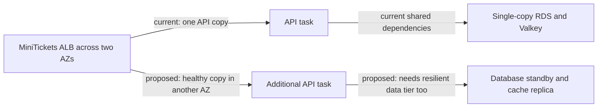

# High availability across availability zones

History: see [CHANGELOG.md](../CHANGELOG.md) or run `pnpm docs:history`

Area: Reliability · Status: 🟡 partial (multi-AZ shape, single copies) · Step docs: [12 network](../../12-infra-network.md) (section 3.9), [14 data](../../14-infra-data.md) (section 3.3)

<!-- interview-card: v2 -->

## 1. What is it?

High availability means continuing useful service when a component fails. It needs working spare capacity and a tested recovery path, not just resources placed in several locations.

## 2. Why do we need it?

MiniTickets can have subnets in two availability zones yet still lose service when its only API task or database fails. An empty second location cannot serve buyers.

## 3. How does it work?

1. Identify which component failures interrupt a user journey.
2. Provide independent working capacity and data recovery/failover for those failures.
3. Test client reconnects, capacity and recovery rather than assuming the diagram guarantees availability.

## 4. How do we use it in MiniTickets?

The network and ALB span two zones, but API/web and data stores use single copies. Current availability is therefore partial. Additional tasks, resilient data configuration, dependable baseline capacity and failure drills are future work; no recovery-time guarantee has been demonstrated.

## 5. Interview-ready answer

“MiniTickets has a two-zone network shape, not a fully highly available stack. Single application copies and data nodes can still interrupt service. I would choose the failure scope and user objective, then add independently placed capacity and appropriate database/cache failover. Clients must reconnect and have enough surviving capacity. More copies reduce specific risks, but shared dependencies and regional failure remain separate concerns.”

## 6. Important follow-up questions

- **Do two subnets establish high availability?** No. They provide placement options; useful copies and recovery behavior must exist.
- **Does another API task solve database failure?** No. The shared data tier needs its own resilience.
- **How fast would recovery be?** It depends on failure mode and configuration; measure it in drills instead of promising a fixed duration.
- **Is high availability the same as backups?** No. Availability maintains service; backups recover lost or corrupted data.

## 7. Advanced details

Technical reference

### Current and proposed tiers

`infra/src/network.ts` creates public/private subnets in two AZs. ALB spans both. API/web each run one Spot task. `infra/src/data/postgres.ts` has `multiAz: false`; `infra/src/data/cache.ts` has `numCacheClusters: 1`, `automaticFailoverEnabled: false`, `multiAzEnabled: false`.

A proposed stronger design would use 2+ placed tasks with dependable on-demand base, RDS Multi-AZ, and Valkey primary/replica with automatic failover/Multi-AZ. These changes require capacity, compatibility, reconnect and operational validation; “just a config change” overstates the work. Multi-region active/passive adds replication/recovery complexity; Aurora is another database architecture, not an automatic requirement.

### Operations, recovery and costs

Read-only checks: `aws ecs describe-tasks --profile ticketlite --cluster minitickets-dev --tasks <task-arns> --query 'tasks[].[group,availabilityZone]' --output table`; `aws rds describe-db-instances --profile ticketlite --db-instance-identifier minitickets-dev-db --query 'DBInstances[0].[MultiAZ,AvailabilityZone]'`.

A sole API failure can leave no healthy target until replacement; database failure affects reads/bookings; cache loss affects authentication/admission/cache behavior according to each policy. The old 1–2 minute task/about-one-minute database estimates were unmeasured examples, not bounds. Failover endpoints can stay stable while clients still need DNS/reconnect handling.

The old **~$0.033/hour** data-layer figure and “doubling” estimates were historical, unpriced approximations. No HA setup cost or recovery drill was measured here; additional capacity/storage/traffic costs require current sizing/pricing. A second zone alone does not remove every failure point.

### Code anchors

- Anchor: `infra/src/network.ts` · `azNames`: 2 AZs, a public and a private subnet in each.
- Anchor: `infra/src/compute/service.ts` · `desiredCount: 1`: one api task.
- Anchor: `infra/src/data/postgres.ts` · `multiAz: false`: no standby.
- Anchor: `infra/src/data/cache.ts` · `numCacheClusters: 1`, `automaticFailoverEnabled: false`: one node.

### Related reading

[regions-and-azs](regions-and-azs.md) · [scaling](scaling.md) · [rds-postgres](rds-postgres.md) · [elasticache-valkey](elasticache-valkey.md) · [fargate-spot](fargate-spot.md) · [backups-dr](backups-dr.md)

[Open this concept in the city explorer](../guides/infra-explorer.html?concept=high-availability#chapter=1&piece=az-b).

## Where it appears in the story

- [Infra story: 7. RDS Postgres](../infra-story.md#7-rds-postgres)

