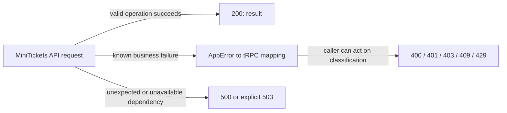

# HTTP methods and status codes

History: see [CHANGELOG.md](../CHANGELOG.md) or run `pnpm docs:history`

Area: API · Status: ✅ built · Step doc: [02 errors](../../02-errors.md), [05 database](../../05-database.md)
<!-- interview-card: v2 -->

## 1. What is it?

An HTTP method describes the requested operation; a status describes its outcome. Standard codes help clients and monitoring distinguish success, invalid requests and server failures.

## 2. Why do we need it?

MiniTickets must distinguish an expired login from a duplicate signup or unavailable service. The interface and retry logic need a stable signal beyond changeable message text.

## 3. How does it work?



1. Use the method required by the procedure.
2. Classify the result at the API boundary.
3. Let clients interpret the status together with the structured response.

## 4. How do we use it in MiniTickets?

TRPC reads use GET and mutations POST. Validation uses 400, missing identity 401, denied access 403 and conflicts 409. Rate limits use 429; explicit unavailability and failed readiness can use 503. Crashes use 500.

## 5. Interview-ready answer

“MiniTickets treats HTTP status as part of its operational contract. Expected client problems get meaningful 4xx codes, while unexpected failures become 500 and explicit unavailability can be 503. The UI and retry policy read those codes. I still check individual results in a batch, because one envelope can contain different procedure outcomes.”

## 6. Important follow-up questions

- **How do 401 and 403 differ?** 401 means valid authentication is needed; 403 means the caller is not allowed to perform the operation.
- **Does a 5xx prove nothing committed?** No. The client may have lost an operation’s outcome; durable intent identity matters for safe retries.
- **Should every failure return 200?** No. It hides useful transport-level failure signals from clients and monitoring.
- **Does POST always mean unsafe retry?** POST is not inherently idempotent, but a designed operation can use a durable idempotency key.

## 7. Advanced details

<details>
<summary>Technical reference</summary>

### Current reading notes

Current code maps TOO_MANY_REQUESTS to 429 with Retry-After and SERVICE_UNAVAILABLE to 503; `/ready` is not the only possible 503 anymore. Existing status examples below are historical local observations, not fresh acceptance checks. Optional CloudFront restricts methods on page behaviours; current entry is direct ALB.

### Implementation reference

- Anchor: `apps/api/src/trpc/init.ts` · `codeByKind`: business error kind → tRPC code (tRPC picks the HTTP status).
- Anchor: `apps/api/src/app.ts` · `/ready`: 200 or 503.

Our table (tRPC code → HTTP status from responses recorded against a local api):

| Status | When in our app | Code / example |
| ------ | --------------- | -------------- |
| 200 | Success | every successful call |
| 400 | Invalid input (`ZodError`) | signup with a bad email |
| 401 | No or bad session; wrong login | `UNAUTHORIZED`: `account.profile` without a cookie; login with a wrong password |
| 403 | Logged in but not allowed | `FORBIDDEN`: admin-only mutations reject authenticated non-admin users |
| 404 | Not found | `NOT_FOUND`: profile of a deleted user |
| 405 | Wrong method | POST to a query (`auth.me`) |
| 409 | Conflict with existing data | `CONFLICT`: duplicate email on signup |
| 415 | Wrong `content-type` | POST without `application/json` |
| 500 | Our bug or a dependency down | anything unmapped, e.g. Redis down |
| 503 | Not ready | `GET /ready` when Postgres or Redis does not answer |

Methods: tRPC queries are `GET`, mutations `POST` ([trpc-client](trpc-client.md)); health routes
are `GET`. CloudFront allows only `GET`/`HEAD` on page paths ([cloudfront](cloudfront.md)).

### Inspection and historical evidence

```bash
curl -s -o /dev/null -w '%{http_code}\n' localhost:4000/trpc/account.profile     # 401
curl -s -o /dev/null -w '%{http_code}\n' -X POST localhost:4000/trpc/auth.me \
  -H 'content-type: application/json'                                             # 405
curl -s -o /dev/null -w '%{http_code}\n' localhost:4000/ready                       # 200 (503 if a store is down)
```

**Break it on purpose:** map `CONFLICT: "BAD_REQUEST"` in `codeByKind`. The duplicate-email
message moves from under the Email field to the generic form error, because the UI looks for 409
([ui-error-handling](ui-error-handling.md)), and the e2e signup test fails.

### Settings and reasoning

401 for "who are you?" (no session, wrong login), 403 reserved for "I know you, but no". 409 for
duplicate email (the request was fine, it conflicts with data). 503 only for readiness, so load
balancers can tell "not ready" from "broken".

### Trade-offs

- **Pros:** standard meaning for clients, proxies and monitoring; retries can be safe by status.
- **Cons:** some cases are debatable (401 vs 400 for a wrong password; we use 401 like most APIs).

### Alternatives and scaling

- **Always 200 with an error object** (some RPC styles): hides failures from monitoring; avoid.
- **422 Unprocessable Content** for validation: some APIs use it; tRPC uses 400.

### Failure diagnosis

- A user mistake returned as 500: alerts fire for nothing, retries waste effort. Logs at `error`
  level show it.
- A 200 for a failure: monitoring misses it entirely.

### Further questions

- *401 vs 403?* 401: we don't know who you are. 403: we know, and you may not.
- *Which methods are idempotent?* GET, PUT, DELETE (and HEAD, OPTIONS); POST is not
  ([idempotency](idempotency.md)).

### Related reading

- [error-handling](error-handling.md)
- [retry-policy](retry-policy.md)
- [health-checks](health-checks.md)

[Open this piece in the city explorer](../guides/infra-explorer.html?concept=http-status-codes#chapter=0&piece=laptop-api).

## Where it appears in the story

- [App story: 11. The error path back to the UI](../app-story.md#11-the-error-path-back-to-the-ui)

</details>
