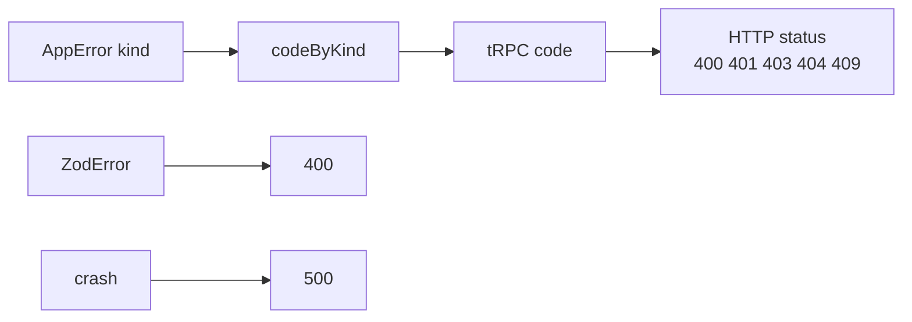

# HTTP methods and status codes

History: see [CHANGELOG.md](../CHANGELOG.md) or run `pnpm docs:history`

Area: API · Status: ✅ built · Step doc: [02 errors](../../02-errors.md), [05 database](../../05-database.md)

## 1. In one line

The **method** says what the request wants (GET reads, POST changes) and the **status code** says
how it went (2xx ok, 4xx your mistake, 5xx our problem); we map every business error to one status.

## 2. Real-life comparison

Parcel tracking codes: "delivered", "wrong address" (your fault), "depot closed" (their fault).
Everyone understands the code without reading the note.

## 3. Picture it



## 4. Where in our code

- Anchor: `apps/api/src/trpc/init.ts` · `codeByKind`: business error kind → tRPC code (tRPC picks the HTTP status).
- Anchor: `apps/api/src/app.ts` · `/ready`: 200 or 503.

Our table (tRPC code → HTTP status from responses recorded against a local api):

| Status | When in our app | Code / example |
| ------ | --------------- | -------------- |
| 200 | Success | every successful call |
| 400 | Invalid input (`ZodError`) | signup with a bad email |
| 401 | No or bad session; wrong login | `UNAUTHORIZED`: `account.profile` without a cookie; login with a wrong password |
| 403 | Logged in but not allowed | `FORBIDDEN`: defined, not used yet (no roles) |
| 404 | Not found | `NOT_FOUND`: profile of a deleted user |
| 405 | Wrong method | POST to a query (`auth.me`) |
| 409 | Conflict with existing data | `CONFLICT`: duplicate email on signup |
| 415 | Wrong `content-type` | POST without `application/json` |
| 500 | Our bug or a dependency down | anything unmapped, e.g. Redis down |
| 503 | Not ready | `GET /ready` when Postgres or Redis does not answer |

Methods: tRPC queries are `GET`, mutations `POST` ([trpc-client](trpc-client.md)); health routes
are `GET`. CloudFront allows only `GET`/`HEAD` on page paths ([cloudfront](cloudfront.md)).

## 5. See it yourself

```bash
curl -s -o /dev/null -w '%{http_code}\n' localhost:4000/trpc/account.profile     # 401
curl -s -o /dev/null -w '%{http_code}\n' -X POST localhost:4000/trpc/auth.me \
  -H 'content-type: application/json'                                             # 405
curl -s -o /dev/null -w '%{http_code}\n' localhost:4000/ready                       # 200 (503 if a store is down)
```

**Break it on purpose:** map `CONFLICT: "BAD_REQUEST"` in `codeByKind`. The duplicate-email
message moves from under the Email field to the generic form error, because the UI looks for 409
([ui-error-handling](ui-error-handling.md)), and the e2e signup test fails.

## 6. How it connects

- **Uses ←** [error-handling](error-handling.md).
- **Gives →** the contract for [ui-error-handling](ui-error-handling.md) and
  [retry-policy](retry-policy.md) (never retry 4xx); ALB and ECS health checks read 200 vs not
  ([health-checks](health-checks.md)).

## 7. Our settings and WHY

401 for "who are you?" (no session, wrong login), 403 reserved for "I know you, but no". 409 for
duplicate email (the request was fine, it conflicts with data). 503 only for readiness, so load
balancers can tell "not ready" from "broken".

## 8. Trade-offs

- **Pros:** standard meaning for clients, proxies and monitoring; retries can be safe by status.
- **Cons:** some cases are debatable (401 vs 400 for a wrong password; we use 401 like most APIs).

## 9. Alternatives and when to choose them

- **Always 200 with an error object** (some RPC styles): hides failures from monitoring; avoid.
- **422 Unprocessable Content** for validation: some APIs use it; tRPC uses 400.

## 10. What breaks, and how we'd notice

- A user mistake returned as 500: alerts fire for nothing, retries waste effort. Logs at `error`
  level show it.
- A 200 for a failure: monitoring misses it entirely.

## 13. Interview answers at 3 levels

- **Simple:** The api answers with standard codes: 2xx fine, 4xx you sent something wrong, 5xx we
  had a problem.
- **Senior:** Business errors map through `codeByKind`: 401 no session or wrong login, 404 not
  found, 409 duplicate email; Zod failures are 400; crashes 500; `/ready` 503. Queries are GET and
  mutations POST, and the UI and retry rules depend on these codes.
- **Lead:** Status codes are an operational contract: dashboards, alerts, retries and CDNs all read
  them. Getting 4xx vs 5xx right is what makes error-rate alerts trustworthy.

## 14. Follow-up questions interviewers ask

- *401 vs 403?* 401: we don't know who you are. 403: we know, and you may not.
- *Which methods are idempotent?* GET, PUT, DELETE (and HEAD, OPTIONS); POST is not
  ([idempotency](idempotency.md)).

## 15. Say it in 30 seconds

"Queries are GET, mutations POST. Business errors map to statuses in one table: 401 for no session
or wrong login, 404, 409 for a duplicate email; bad input is 400, crashes 500, and /ready returns
503 when a data store is down. The UI and the retry rules depend on those codes."

## 16. Status

✅ built.
