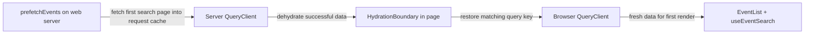

# Hydration (and handing the server's data to the browser)

History: see [CHANGELOG.md](../CHANGELOG.md) or run `pnpm docs:history`

Area: Frontend · Status: ✅ built · Step doc: [22 events SSR](../../22-events-ssr.md)
<!-- interview-card: v2 -->

## 1. What is it?

React hydration connects browser behaviour to HTML already rendered by the server. Query hydration separately restores the server-fetched data into the browser’s cache.

## 2. Why do we need it?

MiniTickets should show the first event page immediately and make it interactive without fetching the same page again. The browser also needs to render the same initial text so React can reuse the HTML.

## 3. How does it work?

1. Create a separate server query cache for the request.
2. Fetch and serialize the first search page.
3. Restore it under the browser hook’s matching key before rendering the interactive list.

## 4. How do we use it in MiniTickets?

Current server prefetch and browser hook both use infinite `events.search` with matching filters, empty initial text and page size. Event dates first use the same UTC text, then switch to the visitor’s timezone.

## 5. Interview-ready answer

“MiniTickets hydrates both UI and query data. The server prepares a first search page in a per-request cache and sends its successful state with the HTML. The browser restores the matching key, so fresh data avoids an immediate duplicate fetch. Stable initial rendering matters too: date text must match before localization.”

## 6. Important follow-up questions

- **What if the query keys differ?** The browser misses the supplied cache entry and starts another request.
- **What if server and browser dates differ?** React can report a hydration mismatch; keep the first render identical.
- **Why avoid a module-level server QueryClient?** It can share data between visitors; use request-scoped state.
- **What if server prefetch fails?** Only successful data is dehydrated by default; the browser can fetch the missing query.

## 7. Advanced details

Technical reference

### Current query handover

`apps/web/src/lib/trpc/server.ts` creates one QueryClient per request using React cache(), with retry:false. A module-level shared QueryClient could leak one visitor's answers to another. The browser has its own mounted-provider QueryClient. The server client makes typed HTTP calls; it does not execute API implementation.

`prefetch-events.ts` now uses prefetchInfiniteQuery on events.search with `{...input,q:"",limit:50}` and getNextPageParam. EventList receives the same filter input, and useEventSearch uses matching infinite-query options with staleTime:30000. The cache shape and key must both match. Only successful queries are dehydrated by default; failed prefetch is logged and browser querying can retry it. HydrationBoundary merges supplied server state without blindly overwriting newer browser data.

### React hydration and dates

React renders client components against the supplied HTML and attaches interaction. A difference in initial text, locale, random IDs or browser-only branching can cause a mismatch and client recovery. EventDate uses useSyncExternalStore with a stable server snapshot so server and first browser render both use en-US UTC text; afterward it renders the visitor's timezone. This can briefly switch displayed text. suppressHydrationWarning would hide a symptom rather than provide this consistent localization flow.

Query-data age uses timestamps, so clock skew can make apparently fresh data stale. Too-short staleTime or a different key/shape can cause an immediate duplicate fetch. Check Network and the console; a test that ignores console errors cannot prove there were no hydration mismatches.

### Historical evidence and choices

Step22 originally prefetched events.list with prefetchQuery/useEvents. Its recorded browser evidence showed auth.me but no duplicate events.list; deliberately removing staleTime produced an extra request to a spare-port test API. That is historical evidence for the same handover principle, not today's catalogue call shape or a newly rerun test. Current search browser coverage checks its own initial-search identity. Service Connect is built; the older “AWS server cannot reach API yet” status is obsolete, while live AWS acceptance remains pending.

The historical fixed date example was Thursday, November 26, 2026 at 6:30 PM UTC, then 12:30 PM in the recorded local timezone. These illustrate matching snapshots, not a current event/time guarantee.

HTML plus dehydrated JSON sends some data twice. A pure server list avoids client-cache payload but loses client refetch/retry interaction. Pending-query dehydration with client Suspense can stream promises with more coordination. Fixed server-only date formatting avoids the timezone switch but is less local.

### Source anchors

- Anchor: `apps/web/src/lib/trpc/server.ts` · `getQueryClient`: one `QueryClient` per request, via React's `cache()`, `retry: false`.
- Anchor: `apps/web/src/features/events/server/prefetch-events.ts` · `prefetchEvents`: current `prefetchInfiniteQuery` for events.search, logs failure and dehydrates success data.
- Anchor: `apps/web/src/app/events/page.tsx` · `EventListWithServerData`: `<HydrationBoundary state={state}><EventList /></HydrationBoundary>`.
- Anchor: `apps/web/src/features/events/hooks/use-events.ts` · `useEvents`: the historical list hook; current catalogue uses useEventSearch with staleTime 30000.
- Anchor: `apps/web/src/features/events/components/event-date.tsx` · `EventDate`: the same date text on server and browser during hydration.
- Anchor: `apps/web/e2e/events.spec.ts` · "the browser makes no events.search request": checks the current search hand-over; earlier list measurements below are historical.

### Related reading

- [22 events SSR](../../22-events-ssr.md)
- [server-to-server-calls](server-to-server-calls.md)
- [server-client-components](server-client-components.md)
- [tanstack-query](tanstack-query.md)
- [csr-vs-ssr](csr-vs-ssr.md)
- [streaming-suspense](streaming-suspense.md)
- [Open this piece in the city explorer](../guides/infra-explorer.html?concept=hydration#chapter=0&piece=laptop-web)
- [App story: 10b. Reading events](../app-story.md#10b-reading-events)

## Where it appears in the story

- [App story: 10b. Reading events](../app-story.md#10b-reading-events)

