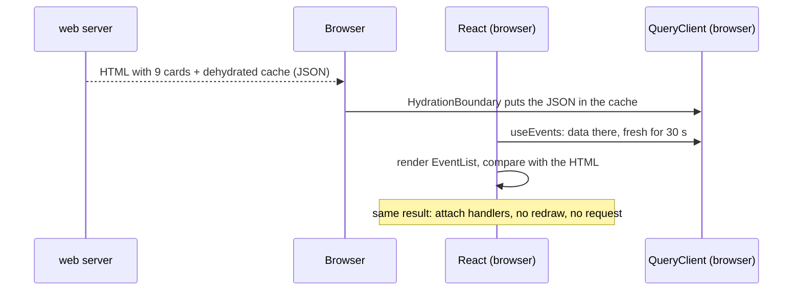

# Hydration (and handing the server's data to the browser)

History: see [CHANGELOG.md](../CHANGELOG.md) or run `pnpm docs:history`

Area: Frontend · Status: ✅ built · Step doc: [22 events SSR](../../22-events-ssr.md)

## 1. In one line

**Hydration** is React, in the browser, taking HTML the server already made and connecting it to
the JavaScript (state, click handlers) without drawing it again; for `/events` we also hand over the
server's **data** (TanStack Query's dehydrate → `HydrationBoundary`), so the browser does not fetch
it a second time.

## 2. Real-life comparison

A flat-pack desk delivered already assembled (the server's HTML). The buyer (the browser) does not
rebuild it; they only plug in the lamp (event handlers). If the delivered desk does not match the
manual (different text on server and browser), the buyer takes it apart and builds it again:
that is a hydration mismatch. The data hand-over is freeze-dried food: the server dries the cache
into JSON (dehydrate), the browser adds water (hydrate).

## 3. Picture it

## 4. Where in our code

- Anchor: `apps/web/src/lib/trpc/server.ts` · `getQueryClient`: one `QueryClient` per request, via React's `cache()`, `retry: false`.
- Anchor: `apps/web/src/features/events/server/prefetch-events.ts` · `prefetchEvents`: `prefetchQuery`, logs a failure, returns `dehydrate(queryClient)`.
- Anchor: `apps/web/src/app/events/page.tsx` · `EventListWithServerData`: `<HydrationBoundary state={state}><EventList /></HydrationBoundary>`.
- Anchor: `apps/web/src/features/events/hooks/use-events.ts` · `useEvents`: `staleTime: 30_000`, so hydrated data is not fetched again.
- Anchor: `apps/web/src/features/events/components/event-date.tsx` · `EventDate`: the same date text on server and browser during hydration.
- Anchor: `apps/web/e2e/events.spec.ts` · "the browser makes no events.list request": proves the hand-over works.

Step by step:

1. `getQueryClient()` returns this request's `QueryClient`. React's `cache()` remembers it for one
   server render only, so two visitors never share a cache.
2. `prefetchEvents` calls `queryClient.prefetchQuery(trpc.events.list.queryOptions())`. The key is
   `[["events","list"],{"type":"query"}]`, the same key `useEvents` uses in the browser.
3. `dehydrate(queryClient)` turns the cache into JSON. By default only **successful** queries are
   included; a failed one is left out, and the browser fetches it itself.
4. `HydrationBoundary` (a Client Component) receives that JSON as a prop. Next.js serialises it into
   the page; in the browser, it writes it into the browser's `QueryClient` before `EventList` renders.
5. `useEvents` finds the data. Because `staleTime` is 30 s, the data counts as fresh, so mounting
   does not trigger a fetch. With TanStack Query's default `staleTime` of 0 it would.
6. React renders `EventList` again in the browser and compares it with the server HTML. Dates are the
   one value that could differ (server timezone vs visitor timezone), so `EventDate` uses
   `useSyncExternalStore(subscribe, () => true, () => false)`: the third function (the "server
   snapshot") is used on the server and during hydration, so both sides render
   `Thursday, November 26, 2026 at 6:30 PM UTC`; right after, the browser re-renders with the
   visitor's timezone (`… at 12:30 PM` on our machine).

## 5. See it yourself

DevTools → Network, reload `/events`: there is a `trpc/auth.me` request but no `events.list`.
`pnpm test:e2e -g "no events.list"` checks the same thing.

`curl -s localhost:3000/events | grep -o '6:30 PM UTC' | head -1` shows the server's fixed date format.

**Break it on purpose:** remove `staleTime` from `useEvents`, rebuild, and run the e2e test above. It
fails with `+ "http://localhost:4110/trpc/events.list?batch=1&input=%7B%7D"` (we did this; the URL
was our test API on port 4110). Or format the date with the visitor's timezone in a Server
Component and open the page with your computer set to another timezone: the console shows a
hydration error.

## 6. How it connects

- **Uses ←** [server-client-components](server-client-components.md) (only Client Components hydrate),
  [tanstack-query](tanstack-query.md) (the cache that is handed over), [server-to-server-calls](server-to-server-calls.md)
  (how the server got the data).
- **Gives →** [csr-vs-ssr](csr-vs-ssr.md): SSR without a second request; [streaming-suspense](streaming-suspense.md):
  the list chunk carries its own part of the cache.

## 7. Our settings and WHY

| Setting | Value | Why |
| ------- | ----- | --- |
| `staleTime` on `useEvents` | 30 s | covers the trip to the browser; after that a remount or tab focus fetches fresh seat counts |
| server `QueryClient` | one per request, `retry: false` | no data shared between visitors; never make a visitor wait for retries |
| dehydrated queries | successful only (TanStack default) | a failed server fetch falls back to the browser fetch |
| date on server + first browser render | `en-US`, UTC, "UTC" appended | identical text on both sides; never wrong, only less local |

## 8. Trade-offs

- **Pros:** content in the first HTML, no duplicate request, interactive without a redraw.
- **Cons:** the data travels twice in one response (as HTML and as JSON for the cache); every value
  must render identically on both sides (dates, random ids, `window` checks); a short flash when the
  date switches from UTC to local time.

## 9. Alternatives and when to choose them

- **Render on the server, no client cache** (pure Server Component list): no JSON copy, but no
  client-side refetch or Retry; good for read-only content.
- **Stream the promise** (dehydrate *pending* queries + `useSuspenseQuery`): the server does not wait
  at all; the browser receives the data when it resolves. More moving parts; needs Suspense in the client.
- **Format dates only on the server** with a fixed timezone (no switch): simpler, but not local.

## 10. What breaks, and how we'd notice

- **Mismatch** (server and browser render different text): React logs a hydration error and redraws
  that part on the client. Seen in the browser console; not seen by our e2e tests unless we check the console.
- **Duplicate fetch** (`staleTime` too short, different query keys): an extra `events.list` request;
  the e2e test fails.
- **Clock skew:** the data's age is computed from the server's clock. A browser clock more than 30 s
  ahead would treat the data as stale and fetch once. Not observed; worth knowing.
- **Shared server cache** (`new QueryClient()` at module level): one visitor's data served to the
  next. Not visible in tests with public data; a serious leak with private data.

## 13. Interview answers at 3 levels

- **Simple:** The server sends a finished page; React in the browser just wires it up instead of
  rebuilding it, and reuses the data the server already fetched.
- **Senior:** We prefetch `events.list` into a per-request QueryClient, dehydrate it, and pass it
  through `HydrationBoundary`. The client hook uses the same key and a 30 s `staleTime`, so there is
  no refetch on mount (an e2e test proves it). Dates render a fixed UTC string during hydration via
  `useSyncExternalStore`, then switch to local time, so there is no mismatch.
- **Lead:** Hydration couples server and client output: anything environment-dependent (time,
  locale, randomness, auth) has to be identical or deferred. I'd make "no hydration errors in the
  console" part of e2e, keep server caches strictly per request, and watch the payload: HTML + JSON
  doubles the bytes for big lists.

## 14. Follow-up questions interviewers ask

- *Why not just `suppressHydrationWarning` on the date?* It hides the warning but keeps the server's
  text, so visitors would see the server's timezone.
- *Does `HydrationBoundary` overwrite newer browser data?* No: TanStack only writes the server's data
  if it is newer than what the browser cache already has.
- *Why `cache()` and not a module-level variable?* A module-level value lives as long as the server
  process, across all visitors.

## 15. Say it in 30 seconds

"The server prefetches events into a per-request TanStack cache, dehydrates it, and HydrationBoundary
restores it in the browser. Same query key, 30-second staleTime, so the browser makes no second call;
an e2e test proves it. Dates render in UTC on both sides during hydration and switch to local time
right after, so React never sees a mismatch."

## 16. Status

✅ built (verified locally on a production build; on AWS the server cannot reach the API yet, see
[server-to-server-calls](server-to-server-calls.md)).

## Where it appears in the story

- [App story: 10b. Reading events](../app-story.md#10b-reading-events)
