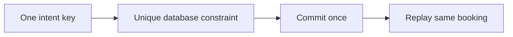

# Idempotency

History: see [CHANGELOG.md](../CHANGELOG.md) or run `pnpm docs:history`

Area: API · Status: ✅ built in repository; live AWS acceptance is separate

## 1. In one line

Booking idempotency stores one successful user/UUID intent in the same transaction as seats and outbox. Same payload replays; changed payload conflicts. Signup has no stored-response contract; worker dedup uses business booking identity.

## 2. Real-life comparison

Two clerks cannot promise the same last seat: one holds the ledger until the reservation is recorded.

## 3. Picture it

## 4. Where in our code

- Anchor: `apps/api/src/db/migrate.ts` — `module configuration`; follow the numbered comments at this boundary.
- Anchor: `apps/api/src/db/seed.ts` — `inserted`; follow the numbered comments at this boundary.
- Anchor: `apps/api/src/procedures/auth.ts` — `module configuration`; follow the numbered comments at this boundary.
- Anchor: `apps/api/src/queries/bookings.ts` — `isPgConstraintError`; follow the numbered comments at this boundary.
- Anchor: `apps/api/src/services/auth.ts` — `logout`; follow the numbered comments at this boundary.
- Anchor: `apps/worker/src/handlers/booking-confirmed.ts` — `handleBookingConfirmed`; follow the numbered comments at this boundary.
- Anchor: `infra/src/jobs/processed-jobs-table.ts` — `createProcessedJobsTable`; follow the numbered comments at this boundary.

`apps/api/src/db/schema/bookings.ts` enforces unique user/idempotency key. `apps/api/src/services/bookings.ts` compares event and quantity on replay; `queries/bookings.ts` handles races across different event rows. `pnpm demo:idempotency` exercises lost responses and concurrent duplicates.

## 5. See it yourself

Run `pnpm demo:idempotency` and inspect the asserted outcome described above.

Failure thought experiment: Why scope by user? Two users may coincidentally submit the same client key without sharing a booking. Do not change a live stack to demonstrate it.

## 6. How it connects

Uses the [current system](../00-big-picture.md); gives a concrete decision to the [scenario](../guides/interview-scenarios.md#idempotency) and [explorer tour](../guides/infra-explorer.html?tour=booking).

## 7. Our settings and WHY

Booking idempotency stores one successful user/UUID intent in the same transaction as seats and outbox. Same payload replays; changed payload conflicts. Signup has no stored-response contract; worker dedup uses business booking identity. A network failure cannot tell a caller whether commit happened.

## 8. Trade-offs

Redis TTL keys add a cross-store gap and can expire/evict. A generic response store can replay exact response bodies but adds retention rules. This app reconstructs successful responses and keeps keys with bookings.

## 9. Alternatives and when to choose them

10x: index/storage retention policy. 100x: explicit idempotency contract for payment providers and async intents.

## 10. What breaks and how we notice

Why scope by user? Two users may coincidentally submit the same client key without sharing a booking.

## 13. Interview answers at 3 levels

- **Simple:** Booking idempotency stores one successful user/UUID intent in the same transaction as seats and outbox.
- **Senior:** A retry repeats one intent rather than making another purchase. The browser creates one UUID per intent and keeps it for ambiguous retries. A unique user/key constraint stores identity with the booking transaction. Same input replays the booking; different input with the same key conflicts. Failed transactions store no success.
- **Lead:** 10x: index/storage retention policy. 100x: explicit idempotency contract for payment providers and async intents.

## 14. Follow-up questions with answers

Why scope by user? Two users may coincidentally submit the same client key without sharing a booking.

What should an ambiguous retry keep? **The same idempotency key.**

## 15. Say it in 30 seconds

A retry repeats one intent rather than making another purchase. The browser creates one UUID per intent and keeps it for ambiguous retries. A unique user/key constraint stores identity with the booking transaction. Same input replays the booking; different input with the same key conflicts. Failed transactions store no success.

## 16. Status and production work

Repository implementation and local evidence are described above. Live AWS/CI execution remains owner acceptance. 10x: index/storage retention policy. 100x: explicit idempotency contract for payment providers and async intents.

## Where it appears in the story

- [app-story: 9b. A booking reaches its transaction](../app-story.md#9b-a-booking-reaches-its-transaction)
