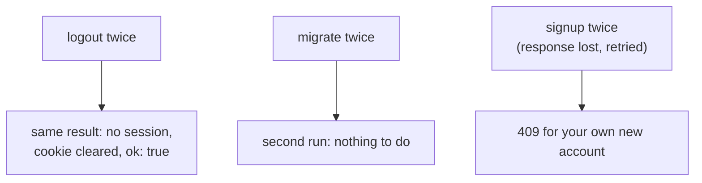

# Idempotency

History: see [CHANGELOG.md](../CHANGELOG.md) or run `pnpm docs:history`

Area: API · Status: 🟡 partial (logout and migrations are idempotent; signup has no idempotency key) · Step doc: [08 logout](../../08-logout.md)

## 1. In one line

An operation is **idempotent** when doing it twice has the same effect as doing it once; that is
what makes retrying it safe.

## 2. Real-life comparison

Pressing a lift button twice still calls one lift (idempotent). Paying at a till twice charges you
twice (not idempotent), so the till must recognise "this is the same payment".

## 3. Picture it



## 4. Where in our code

- Anchor: `apps/api/src/services/auth.ts` · `logout`: no session id → return; otherwise delete (deleting a missing key is not an error).
- Anchor: `apps/api/src/procedures/auth.ts` · `logout`: always clears the cookie and returns `{ ok: true }`.
- Anchor: `apps/api/src/db/migrate.ts` · `migrate(...)`: Drizzle records finished migrations, so a second run applies nothing.
- Anchor: `apps/api/src/db/seed.ts` · `onConflictDoNothing()`: fixed ids plus "on conflict do nothing", so running the seed twice adds nothing (see [seed-data](seed-data.md)).
- Anchor: `infra/src/jobs/processed-jobs-table.ts` · `createProcessedJobsTable`: the DynamoDB table behind the worker's idempotent consumer on AWS (`hashKey: "jobKey"`, TTL `expiresAt`) (S1c).

Step by step:

1. **Logout:** `redis.del(key)` on a key that is gone is fine; the procedure always answers
   `{ ok: true }` and `Set-Cookie: sid=; Max-Age=0`. Calling it 1 or 10 times leaves the same state.
2. **Migrations:** each SQL file runs once; its record in the database makes reruns no-ops. This
   matters because `pnpm infra:migrate` may be run again after a failure.
3. **Reads** (`auth.me`, `account.profile`, `/health`, `/ready`) change nothing, so they are
   idempotent by nature.
4. **Signup is not:** a second identical call hits the unique email and gets 409. That is why
   mutations never retry in the browser ([retry-policy](retry-policy.md)).
5. **Login is not strictly:** each call creates a new session in Redis (harmless, but two sessions).

## 5. See it yourself

Recorded against a local api: logout twice with the same cookie, both `200`,
`{"result":{"data":{"ok":true}}}` and `set-cookie: sid=; Max-Age=0; …`. Afterwards the old cookie
gets `auth.me` → `null`.

```bash
for i in 1 2; do curl -s -b "sid=$SID" -X POST localhost:4000/trpc/auth.logout \
  -H 'content-type: application/json'; echo; done
```

**Break it on purpose:** make `logout` throw `NotFoundError` when the session is already gone. The
second click (or a double-click) now shows an error for something that succeeded.

## 6. How it connects

- **Uses ←** [sessions-vs-jwt](sessions-vs-jwt.md) (server-side sessions can be deleted),
  [migrations](migrations.md).
- **Gives →** safe retries; the reason mutations don't retry ([retry-policy](retry-policy.md)).

## 7. Our settings and WHY

Make naturally idempotent operations actually idempotent (logout, migrations); never auto-retry the
rest. WHY: simplest safe rule without idempotency keys.

## 8. Trade-offs

- **Pros:** double clicks and retries of logout are harmless; reruns of migrations are safe.
- **Cons:** a lost signup response leaves the user unsure; they see 409 if they try again.

## 9. Alternatives and when to choose them

- **Idempotency keys:** the client sends a unique key per action; the server stores
  key → response and replays it on a retry (payments, orders). Needs a store with TTL (Redis fits).
- **Natural keys / upserts:** "create if not exists" when the data has a natural identity.
- **PUT instead of POST:** a full replace is idempotent by design.

## 10. What breaks, and how we'd notice

- A retried non-idempotent mutation: duplicate side effects (two orders, two emails). Not possible
  today for signup thanks to the unique constraint, but future tickets could duplicate.

## 13. Interview answers at 3 levels

- **Simple:** Doing it twice is the same as doing it once, so it's safe to repeat.
- **Senior:** Logout is idempotent (delete a missing key is fine, always `ok: true`, cookie always
  cleared) and migrations are recorded so reruns are no-ops. Signup isn't: a retry hits the unique
  email, so the client never retries mutations. We don't have idempotency keys yet.
- **Lead:** Retries happen everywhere (browsers, proxies, queues), so any write that can be retried
  needs idempotency by design. For tickets or payments I'd add idempotency keys stored in Redis with
  a TTL, returning the first response on replay.

## 14. Follow-up questions interviewers ask

- *Is POST idempotent?* Not by definition; you make it so with keys.
- *Idempotent vs safe?* Safe: no side effects (GET). Idempotent: same effect once or many times
  (DELETE).

## 15. Say it in 30 seconds

"Logout and migrations are idempotent: logout always clears the cookie and deleting a missing
session is fine; migrations record what ran. Signup isn't, so the client never retries mutations.
For things like payments I'd add idempotency keys stored in Redis."

## 16. Status

🟡 partial. **To make it production-grade:** idempotency keys for create operations (tickets),
stored with a TTL; return the original response on replay.

## Where it appears in the story

- [App story: 7. The procedure](../app-story.md#7-the-procedure)
