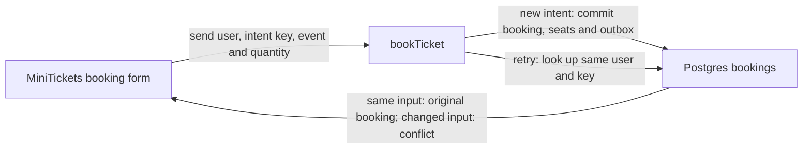

# Idempotency keys: the ticket office receipt number

History: see [CHANGELOG.md](../CHANGELOG.md) or run `pnpm docs:history`

Area: API · Status: ✅ built in repository; live AWS acceptance is separate

<!-- interview-card: v2 -->

## 1. What is it?

An idempotency key is a receipt number for one action. Sending the same booking request again with that number returns the original result instead of buying twice.

## 2. Why do we need it?

A buyer clicks Book, but their connection drops before the reply arrives. They cannot know whether the purchase succeeded. Retrying should recover that purchase safely.

## 3. How does it work?

1. Create one key for the buyer’s intended purchase.
2. Save it together with a successful booking.
3. Reuse it after an uncertain result; use a new key for a different purchase.

## 4. How do we use it in MiniTickets?

`bookTicket` compares event and quantity when replaying a saved booking. A database rule permits only one booking per user/key, including simultaneous requests. Failed transactions store no successful result. This booking protection does not replace duplicate handling in workers.

## 5. Interview-ready answer

“MiniTickets gives each booking intent one random key. The database saves it with the booking and seat change, so a lost response can be retried safely. The same user, key and input return the original booking; changed input conflicts. A database uniqueness rule handles concurrent retries. The caller must keep the original key while the outcome is uncertain.”

## 6. Important follow-up questions

- **Why scope keys to a user?** Two users may choose the same key without sharing bookings or exposing results.
- **What if two retries arrive together?** The database uniqueness rule selects one successful booking; the other reads that result.
- **Why not store keys only in Redis?** Expiry, eviction and a separate database commit can leave gaps.
- **Does this guarantee one email?** No. Asynchronous consumers need their own protection against duplicates.

## 7. Advanced details

Technical reference

### Booking contract and implementation

The [idempotency key](../glossary.md#idempotency-key) is a client UUID. `apps/api/src/services/bookings.ts` → `bookTicket` calls `createGatedBooking` for an admitted new booking. `apps/api/src/queries/bookings.ts` → `createBookingTx` locks the event and saves seats, booking, key and outbox in one transaction.

`apps/api/src/db/schema/bookings.ts` enforces `UNIQUE (user_id, idempotency_key)`. PostgreSQL `23505` race handling also covers requests locking different event rows. Same user/key/event/quantity reconstructs the successful booking; reusing the key for different event/quantity returns **409**. A failed transaction saves no success. Keys remain with bookings; there is no generic exact-response store. Signup has no stored-response contract; worker deduplication uses business booking identity.

Network failure cannot tell the caller whether commit happened. Reuse the original key for ambiguous retries; mint a new key for a changed intent. Investigate apparent duplicates by checking client input/key lifetime, and 409s by comparing event and quantity. [Sessions](sessions-vs-jwt.md) establish ownership, [row locks](row-locks.md) protect seat changes, and the [outbox](outbox.md) preserves confirmation work.

### Reach and inspection

Browser sends `POST /trpc/bookings.create` with verified `sid` and UUID. API reaches RDS on TCP 5432: `minitickets-dev-db-sg` admits `minitickets-dev-api-sg`. Database credentials arrive through execution-role secret injection; the authenticated user owns the key.

RDS → Databases → `minitickets-dev-db` → Connectivity & security shows endpoint/network. No AWS screen lists booking keys; inspect `bookings` through authorized SQL. Session health is under ElastiCache → Valkey.

### Verification, alternatives and growth

`pnpm demo:idempotency` exercises lost responses and concurrent duplicates locally; no new execution or live AWS/CI acceptance is claimed here. Redis TTL keys can expire/evict and introduce a cross-store gap. A stored-response table supports exact replay across many endpoints but needs retention rules. Payment providers require their own explicit idempotency contract.

At 10x, review index/storage retention; at 100x, define contracts for payments and asynchronous intents. Read the [current system](../00-big-picture.md), [idempotency scenario](../guides/interview-scenarios.md#idempotency) and [booking explorer tour](../guides/infra-explorer.html?tour=booking).

### Code anchors

- Anchor: `apps/api/src/db/migrate.ts` — `module configuration`; follow the numbered comments at this boundary.
- Anchor: `apps/api/src/db/seed.ts` — `inserted`; follow the numbered comments at this boundary.
- Anchor: `apps/api/src/procedures/auth.ts` — `module configuration`; follow the numbered comments at this boundary.
- Anchor: `apps/api/src/queries/bookings.ts` — `isPgConstraintError`; follow the numbered comments at this boundary.
- Anchor: `apps/api/src/services/auth.ts` — `logout`; follow the numbered comments at this boundary.
- Anchor: `apps/worker/src/handlers/booking-confirmed.ts` — `handleBookingConfirmed`; follow the numbered comments at this boundary.
- Anchor: `infra/src/jobs/processed-jobs-table.ts` — `createProcessedJobsTable`; follow the numbered comments at this boundary.

[Open this piece in the city explorer](../guides/infra-explorer.html?concept=idempotency#chapter=24&piece=code-store).

## Where it appears in the story

- [app-story: 9b. A booking reaches its transaction](../app-story.md#9b-a-booking-reaches-its-transaction)

