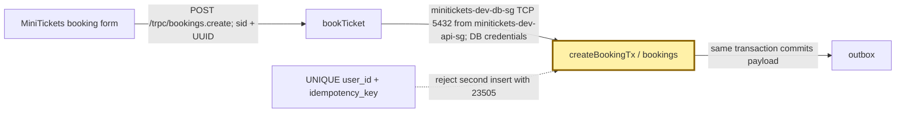
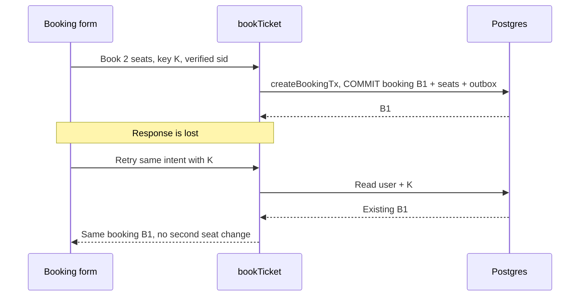

# Idempotency keys: the ticket office receipt number

History: see [CHANGELOG.md](../CHANGELOG.md) or run `pnpm docs:history`

Area: API · Status: ✅ built in repository; live AWS acceptance is separate

<!-- interview-card: v1 -->

## 1. In one line

MiniTickets remembers one [idempotency key](../glossary.md#idempotency-key)—a receipt number for one booking attempt—so a retry cannot buy twice.

## 2. Where it sits

[Open this piece in the city explorer](../guides/infra-explorer.html?concept=idempotency#chapter=24&piece=code-store).

## 3. How it works

## 4. What happens in MiniTickets

1. The browser makes one UUID (a random identifier) for a booking intent.
2. For an admitted new booking, `bookTicket` calls `createGatedBooking`; Postgres locks the event row.
3. `createBookingTx` saves seats, booking, key and outbox together.
4. A retry with the same user, key, event and quantity returns the saved booking. Changed input gets **409**.
5. A failed transaction saves no success. Retry an uncertain result with the **same** key.

## 5. Reach / Allowed / Password

**Reach:** API → RDS :5432; db guard admits minitickets-dev-api-sg.

**Allowed:** verified session chooses user; Postgres unique constraint chooses one winner.

**Password:** RDS credentials from the execution role’s secret injection.

## 6. In our code

`apps/api/src/queries/bookings.ts` → `createBookingTx`

`apps/api/src/services/bookings.ts` → `bookTicket`

## 7. In the AWS console

RDS → Databases → `minitickets-dev-db` → Connectivity & security: endpoint and guard. The AWS console does not show booking keys; inspect `bookings` through an authorized SQL connection.

## 8. Good / Bad

**Good:** retries survive API restarts; seats and identity commit together.

**Bad:** keys stay with bookings; every new intent needs a new key.

## 9. Other choices

- Pick a stored-response table when many endpoints need exact response replay.
- Pick a provider’s key when charging through a payment API.

## 10. Connected to

| Neighbor | Direction | What allows it | Console check |
| --- | --- | --- | --- |
| [Sessions](sessions-vs-jwt.md) | → key owner | verified `sid` | ElastiCache → Valkey |
| [Row locks](row-locks.md) | → seat write | `FOR UPDATE` | RDS → database |
| [Outbox](outbox.md) | → confirmation | same SQL transaction | RDS → database |

## 11. When it breaks

- Duplicate bookings → browser request input → reuse the original key after a lost response.
- 409 on a changed order → compare event/quantity → make a new key for the new intent.

## 12. Say it in 30 seconds

“MiniTickets gives each booking intent one random key. Postgres saves it with the booking and seat change. Retrying the same input returns the original booking. Reusing that key for different input gets 409. A database unique constraint handles simultaneous retries, including requests for different events.”

## 13. Likely follow-ups

- **Why per user?** Another user’s matching key must never expose your booking.
- **Does it prevent every duplicate email?** No. Workers need their own duplicate handling.

## 14. Remember it

Keep the receipt number when asking whether the first purchase worked.

## 15. More detail

Source notes, earlier detail and code anchors

Booking idempotency stores one successful user/UUID intent in the same transaction as seats and outbox. Same payload replays; changed payload conflicts. Signup has no stored-response contract; worker dedup uses business booking identity.

### Earlier card: 2. Real-life comparison

Two clerks cannot promise the same last seat: one holds the ledger until the reservation is recorded.

### Earlier card: 3. Picture it

### Earlier card: 4. Where in our code

- Anchor: `apps/api/src/db/migrate.ts` — `module configuration`; follow the numbered comments at this boundary.
- Anchor: `apps/api/src/db/seed.ts` — `inserted`; follow the numbered comments at this boundary.
- Anchor: `apps/api/src/procedures/auth.ts` — `module configuration`; follow the numbered comments at this boundary.
- Anchor: `apps/api/src/queries/bookings.ts` — `isPgConstraintError`; follow the numbered comments at this boundary.
- Anchor: `apps/api/src/services/auth.ts` — `logout`; follow the numbered comments at this boundary.
- Anchor: `apps/worker/src/handlers/booking-confirmed.ts` — `handleBookingConfirmed`; follow the numbered comments at this boundary.
- Anchor: `infra/src/jobs/processed-jobs-table.ts` — `createProcessedJobsTable`; follow the numbered comments at this boundary.

`apps/api/src/db/schema/bookings.ts` enforces unique user/idempotency key. `apps/api/src/services/bookings.ts` compares event and quantity on replay; `queries/bookings.ts` handles races across different event rows. `pnpm demo:idempotency` exercises lost responses and concurrent duplicates.

### Earlier card: 5. See it yourself

Run `pnpm demo:idempotency` and inspect the asserted outcome described above.

Failure thought experiment: Why scope by user? Two users may coincidentally submit the same client key without sharing a booking. Do not change a live stack to demonstrate it.

### Earlier card: 6. How it connects

Uses the [current system](../00-big-picture.md); gives a concrete decision to the [scenario](../guides/interview-scenarios.md#idempotency) and [explorer tour](../guides/infra-explorer.html?tour=booking).

### Earlier card: 7. Our settings and WHY

Booking idempotency stores one successful user/UUID intent in the same transaction as seats and outbox. Same payload replays; changed payload conflicts. Signup has no stored-response contract; worker dedup uses business booking identity. A network failure cannot tell a caller whether commit happened.

### Earlier card: 8. Trade-offs

Redis TTL keys add a cross-store gap and can expire/evict. A generic response store can replay exact response bodies but adds retention rules. This app reconstructs successful responses and keeps keys with bookings.

### Earlier card: 9. Alternatives and when to choose them

10x: index/storage retention policy. 100x: explicit idempotency contract for payment providers and async intents.

### Earlier card: 10. What breaks and how we notice

Why scope by user? Two users may coincidentally submit the same client key without sharing a booking.

### Earlier card: 13. Interview answers at 3 levels

- **Simple:** Booking idempotency stores one successful user/UUID intent in the same transaction as seats and outbox.
- **Senior:** A retry repeats one intent rather than making another purchase. The browser creates one UUID per intent and keeps it for ambiguous retries. A unique user/key constraint stores identity with the booking transaction. Same input replays the booking; different input with the same key conflicts. Failed transactions store no success.
- **Lead:** 10x: index/storage retention policy. 100x: explicit idempotency contract for payment providers and async intents.

### Earlier card: 14. Follow-up questions with answers

Why scope by user? Two users may coincidentally submit the same client key without sharing a booking.

What should an ambiguous retry keep? **The same idempotency key.**

### Earlier card: 15. Say it in 30 seconds

A retry repeats one intent rather than making another purchase. The browser creates one UUID per intent and keeps it for ambiguous retries. A unique user/key constraint stores identity with the booking transaction. Same input replays the booking; different input with the same key conflicts. Failed transactions store no success.

### Earlier card: 16. Status and production work

Repository implementation and local evidence are described above. Live AWS/CI execution remains owner acceptance. 10x: index/storage retention policy. 100x: explicit idempotency contract for payment providers and async intents.

## Where it appears in the story

- [app-story: 9b. A booking reaches its transaction](../app-story.md#9b-a-booking-reaches-its-transaction)
