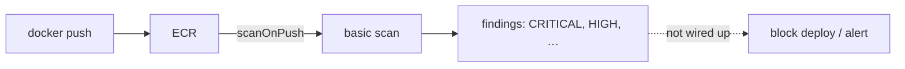

# Image vulnerability scanning

History: see [CHANGELOG.md](../CHANGELOG.md) or run `pnpm docs:history`

Area: DevOps & CI/CD · Status: 🟡 partial (scans run, nobody reads them automatically) · Step doc: [16 ECR](../../16-infra-ecr.md) (section 3c)

## 1. In one line

**Image scanning** checks the packages inside an image against lists of known vulnerabilities (CVEs);
ECR runs a basic scan on every push, but nothing in our pipeline reads or acts on the results.

## 2. Real-life comparison

A food inspector checks every delivery and writes a report. If nobody reads the report, the bad
batch still goes on the shelf.

## 3. Picture it



## 4. Where in our code

- Anchor: `infra/src/registry.ts` · `imageScanningConfiguration: { scanOnPush: true }`.

Step by step:

1. Every image pushed by `pnpm images:push` is scanned by ECR's basic scanning.
2. Basic scanning looks at **operating system packages only** (the Debian packages inside
   `node:24.13.0-slim`). It does **not** look at our npm packages (`fastify`, `next`, `pg`, …).
   **Verified from AWS docs:** the basic scanning page is titled "Scan images for OS vulnerabilities"
   and describes "vulnerability detection across a broad set of popular operating systems"; the
   enhanced scanning page is the one that adds "programming language package vulnerabilities"
   ([basic](https://docs.aws.amazon.com/AmazonECR/latest/userguide/image-scanning-basic.html),
   [enhanced](https://docs.aws.amazon.com/AmazonECR/latest/userguide/image-scanning-enhanced.html)).
3. It scans once, at push. **Verified from AWS docs:** basic scanning is "scan on push" or manual,
   and an image can be scanned at most once per 24 hours. A CVE published next week is not found
   in an image we pushed today unless we scan it again.
4. Findings are visible in the console and through the CLI.
5. Nothing reads them automatically: no CI gate, no alert.

So today **nobody scans our npm dependencies at all**: not ECR, not CI. The biggest part of our
code that we did not write is unchecked.

## 5. See it yourself

```bash
cd infra
aws ecr describe-image-scan-findings --profile ticketlite --repository-name minitickets-dev-api \
  --image-id imageTag=$(pulumi config get apiImageTag) --query "imageScanFindings.findingSeverityCounts"
```

## 6. How it connects

- **Uses ←** [ECR](ecr.md).
- **Gives →** input for a future CD gate (planned card `continuous-deployment`, Phase 5).

## 7. Our settings and WHY

Basic scan on push: free and zero effort. Slim base images and production-only dependencies keep the
attack surface small (Phase 3 `container-hardening`).

## 8. Trade-offs

- **Pros:** free visibility.
- **Cons:** only at push time (new CVEs found later are not rescanned with basic scanning); only OS
  packages, not npm dependencies (verified from AWS docs, see section 4); no enforcement.

## 9. Alternatives and when to choose them

- **ECR enhanced scanning (Amazon Inspector):** OS **and** programming language packages (npm
  included), continuous rescans; paid per scan through Inspector (verified from AWS docs: "scanned
  for both operating systems and programming language package vulnerabilities"; "automatic,
  continuous scanning").
- **Trivy / Grype in CI:** fail the build on CRITICAL findings.
- **`pnpm audit` / Dependabot:** npm dependency vulnerabilities in the repo.

## 10. What breaks, and how we'd notice

Nothing breaks, which is the problem: a vulnerable image deploys silently.

## 11. Reach / Allowed / Password

Not a connection.

## 12. Cost

Basic scanning is free.

## 13. Interview answers at 3 levels

- **Simple:** AWS checks our images for known security bugs when we push them.
- **Senior:** `scanOnPush` runs ECR's basic scan, which covers OS packages only, once, at push. Our
  npm dependencies are not scanned by anything today, and nothing gates on the results.
- **Lead:** Scanning without a policy is theatre. I'd add a CI scan that fails on critical findings with
  an exception process, continuous rescans of running images, and Dependabot for npm packages.

## 14. Follow-up questions interviewers ask

- *Basic vs enhanced scanning?* Basic: OS packages, on push or manual. Enhanced (Inspector): OS +
  language packages (npm), continuous rescans, paid.
- *Does basic scanning catch a vulnerable npm package?* No. That needs enhanced scanning, Trivy (or
  similar) in CI, or `pnpm audit` / Dependabot on the repo.
- *What do you do with a critical CVE?* Rebuild on a patched base or bump the package, redeploy, verify.

## 15. Say it in 30 seconds

"ECR's basic scan checks the OS packages of every pushed image, once, at push. It doesn't look at our
npm dependencies, and we don't act on the results yet. The production version adds dependency
scanning, Inspector enhanced scanning or Trivy in CI, and fails the build on critical findings."

## 16. Status

🟡 partial. **To make it production-grade:**

1. **Dependency scanning** for npm packages, because basic scanning skips them. Either turn on ECR
   **enhanced scanning** (Amazon Inspector: OS + language packages, continuous rescans, paid), or run
   **Trivy** (or Grype) in the CI `docker` job against the built image.
2. A **CI gate**: fail the build on CRITICAL findings, with a written exception process.
3. **Dependency updates**: Dependabot or Renovate, so fixes arrive as pull requests.

## Where it appears in the story

- [Infra story: 12. ECR](../infra-story.md#12-ecr)
