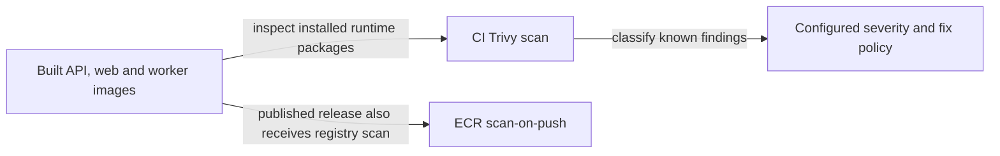

# Image vulnerability scanning

History: see [CHANGELOG.md](../CHANGELOG.md) or run `pnpm docs:history`

Area: DevOps & CI/CD · Status: ✅ built in repository; live AWS acceptance is separate
<!-- interview-card: v2 -->

## 1. What is it?

Image scanning checks container software against known vulnerability information. A policy then decides which findings block delivery; a passing scan is not proof that the application is safe.

## 2. Why do we need it?

MiniTickets can inherit a vulnerable operating-system package even when its own code is unchanged. Scanning the complete runtime image reveals issues that checking JavaScript dependencies alone can miss.

## 3. How does it work?

1. Scan the actual runtime artifacts and dependencies.
2. Apply the documented blocking policy and dated exceptions.
3. Review residual findings and rebuild when fixes become available.

## 4. How do we use it in MiniTickets?

CI scans three images; ECR scanning is a separate check. Prior recorded local evidence shows patched ARM64/AMD64 images passing the configured gates. Those checks were not rerun for this rewrite, and neither result proves live AWS acceptance.

## 5. Interview-ready answer

“MiniTickets scans runtime images and dependencies because vulnerable code can enter through both. Our image gate blocks configured critical findings with available fixes, and dated exceptions are reviewed separately. A green gate still leaves residual risk, so I record what was filtered or unresolved and distinguish local evidence from pipeline or production verification.”

## 6. Important follow-up questions

- **Why scan the runtime image?** It includes OS packages that a JavaScript dependency audit does not inspect.
- **Does no critical finding mean no vulnerability?** No. Severity policy and scanner knowledge are limited.
- **What about an unfixed critical?** Our current filter excludes it from the gate; track the risk and revisit fixes.
- **Do ECR and CI scans replace each other?** No. They run at different boundaries and must be interpreted under their own policies.

## 7. Advanced details

Technical reference

### Source anchors

- Anchor: `.github/workflows/ci.yml` — `module configuration`; follow the numbered comments at this boundary.
- Anchor: `infra/src/registry.ts` — `repo`; follow the numbered comments at this boundary.

### Pipeline and residual risk

`.github/workflows/ci.yml` runs Trivy CRITICAL/exit-1 scans for API, web and worker with `ignore-unfixed: true`. The dependency audit is a separate critical-threshold gate. `infra/src/registry.ts` enables basic ECR scan-on-push; its result is separate from CI's policy and timing.

`.trivyignore` records only CVE-2023-45853, the Debian contrib/minizip code absent from the shipped binary packages, expiring 2026-11-14. The general no-fix filter is independent of that dated exception. Do not interpret passing as zero findings. Review exceptions by scope and expiry; an expired exception must not silently become permanent.

API/web runtime is Node 24.22.0-bookworm-slim with Debian perl-base security update and package managers removed. Build stages and .nvmrc remain 24.13.0. The scoped esbuild override removes the earlier moderate loader finding. High braces has no published fix in the recorded evidence.

### Recorded verification, not rerun here

PENDING records all six ARM64/AMD64 builds succeeding; raw critical counts API/web 7→1 and worker 0→0, with only unfixed zlib remaining. All configured gates returned 0. Old API remained a failing control with six fixable criticals; expiry/filter probes distinguished the dated ignore from ignore-unfixed. Prior dependency audit had one high braces, zero moderate/critical. These measurements were not repeated for this documentation edit. GitHub execution and live AWS acceptance remain separate.

### Review and diagnosis

Inspect the scanner finding, affected installed package, fix availability, runtime image architecture and exact policy. Scan actual final images rather than only build stages. Dependency scanners, image scanners and application review cover different risks. At scale add provenance, tracked exceptions and attack-surface reviews; scanners cannot establish business authorization or prove absence of unknown vulnerabilities.

Separate browser controls remain: proxy.ts supplies fresh script nonces/no-store HTML, security-policy.ts forbids production unsafe-eval, and the client disables optional Zod JIT. pnpm demo:security covers browser policy locally, not image scanning. Those controls remain relevant defense in depth, but do not substitute for the image gates.

### Preserved references

- [current system](../00-big-picture.md)
- [scenario](../guides/interview-scenarios.md#csp-xss)
- [explorer tour](../guides/infra-explorer.html?tour=security-layers)

[Open this piece in the city explorer](../guides/infra-explorer.html?concept=image-scanning#chapter=7&piece=ecr).

## Where it appears in the story

- [app-story: 4b. Mutation admission and browser security](../app-story.md#4b-mutation-admission-and-browser-security)

