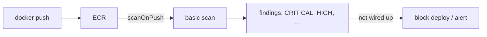

# Image vulnerability scanning

Area: DevOps & CI/CD · Status: 🟡 partial (scans run, nobody reads them automatically) · Step doc: [16 ECR](../../16-infra-ecr.md) (section 3c)

## 1. In one line

**Image scanning** checks the packages inside an image against lists of known vulnerabilities (CVEs);
ECR runs a basic scan on every push, but nothing in our pipeline reads or acts on the results.

## 2. Real-life comparison

A food inspector checks every delivery and writes a report. If nobody reads the report, the bad
batch still goes on the shelf.

## 3. Picture it



## 4. Where in our code

- Anchor: `infra/src/registry.ts` · `imageScanningConfiguration: { scanOnPush: true }`.

Step by step:

1. Every image pushed by `pnpm images:push` is scanned by ECR's basic scanning.
2. Findings are visible in the console and through the CLI.
3. Nothing reads them automatically: no CI gate, no alert.

## 5. See it yourself

```bash
cd infra
aws ecr describe-image-scan-findings --profile ticketlite --repository-name minitickets-dev-api \
  --image-id imageTag=$(pulumi config get apiImageTag) --query "imageScanFindings.findingSeverityCounts"
```

## 6. How it connects

- **Uses ←** [ECR](ecr.md).
- **Gives →** input for a future CD gate (planned card `continuous-deployment`, Phase 5).

## 7. Our settings and WHY

Basic scan on push: free and zero effort. Slim base images and production-only dependencies keep the
attack surface small (Phase 3 `container-hardening`).

## 8. Trade-offs

- **Pros:** free visibility.
- **Cons:** only at push time (new CVEs found later are not rescanned with basic scanning); only OS
  packages in basic mode, as far as I know (not npm dependencies; not verified); no enforcement.

## 9. Alternatives and when to choose them

- **ECR enhanced scanning (Amazon Inspector):** continuous rescans, language packages; paid.
- **Trivy / Grype in CI:** fail the build on CRITICAL findings.
- **`pnpm audit` / Dependabot:** npm dependency vulnerabilities in the repo.

## 10. What breaks, and how we'd notice

Nothing breaks, which is the problem: a vulnerable image deploys silently.

## 11. Reach / Allowed / Password

Not a connection.

## 12. Cost

Basic scanning is free.

## 13. Interview answers at 3 levels

- **Simple:** AWS checks our images for known security bugs when we push them.
- **Senior:** `scanOnPush` runs ECR's basic scan; results are in ECR but nothing gates on them yet.
- **Lead:** Scanning without a policy is theatre. I'd add a CI scan that fails on critical findings with
  an exception process, continuous rescans of running images, and Dependabot for npm packages.

## 14. Follow-up questions interviewers ask

- *Basic vs enhanced scanning?* On-push OS-package scan vs continuous Inspector scans incl. language packages.
- *What do you do with a critical CVE?* Rebuild on a patched base or bump the package, redeploy, verify.

## 15. Say it in 30 seconds

"ECR scans every pushed image for known vulnerabilities, but we don't act on the results yet. The
production version is a CI scan that fails on critical findings, plus continuous rescans and
dependency updates."

## 16. Status

🟡 partial. **To make it production-grade:** a CI gate, enhanced scanning, dependency updates.
