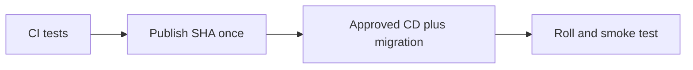

# Immutable image tags (git SHA)

History: see [CHANGELOG.md](../CHANGELOG.md) or run `pnpm docs:history`

Area: DevOps & CI/CD · Status: ✅ built in repository; live acceptance is separate

## 1. In one line

One immutable SHA names the api/web/worker images built by publish. Deploy reuses them; deployed tags are retained separately from latest push order. An older app tag must have compatible schema and required worker handlers; SSM records the selected release.

## 2. Real-life comparison

A sealed package is built once, then checked at a gate before the manager installs that exact version.

## 3. Picture it

## 4. Where in our code

- Anchor: `scripts/push-images.sh` · step 3 and `TAG`: refuses a dirty tree; tag = `git rev-parse --short HEAD`.
- Anchor: `infra/src/registry.ts` · `imageTagMutability: "IMMUTABLE"`: ECR refuses to overwrite a tag.
- Anchor: `infra/index.ts` · `apiImageTag` / `webImageTag`: required, no `latest` default.

The publish job in `.github/workflows/cd.yml` builds/pushes; its deploy job resolves release and runs two-phase deploy/migrate/smoke checks. `infra/src/image-tag.ts` reads the tag; `release.ts` tracks last deployed commit. See runbook §3.11–3.18. No publish, AWS write or live rollback was performed by this documentation work.

## 5. See it yourself

The publish job in `.github/workflows/cd.yml` builds/pushes; its deploy job resolves release and runs two-phase deploy/migrate/smoke checks. `infra/src/image-tag.ts` reads the tag; `release.ts` tracks last deployed commit. See runbook §3.11–3.18. No publish, AWS write or live rollback was performed by this documentation work.

Failure thought experiment: Should rollback run old Pulumi code? No; image rollback and infrastructure rollback are different risks.

## 6. How it connects

Uses the [current system](../00-big-picture.md); gives a concrete decision to the [scenario](../guides/interview-scenarios.md#delivery-rollback) and [explorer tour](../guides/infra-explorer.html?tour=deploy).

## 7. Our settings and WHY

One immutable SHA names the api/web/worker images built by publish. Deploy reuses them; deployed tags are retained separately from latest push order. An older app tag must have compatible schema and required worker handlers; SSM records the selected release. Rebuilding on deploy can ship bytes that were never reviewed or tested.

## 8. Trade-offs

Rolling deployment overlaps versions. Blue/green gives a switchable target but costs overlap and still needs compatible migrations. Secrets/config are part of release compatibility.

## 9. Alternatives and when to choose them

10x: expired approvals and automated rollback criteria. 100x: canary analysis, immutable manifests and cross-service compatibility.

## 10. What breaks and how we notice

Should rollback run old Pulumi code? No; image rollback and infrastructure rollback are different risks.

## 13. Interview answers at 3 levels

- **Simple:** One immutable SHA names the api/web/worker images built by publish. Deploy reuses them; deployed tags are retained separately from latest push order. An older app tag must have compatible schema and required worker handlers; SSM records the selected release.
- **Senior:** Publish API/web/worker images once with the git SHA after CI, then deploy that immutable release. The environment switches live in committed Pulumi YAML; deployed image tag lives in SSM and is written by CD. Migration runs before rollout. Roll back app images to a known tag while respecting current schema and current infrastructure.
- **Lead:** 10x: expired approvals and automated rollback criteria. 100x: canary analysis, immutable manifests and cross-service compatibility.

## 14. Follow-up questions with answers

Should rollback run old Pulumi code? No; image rollback and infrastructure rollback are different risks.

## 15. Say it in 30 seconds

Publish API/web/worker images once with the git SHA after CI, then deploy that immutable release. The environment switches live in committed Pulumi YAML; deployed image tag lives in SSM and is written by CD. Migration runs before rollout. Roll back app images to a known tag while respecting current schema and current infrastructure.

## 16. Status and production work

Repository implementation and local evidence are described above. Live AWS/CI execution remains owner acceptance. 10x: expired approvals and automated rollback criteria. 100x: canary analysis, immutable manifests and cross-service compatibility.

## Where it appears in the story

- [Infra story: 12. ECR](../infra-story.md#12-ecr)
- [Infra story: The deploy story](../infra-story.md#the-deploy-story)
