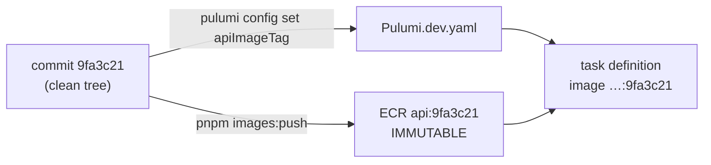

# Immutable image tags (git SHA)

History: see [CHANGELOG.md](../CHANGELOG.md) or run `pnpm docs:history`

Area: DevOps & CI/CD · Status: ✅ built · Step doc: [16 ECR](../../16-infra-ecr.md) (section 3b)

## 1. In one line

Every image is tagged with the **git commit SHA** it was built from, and ECR refuses to move a tag, so
a tag always names exactly one build of exactly one commit.

## 2. Real-life comparison

A batch number printed on medicine. "Latest batch" is useless in a recall; "batch 9fa3c21" tells you
exactly which factory run it came from.

## 3. Picture it



## 4. Where in our code

- Anchor: `scripts/push-images.sh` · step 3 and `TAG`: refuses a dirty tree; tag = `git rev-parse --short HEAD`.
- Anchor: `infra/src/registry.ts` · `imageTagMutability: "IMMUTABLE"`: ECR refuses to overwrite a tag.
- Anchor: `infra/index.ts` · `apiImageTag` / `webImageTag`: required, no `latest` default.

Step by step:

1. The script stops if `git status --porcelain` shows changes: the image must match the commit.
2. `TAG=$(git rev-parse --short HEAD)`.
3. Pushing an existing tag fails (`tag … already exists`), so a tag can never point at other code.
4. `config.require("apiImageTag")` stops `pulumi up` with a clear error if no tag is set; there is no
   default that could hide which code runs.
5. The deploy commit only changes `Pulumi.dev.yaml`, so the repo always records what runs on AWS.
6. The script prints each image's digest (sha256 of the content) for exact pinning later.

## 5. See it yourself

```bash
cd infra && pulumi config get apiImageTag
git show --stat $(pulumi config get apiImageTag) | head -5      # the code that runs
aws ecs describe-task-definition --profile ticketlite --task-definition minitickets-dev-api \
  --query "taskDefinition.containerDefinitions[0].image"
```

**Break it on purpose:** run `pnpm images:push` twice for the same commit: the second push fails with
`tag … already exists`.

## 6. How it connects

- **Uses ←** git, [ECR](ecr.md).
- **Gives →** traceable [task definitions](task-definition.md); rollback to a known image.

## 7. Our settings and WHY

Short SHA as the only tag; immutable repos; no default tag in Pulumi.

## 8. Trade-offs

- **Pros:** any running container maps to a commit; no accidental overwrite.
- **Cons:** a rebuild of the same commit (for a new base image patch) needs a new commit or a
  different tag scheme.

## 9. Alternatives and when to choose them

- **Pin by digest** (`image@sha256:…`): strongest guarantee; less readable.
- **Semantic version tags** plus SHA: released software with versions.

## 10. What breaks, and how we'd notice

- Tag set but not pushed: `CannotPullContainerError`.
- Pushing from a dirty tree: refused by the script.

## 11. Reach / Allowed / Password

Not a connection.

## 12. Cost

Free; the lifecycle policy keeps 10 tagged images per repo.

## 13. Interview answers at 3 levels

- **Simple:** Each image is named after the git commit it came from, and names can't be reused.
- **Senior:** The push script refuses a dirty tree and tags with the short SHA; ECR repos are
  `IMMUTABLE`; Pulumi requires the tag with no default. So the task definition's image names one commit.
- **Lead:** Traceability is what makes incident response and rollback fast. In CI I'd tag with the full
  SHA, record the digest, and promote the same image through environments instead of rebuilding.

## 14. Follow-up questions interviewers ask

- *Why not `latest`?* It moves; you can't tell what runs or roll back reliably.
- *Tag vs digest?* A tag is a name; a digest is the content hash.

## 15. Say it in 30 seconds

"Images are tagged with the git SHA from a clean tree, ECR refuses to overwrite tags, and Pulumi
requires an explicit tag. So every running task points at exactly one commit, and the deploy commit
records which."

## 16. Status

✅ built.

## Where it appears in the story

- [Infra story: 12. ECR](../infra-story.md#12-ecr)
- [Infra story: The deploy story](../infra-story.md#the-deploy-story)
