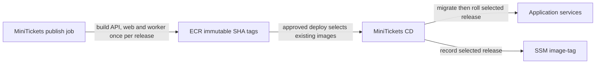

# Immutable image tags (git SHA)

History: see [CHANGELOG.md](../CHANGELOG.md) or run `pnpm docs:history`

Area: DevOps & CI/CD · Status: ✅ built in repository; live acceptance is separate

<!-- interview-card: v2 -->

## 1. What is it?

An immutable image tag names one fixed container image and cannot be overwritten. MiniTickets uses a Git commit identifier to connect a release to its source.

## 2. Why do we need it?

If “the latest image” changes between approval and deployment, we may ship different code than the reviewer expected. A fixed release name makes deployment and rollback deliberate.

## 3. How does it work?

1. Publish release images under their commit tag.
2. Deploy the selected published images rather than rebuilding them.
3. Record the release and verify what actually runs.

## 4. How do we use it in MiniTickets?

The publish and deploy jobs are separate. An application rollback selects an existing tag while retaining current infrastructure code. Database changes, secrets and worker message formats must still be compatible; a fixed image does not freeze the whole environment.

## 5. Interview-ready answer

“MiniTickets publishes release images once under an immutable commit tag. Approved deployment reuses those images, making the release identifiable and allowing an explicit rollback choice. We keep application image rollback separate from infrastructure history. The important limit is compatibility: an older image must still understand the current database, configuration and messages.”

## 6. Important follow-up questions

- **Is a tag the same as a digest?** No. A digest identifies image content; immutability prevents our release tag being reassigned.
- **Can we roll back any old image?** Only if it remains compatible with current data, secrets and required worker handlers.
- **Why avoid rebuilding on deploy?** A rebuild can resolve different inputs and produce different bytes.
- **Does this prove production works?** No. Deployment and live acceptance checks are still required.

## 7. Advanced details

Technical reference

### Release contract and sources

`.github/workflows/cd.yml` builds/pushes API/web/worker images in publish, resolves an existing release in deploy, then performs two-phase migration/rollout and smoke checks. `infra/src/image-tag.ts` reads the selected tag; `infra/src/release.ts` tracks infrastructure deployment history separately. Runbook §3.11–3.18 explains release acceptance. SSM `/minitickets/dev/image-tag` is written by CD; committed `infra/Pulumi.dev.yaml` defines environment shape.

`scripts/push-images.sh` refuses a dirty tree and derives its local tag from `git rev-parse --short HEAD`. ECR `imageTagMutability: "IMMUTABLE"` rejects overwrite. Deployed tags are retained separately from latest-push order. Rollback must retain required worker handlers and compatible schema/config/secrets.

### Trade-offs and acceptance

Rolling delivery overlaps versions; blue/green adds a traffic switch and overlap cost while retaining migration risk. Future options include approval expiry, explicit rollback criteria, canary analysis and immutable release manifests. No publish, AWS write or live rollback was performed for this documentation work. The original `infra/index.ts` image-tag anchor is retained as historical navigation; current resolution is in `infra/src/image-tag.ts`.

### Code anchors

- Anchor: `scripts/push-images.sh` · step 3 and `TAG`: refuses a dirty tree; tag = `git rev-parse --short HEAD`.
- Anchor: `infra/src/registry.ts` · `imageTagMutability: "IMMUTABLE"`: ECR refuses to overwrite a tag.
- Anchor: `infra/index.ts` · historical entry-point navigation; current selected-release resolution is in `infra/src/image-tag.ts`, without a `latest` default.

### Related reading

[current system](../00-big-picture.md) · [scenario](../guides/interview-scenarios.md#delivery-rollback) · [explorer tour](../guides/infra-explorer.html?tour=deploy)

[Open this concept in the city explorer](../guides/infra-explorer.html?concept=immutable-image-tags#chapter=7&piece=ecr).

## Where it appears in the story

- [Infra story: 12. ECR](../infra-story.md#12-ecr)
- [Infra story: The deploy story](../infra-story.md#the-deploy-story)

