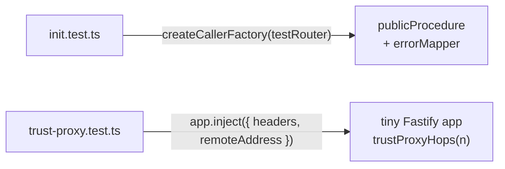

# In-process API tests (no real network)

History: see [CHANGELOG.md](../CHANGELOG.md) or run `pnpm docs:history`

Area: Testing · Status: ✅ built · Step doc: [02 errors](../../02-errors.md), [19 CloudFront](../../19-infra-cloudfront.md)

## 1. In one line

Some api tests call tRPC procedures as plain functions (`createCallerFactory`) or send fake HTTP
requests in memory (`app.inject`), so they test real api code without opening a port.

## 2. Real-life comparison

Testing a car engine on a stand in the workshop: real engine, real fuel, but no road, traffic or
driver.

## 3. Picture it



## 4. Where in our code

- Anchor: `apps/api/src/trpc/init.test.ts` · `createCallerFactory(testRouter)({} as Context)`: procedures called like functions.
- Anchor: `apps/api/src/config/trust-proxy.test.ts` · `whoAmI`: `app.inject` with a fake `remoteAddress` and `X-Forwarded-For`.

Step by step:

1. `init.test.ts` builds a tiny router whose procedures throw like services would, on the **real**
   `publicProcedure` (so the real `errorMapper` runs), and checks the resulting tRPC codes.
2. The context is `{}`: those procedures never read it.
3. `trust-proxy.test.ts` builds a Fastify app with the real `trustProxyHops`, then
   `app.inject({ remoteAddress: "10.0.0.37", headers })` simulates the ALB connecting, with the
   header CloudFront and the ALB would write.
4. Neither imports `app.ts` or `env.ts`, so no env vars, database or Redis are needed.

## 5. See it yourself

```bash
pnpm test init.test trust-proxy
```

**Break it on purpose:** change `trustProxyHops` to `return (_a, hop) => hop <= hops`. The "fake
X-Forwarded-For is never used" test fails: the spoofed `6.6.6.6` becomes `request.ip`.

## 6. How it connects

- **Uses ←** [fastify-app](fastify-app.md) ("build apart from listen" idea),
  [trpc-middleware](trpc-middleware.md), [trust-proxy](trust-proxy.md).
- **Gives →** the middle layer of the [testing-pyramid](testing-pyramid.md).

## 7. Our settings and WHY

Test real code paths in memory; avoid importing modules that validate env at import. WHY: realistic
and fast, with no setup.

## 8. Trade-offs

- **Pros:** real middleware and Fastify behaviour; no ports, no flakiness.
- **Cons:** procedures that need Postgres or Redis aren't covered this way yet; `app.ts` can't be
  imported without env vars.

## 9. Alternatives and when to choose them

- **Supertest** against a listening server: closer to production, slower.
- **Real-store integration tests** in CI (the e2e job already has Postgres and Redis services).
- **Injectable config** so `buildApp(config)` can be tested whole.

## 10. What breaks, and how we'd notice

A test that imports `app.ts` fails at import with "Invalid environment variables" unless env vars are
set: confusing, but loud.

## 13. Interview answers at 3 levels

- **Simple:** We test the api's real code without starting a server.
- **Senior:** `createCallerFactory` runs procedures through the real middleware chain to test
  error mapping; `app.inject` simulates requests from the ALB with crafted `X-Forwarded-For` to test
  `trustProxy`, including spoofing. No env, no ports.
- **Lead:** In-process tests give most of the confidence of HTTP tests at unit-test speed. I'd make
  config injectable so the full app can be tested this way, and add real-database integration tests
  for queries.

## 14. Follow-up questions interviewers ask

- *What does `inject` simulate?* A full HTTP request through Fastify's routing and hooks, without a
  socket.
- *Why not mock tRPC?* The point is to run the real middleware.

## 15. Say it in 30 seconds

"Two api tests run real code in memory: one calls procedures through createCallerFactory to check
the error mapper, the other uses Fastify's inject with fake proxy headers to check trustProxy and
spoofing. No server, no env vars, a few milliseconds."

## 16. Status

✅ built.

## Where it appears in the story

- [App story: 14. The testing pyramid](../app-story.md#14-the-testing-pyramid)
