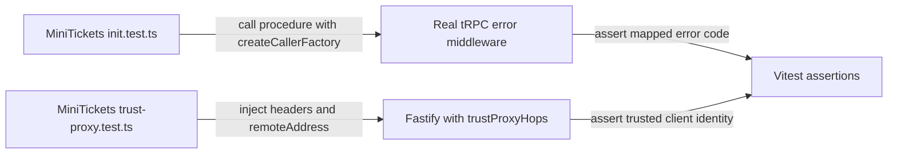

# In-process API tests (no real network)

History: see [CHANGELOG.md](../CHANGELOG.md) or run `pnpm docs:history`

Area: Testing · Status: ✅ built · Step doc: [02 errors](../../02-errors.md), [19 CloudFront](../../19-infra-cloudfront.md)

<!-- interview-card: v2 -->

## 1. What is it?

An in-process API test runs real request-handling code inside the test process. It can call procedures or simulate HTTP without opening a network port.

## 2. Why do we need it?

A spoofed forwarded IP might bypass a login limit. We can give Fastify crafted proxy headers and check the chosen client IP without starting the whole stack.

## 3. How does it work?

1. Build a small router or Fastify app around the real boundary.
2. Send controlled inputs, including failure and spoofing cases.
3. Assert outputs without confusing this with a real network or store test.

## 4. How do we use it in MiniTickets?

The tRPC tests use real error-mapping middleware. Proxy tests use Fastify’s in-memory request injection with the real trust policy. These targeted tests avoid modules that require environment variables and databases at import time.

## 5. Interview-ready answer

“MiniTickets exercises real API boundaries without listening on a port. One test calls procedures through the actual error middleware; another injects HTTP requests with controlled proxy headers into Fastify. This is fast and gives precise failures. It does not prove database behavior, TLS or load-balancer configuration, so those require separate evidence.”

## 6. Important follow-up questions

- **What does request injection cover?** Fastify routing and hooks without a real socket.
- **Why avoid mocking the middleware?** We want to test its actual mapping or trust decision.
- **Can these tests import the whole app?** That currently requires valid environment configuration; the focused tests avoid that dependency.
- **What would improve broader coverage?** Injectable configuration and real-store integration tests, without replacing these focused checks.

## 7. Advanced details

Technical reference

### Exact test paths and commands

`apps/api/src/trpc/init.test.ts` builds a tiny router on real `publicProcedure`, throws service-like errors and checks tRPC codes using `createCallerFactory(testRouter)({} as Context)`. Empty context works only because those procedures never read it.

`apps/api/src/config/trust-proxy.test.ts` builds a small Fastify app with real `trustProxyHops`; `app.inject` supplies `remoteAddress: "10.0.0.37"` and `X-Forwarded-For` representing proxy hops. Neither imports `app.ts` or `env.ts`, so no stores/env setup is needed. `pnpm test init.test trust-proxy` selects these tests.

### Failure cases and alternatives

Changing the trust comparison from `< hops` to `<= hops` would admit spoofed `6.6.6.6`; the existing spoofing test should fail. Importing the full app without environment values fails loudly with invalid-environment errors. No mutation was performed here.

These tests do not establish real Postgres/Redis paths. Real-store tests cover that boundary; a listening-server test such as Supertest adds socket behavior at setup cost. Injectable `buildApp(config)` remains a possible improvement, not a current complete-app testing guarantee.

### Code anchors

- Anchor: `apps/api/src/trpc/init.test.ts` · `createCallerFactory(testRouter)({} as Context)`: procedures called like functions.
- Anchor: `apps/api/src/config/trust-proxy.test.ts` · `whoAmI`: `app.inject` with a fake `remoteAddress` and `X-Forwarded-For`.

### Related reading

[fastify-app](fastify-app.md) · [trpc-middleware](trpc-middleware.md) · [trust-proxy](trust-proxy.md) · [testing-pyramid](testing-pyramid.md)

[Open this concept in the city explorer](../guides/infra-explorer.html?concept=in-process-api-tests#chapter=13&piece=github).

## Where it appears in the story

- [App story: 14. The testing pyramid](../app-story.md#14-the-testing-pyramid)

