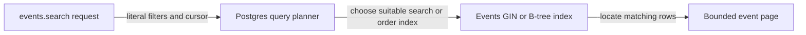

# Indexes (B-tree)

History: see [CHANGELOG.md](../CHANGELOG.md) or run `pnpm docs:history`

Area: Data · Status: ✅ built in repository; live AWS acceptance is separate
<!-- interview-card: v2 -->

## 1. What is it?

An index is an extra lookup structure that helps the database find or order matching rows. It trades storage and write work for faster suitable reads.

## 2. Why do we need it?

If MiniTickets scans every event for every search or page, work grows with the whole catalogue. A matching index can find a small result set without repeatedly reading everything.

## 3. How does it work?

1. Start from the query’s filter and ordering requirements.
2. Provide an index matching that access pattern.
3. Check the real execution plan and row counts instead of assuming the index is used.

## 4. How do we use it in MiniTickets?

Events use a time/ID ordering index and a trigram index for contains search. Bookings index user/time and enforce per-user intent uniqueness. Outbox has an index for due work. Each solves a specific access pattern.

## 5. Interview-ready answer

“MiniTickets chooses indexes from actual queries: trigram search for title and venue text, ordered time-and-ID traversal for pages, and targeted booking and outbox access. Indexes are not free; they add writes and storage. I validate selective and broad cases because the planner may correctly prefer scanning for a small table or common match.”

## 6. Important follow-up questions

- **Why can a query ignore an index?** A broad predicate or small table can make a scan cheaper.
- **Why pair starts_at with id?** ID breaks equal-time ties and supports deterministic page boundaries.
- **Does an index make deep OFFSET cheap?** Not automatically; skipping an ever-growing prefix still costs work.
- **When add another index?** When measured query benefit outweighs write, storage and operational cost.

## 7. Advanced details

Technical reference

### Current implementation

Current events_search_order_idx is B-tree on starts_at/id; events_search_trgm_idx is GIN on the combined title/venue expression with gin_trgm_ops. Migration 0008 adds search support. Search escapes LIKE metacharacters, uses tuple cursors and requests one extra row. Historical demo evidence covers 10k rows and timestamp ties; no new benchmark was run.

### Technical limits and diagnosis

Current events indexes include the earlier starts_at B-tree and starts_at/id traversal plus trigram GIN contains search. Booking indexes cover user/created order and per-user idempotency uniqueness; users enforces email uniqueness; outbox has a partial due-row index. Each is chosen for a real predicate/order.

Deep OFFSET repeatedly discards earlier rows. Keyset uses the last ordered pair, but cannot directly jump to arbitrary page 200. A stable upcoming cutoff is not a snapshot: concurrent inserts and edits can affect later pages. ID handles timestamp ties. GIN costs writes/storage, and short or broad terms can favour a scan.

Historical demo:search used 10k isolated rows and inspected plans/page boundaries including ties. No benchmark was rerun here. Measure real selectivity, rows and buffers before adding indexes; retention/partitioning or full-text relevance follow product needs.

### Failure diagnosis

Slow search calls for checking the actual expression, index migration, statistics and plan. Missing tie rows call for matching tuple order, precision and cursor direction. The explicit legacy fragment above preserves the incoming link from docs/23-events-index.md.

### Source anchors

- Anchor: `apps/api/src/db/schema/events.ts` — `events`; follow the numbered comments at this boundary.
- Anchor: `apps/api/src/db/schema/users.ts` — `module configuration`; follow the numbered comments at this boundary.
- Anchor: `apps/api/src/queries/events.ts` — `DAY_MS`; follow the numbered comments at this boundary.

### Related reading

- [current system](../00-big-picture.md)
- [scenario](../guides/interview-scenarios.md#indexes-pagination)
- [explorer tour](../guides/infra-explorer.html?tour=search)
- [app-story: 1b. Search input, hydration and bounded rows](../app-story.md#1b-search-input-hydration-and-bounded-rows)

[Open this piece in the city explorer](../guides/infra-explorer.html?concept=indexing#chapter=24&piece=code-query).

## Where it appears in the story

- [app-story: 1b. Search input, hydration and bounded rows](../app-story.md#1b-search-input-hydration-and-bounded-rows)

