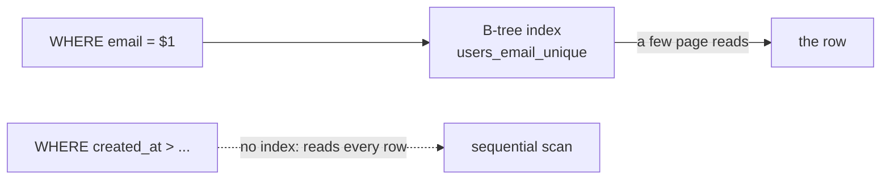

# Indexes (B-tree)

History: see [CHANGELOG.md](../CHANGELOG.md) or run `pnpm docs:history`

Area: Data · Status: 🟡 partial (the unique email index and the primary key; no other indexes) · Step doc: [05 database](../../05-database.md)

## 1. In one line

An **index** is a sorted lookup structure (usually a **B-tree**) that lets Postgres find rows by a
column without reading the whole table; we have two, both created automatically.

## 2. Real-life comparison

The index at the back of a book: to find "argon2", you look it up in the sorted list and jump to
the page, instead of reading every page.

## 3. Picture it



## 4. Where in our code

- Anchor: `apps/api/src/db/schema/users.ts` · `email: text("email").notNull().unique()`: the unique constraint, backed by an index.
- Anchor: `apps/api/src/db/schema/events.ts` · `events`: deliberately NO index yet. `listUpcoming` filters and sorts on `starts_at`, so it reads the whole table until a later step adds one.

What exists:

1. `users_pkey` on `id` (the primary key).
2. `users_email_unique` on `email`. **Verified from the Postgres 17 docs**
   ([Constraints](https://www.postgresql.org/docs/17/ddl-constraints.html)): "Adding a unique
   constraint will automatically create a unique B-tree index on the column or group of columns
   listed in the constraint."
3. Our queries use exactly these: `findByEmail` (login) and `findById` (session → user).
4. The `events` table has none beyond its primary key. `listUpcoming` filters on `starts_at` and sorts by it, so Postgres reads the whole table. With 12 rows that is instant; a later step adds an index and compares the `EXPLAIN` output before and after.
5. No other indexes.

## 5. See it yourself

```bash
docker exec minitickets-postgres-1 psql -U minitickets -d minitickets -c '\di'
# users_email_unique | index | users      users_pkey | index | users   (recorded locally)
docker exec minitickets-postgres-1 psql -U minitickets -d minitickets \
  -c "explain select * from users where email = 'x@example.com'"
```

With very few rows Postgres may still choose a sequential scan (cheaper on a tiny table); with many
rows the plan uses `users_email_unique`.

**Break it on purpose (thought experiment):** drop the unique constraint. Login now reads the whole
table per attempt, and duplicate emails become possible ([unique-constraint-race](unique-constraint-race.md)).

## 6. How it connects

- **Uses ←** [drizzle-schema](drizzle-schema.md).
- **Gives →** fast login lookups; the atomic uniqueness for [unique-constraint-race](unique-constraint-race.md).

## 7. Our settings and WHY

Only the indexes our queries need. WHY: every index speeds reads but slows writes and uses space.

## 8. Trade-offs

- **Pros:** login and session lookups stay fast as the table grows.
- **Cons:** writes update every index; random UUID primary keys spread inserts across the B-tree.

## 9. Alternatives and when to choose them

- **Composite indexes** (`(org_id, created_at)`) for future ticket lists.
- **Partial indexes** (`WHERE status = 'open'`).
- **GIN** for full-text search or JSONB; **BRIN** for huge append-only time tables.

## 10. What breaks, and how we'd notice

A missing index shows up as slow queries under load. We have no slow-query logging or Performance
Insights yet ([metrics](metrics.md)).

## 13. Interview answers at 3 levels

- **Simple:** An index is a sorted shortcut so the database finds rows fast.
- **Senior:** We have the primary key on `id` and the unique index Postgres creates for
  `users.email`, which serve our only two lookups. B-trees give O(log n) equality and range lookups.
  Everything else would be a sequential scan, which is fine until a query needs it.
- **Lead:** Index from real query patterns and `EXPLAIN ANALYZE`, not guesses; each index costs
  write throughput. For tickets I'd plan composite indexes matching list filters and sort order.

## 14. Follow-up questions interviewers ask

- *Does a unique constraint create an index?* Yes in Postgres, a unique B-tree index.
- *Why might Postgres ignore an index?* Tiny tables or low selectivity: a scan is cheaper.

## 15. Say it in 30 seconds

"We have two indexes: the primary key and the unique B-tree index Postgres creates for the email
constraint. They cover our only lookups, by email at login and by id from the session. New indexes
come from real query plans, because each one slows writes."

## 16. Status

🟡 partial. **To make it production-grade:** slow-query logging, `EXPLAIN ANALYZE` in reviews,
indexes for ticket queries when they exist.

## Where it appears in the story

- [App story: 10. Postgres and Redis](../app-story.md#10-postgres-and-redis)
- [App story: 10b. Reading events](../app-story.md#10b-reading-events)
