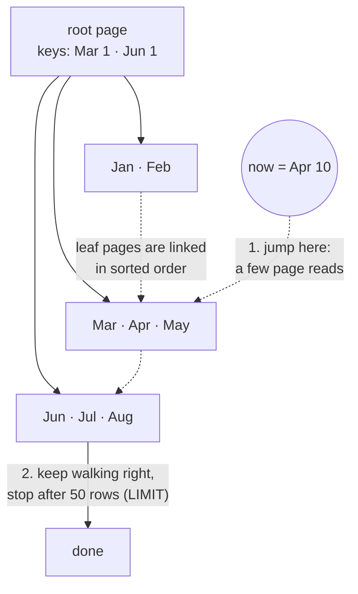
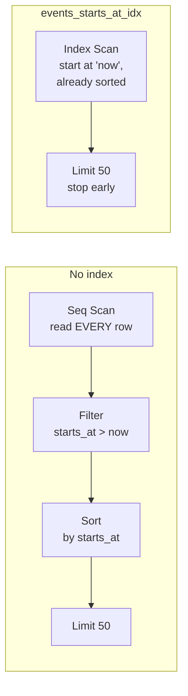
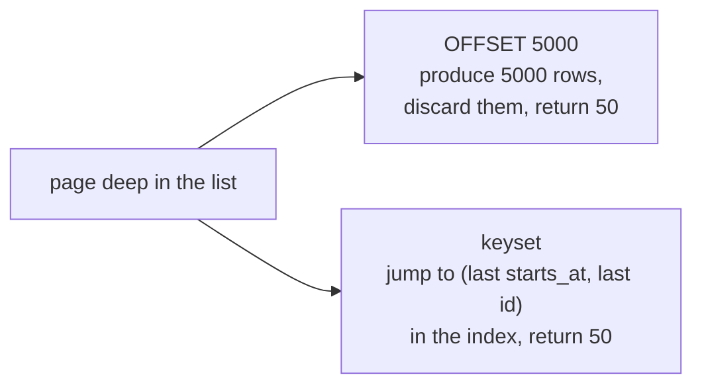

# Indexes (B-tree)

History: see [CHANGELOG.md](../CHANGELOG.md) or run `pnpm docs:history`

Area: Data · Status: ✅ built (primary keys, the unique email index, and `events_starts_at_idx`; composite, partial and keyset pagination are 📖 / 📋) · Step doc: [05 database](../../05-database.md), [23 events index](../../23-events-index.md)

## 1. In one line

An **index** is a sorted lookup structure (usually a **B-tree**) that lets Postgres find rows by a
column without reading the whole table; `events_starts_at_idx` makes the `/events` query jump straight
to "now" and stop after 50 rows.

## 2. Real-life comparison

The index at the back of a book: to find "argon2", you look it up in the sorted list and jump to the
page, instead of reading every page. For `/events` it is closer to a **diary sorted by date**: open it
at today, read the next 50 entries, close it. Without the index you must read the whole diary, then
sort every entry by date yourself.

## 3. Picture it

**A B-tree is a sorted tree.** Postgres walks from the root down to the first leaf at or after "now",
then walks along the leaves, which are linked in order. Real trees are wider and have a few levels;
this one is drawn tiny.



**Without the index** (Seq Scan) versus **with it** (Index Scan), for our exact query:



Why it fits: the filter (`starts_at > now`), the sort (`order by starts_at`) and the limit (50) all
use **the same column**. The index is already in that order, so there is no separate sort step and
Postgres can stop as soon as it has 50 rows. (When the planner picks a parallel plan, the no-index
side may also show `Gather Merge`; see [explain-analyze](explain-analyze.md).)

## 4. Where in our code

- Anchor: `apps/api/src/db/schema/events.ts` · `events`: `index("events_starts_at_idx").on(table.startsAt)`, the new index.
- Anchor: `apps/api/src/queries/events.ts` · `listUpcoming`: the query the index serves (filter + order by + limit on `starts_at`).
- Anchor: `apps/api/src/db/schema/users.ts` · `email: text("email").notNull().unique()`: the unique constraint, backed by an index.

What exists:

1. `users_pkey` on `id` and `events_pkey` on `id` (the primary keys).
2. `users_email_unique` on `email`. **Verified from the Postgres 17 docs**
   ([Constraints](https://www.postgresql.org/docs/17/ddl-constraints.html)): "Adding a unique
   constraint will automatically create a unique B-tree index on the column or group of columns
   listed in the constraint."
3. `events_starts_at_idx` on `events (starts_at)`, created by
   `apps/api/drizzle/0002_mixed_karen_page.sql` (generated by `db:generate`; we added the comment
   at the top that says why). The SQL that `listUpcoming` sends is:
   `select … from "events" where "events"."starts_at" > $1 order by "events"."starts_at" asc limit $2`
   (`$1` = now, `$2` = 50).
4. Our queries use exactly these: `findByEmail` (login), `findById` (session → user), `listUpcoming`.
5. No other indexes. `seats_left` and `title` are not indexed: no query filters on them.

## 5. See it yourself

The short version (the full runbook, with 200 000 rows, is in
[explain-analyze, section 5](explain-analyze.md#5-see-it-yourself)):

```bash
pnpm --filter @minitickets/api db:migrate          # applies 0002: creates the index
docker exec minitickets-postgres-1 psql -U minitickets -d minitickets -c '\di'
# events_starts_at_idx | index | events     users_email_unique | index | users   (run it to see yours)
docker exec minitickets-postgres-1 psql -U minitickets -d minitickets \
  -c "explain select * from events where starts_at > now() order by starts_at limit 50"
```

**Numbers: run it to see yours.** With only the 12 seed rows, Postgres may well choose a Seq Scan
even though the index exists: the whole table is one 8 kB page, so reading it is cheaper than
walking an index. That is correct behaviour, not a bug (section 10). Load 200 000 rows (explain-analyze
section 5) and compare the plans before and after `DROP INDEX events_starts_at_idx`.

**Break it on purpose:** `DROP INDEX events_starts_at_idx;` and run `EXPLAIN ANALYZE` again: the plan
gains `Seq Scan` and `Sort` and the timing grows with the row count. Put the index back with the
`CREATE INDEX` line in explain-analyze section 5 (the migration history still says it exists).

## 6. How it connects

- **Uses ←** [drizzle-schema](drizzle-schema.md) (the index is declared in the table's second argument), [migrations](migrations.md) (the SQL file that creates it), [seed-data](seed-data.md).
- **Gives →** a fast `events.list` as the table grows (chapter [10b](../app-story.md#10b-reading-events)); the atomic uniqueness for [unique-constraint-race](unique-constraint-race.md); the reading skill in [explain-analyze](explain-analyze.md).

## 7. Our settings and WHY

- **One index on `starts_at`, plain B-tree, ascending.** WHY: it is the only column `listUpcoming`
  filters and sorts on. A B-tree can be walked forwards or backwards, so `asc` needs no special
  declaration.
- **No index on `seats_left`.** WHY: no query filters on it, and it will change on every booking.
  An index on a column that changes often makes every booking write slower for nothing. (Postgres
  can skip index updates for a row change that touches no indexed column, a "HOT update", when there
  is room on the same page; this is another reason to index only what you read by.)
- **Plain `CREATE INDEX` in the migration.** WHY: `events` is tiny today, and drizzle's migrator
  runs migrations inside a transaction (checked in `drizzle-orm`'s migrator code), where
  `CREATE INDEX CONCURRENTLY` is not allowed. See "Production" below.
- **Added after the baseline.** WHY: [step 21](../../21-events-list.md) recorded the no-index
  behaviour first, so the change can be measured, not assumed.

## 8. Trade-offs

- **Pros:** reads that filter or sort by the column become O(log n) to find the start, then read
  only what is needed; `LIMIT` queries stop early; a sort step disappears.
- **Cons (costs of indexes):**
  - **Slower writes.** Every `INSERT` and `DELETE` must also update every index on the table, and an
    `UPDATE` of an indexed column does too.
  - **Storage.** An index is a second copy of the column (plus pointers) on disk and in memory.
  - **Maintenance.** Indexes bloat after many updates and deletes and may need a `REINDEX`.
  - **A false sense of safety.** An unused index still costs writes. `pg_stat_user_indexes`
    (`idx_scan = 0`) shows indexes nobody uses.
- **When NOT to add one:**
  - the table is small (a Seq Scan is as fast);
  - no real query filters or sorts on the column;
  - the column has very few distinct values, like a boolean, and the query returns a big share of
    the table (the index does not narrow anything);
  - the table is write-heavy and the read is rare;
  - you have not looked at the `EXPLAIN` output. Index from real query plans, not guesses.

## 9. Alternatives and when to choose them

- **Composite index (📖 explain-only today).** One index on several columns, like
  `(user_id, created_at)`. It is sorted by the first column, then by the second inside each first
  value (the "leftmost prefix" rule). Use it for `where user_id = $1 order by created_at desc limit 20`.
  Put the equality column first and the range/sort column second. An index on `(a, b)` helps a query
  on `a` alone but not one on `b` alone. We would add one when tickets exist ("my tickets, newest first").
- **Partial index (📖 explain-only today).** An index on only some rows, like
  `create index … on events (starts_at) where seats_left > 0`. Smaller and cheaper to write, but
  only used when the query's `WHERE` implies the index's `WHERE`. It would NOT help `listUpcoming`
  today, because the list also shows sold-out events (the "sold out" badge).
- **Keyset (cursor) pagination vs `OFFSET` (📋 planned if the list needs pages).** `listUpcoming`
  has `limit 50` and no `offset`. For "page 2", `OFFSET 50` makes Postgres produce 50 rows and
  throw them away, and the cost grows with every page. Keyset instead remembers the last row seen:
  `where (starts_at, id) > ($lastStartsAt, $lastId) order by starts_at, id limit 50`. It jumps
  straight to the spot through the index, however deep the page. It needs a unique tie-breaker
  (`id`, because two events can share `starts_at`) and an index that matches the sort, `(starts_at, id)`.
  Trade-off: you can go "next/previous" but not "jump to page 37".
- **Other index types (📖):** GIN for full-text search and JSONB, BRIN for huge append-only time
  tables, hash for equality only. B-tree is the right default.



## 10. What breaks, and how we'd notice

- **Missing index:** the query slows down as the table grows; the list chunk of `/events` arrives
  later (the frame does not). We have no slow-query log or alert yet ([metrics](metrics.md)).
- **Postgres ignores the index.** It is a cost-based planner and picks the cheapest plan it
  estimates:
  - **Small table:** reading one page beats walking an index. Normal.
  - **Low selectivity:** if the query returns most of the table, reading it in order is cheaper than
    jumping around via the index.
  - **Stale statistics:** the planner's row estimates come from `ANALYZE` (autovacuum does it, but
    not instantly after a bulk load). Run `ANALYZE events;`. A big gap between `rows=` (estimate) and
    `actual rows=` is the sign.
  - **The query hides the column:** `where date(starts_at) = …` or `where starts_at + interval '1 day' > …`
    cannot use a plain index on `starts_at`. Compare the bare column with a value.
- **Production: adding an index to a big, busy table.**
  - Plain `CREATE INDEX` blocks writes to the table (inserts, updates, deletes wait) until it
    finishes. Reads still work.
  - `CREATE INDEX CONCURRENTLY` does not block writes. It scans the table twice and waits for older
    transactions, so it is slower, but nobody is locked out.
  - **It cannot run inside a transaction block**, because it needs to commit in steps and wait for
    other transactions; Postgres refuses it with an error. Drizzle's migrator wraps migrations in a
    transaction, so a migration file with `CONCURRENTLY` fails.
  - **How teams handle it:** run that one statement by hand (or from a script) outside the
    migration runner, then record it in the schema; or use a migration tool that can mark a migration
    "no transaction"; and always do it as its own small deploy step.
  - **If it fails**, it can leave an `INVALID` index behind (still costs writes, never used). Find it
    with `select indexrelid::regclass from pg_index where not indisvalid;`, `DROP INDEX` it and retry.
  - We keep plain `CREATE INDEX` because `events` has 12 rows; the day a table is big and live, we
    switch (see [migrations](migrations.md), and the planned expand-and-contract idea in the concept map).

## 13. Interview answers at 3 levels

- **Simple:** An index is a sorted shortcut so the database finds rows fast, like the index of a book.
- **Senior:** `listUpcoming` filters `starts_at > now`, orders by `starts_at` and limits to 50. A
  B-tree on `starts_at` is already in that order, so Postgres descends the tree to "now" and reads
  the next 50 entries: an Index Scan under a Limit, with no Sort. Without it, a Seq Scan reads every
  row, filters, then sorts (top-N heapsort) to keep 50. I check this with `EXPLAIN (ANALYZE,
  BUFFERS)` and compare rows, time and buffers. The costs: every write maintains the index, and it
  takes space. Postgres may ignore an index on a small table or when the query returns most rows.
- **Lead:** I index from real query plans and keep the number small, because each index taxes writes
  (bookings will update `events` often, so I deliberately did not index `seats_left`). On a big live
  table, I add indexes with `CREATE INDEX CONCURRENTLY` outside the transactional migration runner,
  and verify there is no `INVALID` index afterwards. I would plan composite indexes to match list
  filters and sort order, move to keyset pagination before `OFFSET` gets deep, and find dead
  weight with `pg_stat_user_indexes`. Whether it is worth it is decided by measurement, which is why
  the baseline came first.

## 14. Follow-up questions interviewers ask

- *Does a unique constraint create an index?* Yes in Postgres, a unique B-tree index.
- *Why might Postgres ignore an index?* Tiny tables, low selectivity, stale statistics, or a query that wraps the column in a function.
- *Does an index help `ORDER BY` as well as `WHERE`?* Yes, when it is in the same order: no sort step is needed, and `LIMIT` can stop early.
- *Why can't `CREATE INDEX CONCURRENTLY` run in a transaction?* It must commit in several phases and wait for other transactions; one big transaction would defeat that.
- *Why is `OFFSET` slow for deep pages?* It still produces and discards the skipped rows; keyset pagination seeks instead.
- *In `(a, b)`, does a query on `b` alone use the index?* Not efficiently: the index is sorted by `a` first.

## 15. Say it in 30 seconds

"We have the primary keys, the unique email index, and one index I added on `events.starts_at`,
because `/events` filters, sorts and limits on that column. It turns a Seq Scan plus Sort into an
Index Scan that jumps to now and stops after 50 rows. I checked it with `EXPLAIN ANALYZE` on 200 000
generated rows, before and after. Indexes cost write speed and space, so I only add ones a real query plan asks
for, and on a large live table I'd create it `CONCURRENTLY`."

## 16. Status

✅ built for the three lookups we have. **To make it production-grade:** slow-query logging
(`log_min_duration_statement`) and `pg_stat_statements` to find what needs an index; a check for
unused indexes; a plan for `CONCURRENTLY` migrations once tables are big; composite indexes and
keyset pagination when tickets and paged lists exist.

## Where it appears in the story

- [App story: 10. Postgres and Redis](../app-story.md#10-postgres-and-redis)
- [App story: 10b. Reading events](../app-story.md#10b-reading-events)
