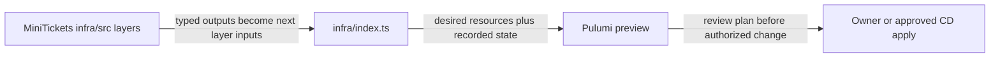

# Infrastructure as Code with Pulumi

History: see [CHANGELOG.md](../CHANGELOG.md) or run `pnpm docs:history`

Area: DevOps & CI/CD · Status: ✅ built · Step docs: [12 network](../../12-infra-network.md), [15 dependencies](../../15-infra-dependencies.md)
<!-- interview-card: v2 -->

## 1. What is it?

Infrastructure as code describes cloud resources in versioned files. Pulumi uses that description and its stored resource record to plan changes to MiniTickets’ AWS setup.

## 2. Why do we need it?

Building a database and its network through scattered console clicks makes the next environment hard to reproduce. Code makes the intended setup reviewable and connects its dependencies explicitly.

## 3. How does it work?



1. Describe resources in small typed layer functions.
2. Connect their outputs and inputs in the entry point.
3. Review the plan before an authorized deployment applies it.

## 4. How do we use it in MiniTickets?

Committed Pulumi YAML defines environment shape; SSM records the deployed release and guards stale infrastructure runs. Preview is our read-only check. The owner or approved delivery workflow performs cloud changes; this documentation rewrite changes no resource.

## 5. Interview-ready answer

“MiniTickets expresses infrastructure as typed Pulumi layers with one place wiring dependencies. That makes the intended network, permissions and services reviewable alongside code. State records managed resources, and previews help catch replacements before apply. I still protect state, separate release configuration from environment shape and account for out-of-band cloud changes.”

## 6. Important follow-up questions

- **What is state?** The deployment tool’s record of managed resources and their properties.
- **What is drift?** The actual cloud differs from the intended or recorded setup.
- **Does preview always discover every manual change?** No. A preview is not a guarantee of a fresh inventory; drift checking needs deliberate handling.
- **Why do explicit dependencies matter?** Missing ordering can cause first-create races even when later deployments appear fine.

## 7. Advanced details

<details>
<summary>Technical reference</summary>

### Source references

- Anchor: `infra/index.ts` · the whole file: the only place that connects layers, in dependency order.

How the code is organised, step by step:

1. Each layer is a function in `infra/src/` with typed inputs and outputs (`createNetwork`,
   `createSecurityGroups`, `createPostgres`, …). Each file starts with a `NEEDS / CREATES / GIVES`
   header ([docs/15](../../15-infra-dependencies.md)).
2. `index.ts` calls them top to bottom and passes outputs into inputs; an output used as an input is a
   dependency, so Pulumi creates things in the right order.
3. Switches (`dataEnabled`, `computeEnabled`, `entryEnabled`) decide which layers exist
   ([cost-switches](cost-switches.md)).
4. The deployed image tag lives in SSM `/minitickets/dev/image-tag`, written only by CD; `/minitickets/dev/deployed-commit` guards old infrastructure runs. Config lives in `Pulumi.dev.yaml` (`aws:region` and environment switches; the
   alert email encrypted).
5. Stack outputs (step 25-29) give scripts the values they need (`apiRepoUrl`, `clusterName`, …).
6. Ordering tricks where Pulumi can't see a dependency: return a value only after another resource
   exists (`cluster.ts` step 3, `iam.ts` step 8, `listener.ts` step 5).
7. Rules: Claude may run `pulumi preview`; only the owner runs `pulumi up` / `destroy` (CLAUDE.md).

### Configuration and design

| Choice | Why |
| ------ | --- |
| Pulumi in TypeScript | Same language as the app; real functions, types and comments. |
| One function per layer, wired only in `index.ts` | Dependencies are visible in one file. |
| `preview` before every `up` | Read the plan; catch replaces and deletes. |

**Allowed:** local read-only previews use `AWS_PROFILE=ticketlite`; approved CD uses its scoped OIDC role. No `aws:profile` belongs in committed config.

### Checks and troubleshooting

```bash
cd infra
pulumi preview                 # what would change; read-only
pnpm infra:graph               # writes deps.dot: the real dependency graph
pulumi stack output
```

**Break it on purpose (read-only):** change a security group's `description` and run
`pulumi preview`: it shows a **replace**, because AWS cannot edit descriptions.

- Unexpected preview updates need investigation; a normal preview is not a complete live-drift audit.
- Hidden replace: a description or name change replaces a resource; read `+-` lines in the preview.
- Missing dependency: intermittent "not found" or "not associated" errors on first create.

- *What is state?* Pulumi's record of what it created, used to compute the diff.
- *What is drift?* The real cloud differs from the state (someone changed it by hand).

### Trade-offs and alternatives

- **Pros:** reviewable, repeatable, documented infrastructure; "off" and "on" are one command each.
- **Cons:** state must be protected and kept in sync; out-of-band drift needs deliberate detection rather than assuming every preview refreshes state; some changes silently mean replace.

- **Terraform / OpenTofu:** the most common choice in companies; HCL instead of a general language.
- **AWS CDK / CloudFormation:** AWS-only shops wanting native integration.
- **Console clicks:** only for learning and one-off experiments.

### Further technical context

Each layer is a typed function; `index.ts` wires outputs to inputs in dependency order and
  wraps the expensive layers in config switches. We preview before every apply, keep generated secrets
  encrypted in state, and export only ARNs and addresses.

Historical cost notes (not a current quote):

Pulumi's state backend is the owner's Pulumi account (cost not tracked here); the code itself costs
nothing.

### Related reading

- **Uses ←** the AWS provider, the owner's AWS profile and Pulumi login.
- **Gives →** every AWS card in this handbook; repeatable on/off deploy days ([docs/20](../../20-deploy-day.md)).

[Open this piece in the city explorer](../guides/infra-explorer.html?concept=infrastructure-as-code#chapter=1&piece=pulumi).

## Where it appears in the story

- [Infra story: 14. Pulumi and the switches](../infra-story.md#14-pulumi-and-the-switches)

</details>
