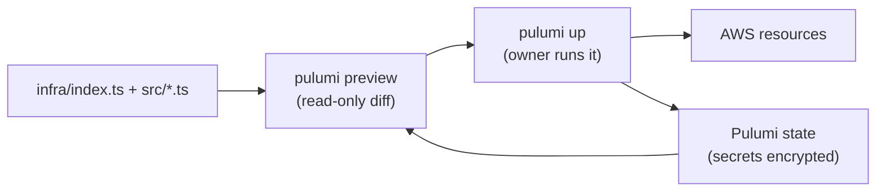

# Infrastructure as Code with Pulumi

History: see [CHANGELOG.md](../CHANGELOG.md) or run `pnpm docs:history`

Area: DevOps & CI/CD · Status: ✅ built · Step docs: [12 network](../../12-infra-network.md), [15 dependencies](../../15-infra-dependencies.md)

## 1. In one line

**Infrastructure as Code (IaC)** describes cloud resources in code; **Pulumi** compares that code
with what exists and creates, changes or deletes resources to match.

## 2. Real-life comparison

An architect's blueprint plus a builder who reads it. Change the blueprint, and the builder shows you
exactly which walls they would move (preview) before touching anything (up).

## 3. Picture it



## 4. Where in our code

- Anchor: `infra/index.ts` · the whole file: the only place that connects layers, in dependency order.

How the code is organised, step by step:

1. Each layer is a function in `infra/src/` with typed inputs and outputs (`createNetwork`,
   `createSecurityGroups`, `createPostgres`, …). Each file starts with a `NEEDS / CREATES / GIVES`
   header ([docs/15](../../15-infra-dependencies.md)).
2. `index.ts` calls them top to bottom and passes outputs into inputs; an output used as an input is a
   dependency, so Pulumi creates things in the right order.
3. Switches (`dataEnabled`, `computeEnabled`, `entryEnabled`) decide which layers exist
   ([cost-switches](cost-switches.md)).
4. Config lives in `Pulumi.dev.yaml` (`aws:region`, `aws:profile`, the switches, the image tags; the
   alert email encrypted).
5. Stack outputs (step 25-29) give scripts the values they need (`apiRepoUrl`, `clusterName`, …).
6. Ordering tricks where Pulumi can't see a dependency: return a value only after another resource
   exists (`cluster.ts` step 3, `iam.ts` step 8, `listener.ts` step 5).
7. Rules: Claude may run `pulumi preview`; only the owner runs `pulumi up` / `destroy` (CLAUDE.md).

## 5. See it yourself

```bash
cd infra
pulumi preview                 # what would change; read-only
pnpm infra:graph               # writes deps.dot: the real dependency graph
pulumi stack output
```

**Break it on purpose (read-only):** change a security group's `description` and run
`pulumi preview`: it shows a **replace**, because AWS cannot edit descriptions.

## 6. How it connects

- **Uses ←** the AWS provider, the owner's AWS profile and Pulumi login.
- **Gives →** every AWS card in this handbook; repeatable on/off deploy days ([docs/20](../../20-deploy-day.md)).

## 7. Our settings and WHY

| Choice | Why |
| ------ | --- |
| Pulumi in TypeScript | Same language as the app; real functions, types and comments. |
| One function per layer, wired only in `index.ts` | Dependencies are visible in one file. |
| `preview` before every `up` | Read the plan; catch replaces and deletes. |

## 8. Trade-offs

- **Pros:** reviewable, repeatable, documented infrastructure; "off" and "on" are one command each.
- **Cons:** state must be protected and kept in sync; drift (console changes) is invisible until the
  next preview; some changes silently mean replace.

## 9. Alternatives and when to choose them

- **Terraform / OpenTofu:** the most common choice in companies; HCL instead of a general language.
- **AWS CDK / CloudFormation:** AWS-only shops wanting native integration.
- **Console clicks:** only for learning and one-off experiments.

## 10. What breaks, and how we'd notice

- Drift: `pulumi preview` shows unexpected updates.
- Hidden replace: a description or name change replaces a resource; read `+-` lines in the preview.
- Missing dependency: intermittent "not found" or "not associated" errors on first create.

## 11. Reach / Allowed / Password

**Allowed:** Pulumi acts with the owner's AWS credentials (`aws:profile`). It never prints them.

## 12. Cost

Pulumi's state backend is the owner's Pulumi account (cost not tracked here); the code itself costs
nothing.

## 13. Interview answers at 3 levels

- **Simple:** We describe our AWS setup in TypeScript and Pulumi builds it.
- **Senior:** Each layer is a typed function; `index.ts` wires outputs to inputs in dependency order and
  wraps the expensive layers in config switches. We preview before every apply, keep generated secrets
  encrypted in state, and export only ARNs and addresses.
- **Lead:** IaC turns infrastructure into reviewed code. Next steps: run previews in CI on pull requests,
  apply from a pipeline with an OIDC role, add policy checks (CrossGuard), and detect drift on a schedule.

## 14. Follow-up questions interviewers ask

- *What is state?* Pulumi's record of what it created, used to compute the diff.
- *What is drift?* The real cloud differs from the state (someone changed it by hand).

## 15. Say it in 30 seconds

"All AWS resources are Pulumi TypeScript: one typed function per layer, wired in `index.ts` in
dependency order, with on/off switches for the expensive layers. We always preview first, and secrets
stay encrypted in state."

## 16. Status

✅ built. **To make it production-grade:** previews and applies in CI, policy checks, drift detection.

## Where it appears in the story

- [Infra story: 14. Pulumi and the switches](../infra-story.md#14-pulumi-and-the-switches)
