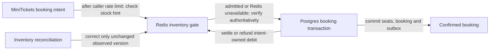

# Inventory gate

History: see [CHANGELOG.md](../CHANGELOG.md) or run `pnpm docs:history`

Area: Data · Status: ✅ built in repository; live AWS acceptance is separate

<!-- interview-card: v2 -->

## 1. What is it?

An inventory gate uses a quick stock estimate to reject requests that are unlikely to succeed. It is an admission hint, not the record that confirms a purchase.

## 2. Why do we need it?

When an event sells out, thousands of doomed buyers can still queue for the same database row. MiniTickets can reject obvious sold-out attempts earlier and leave the database to decide real bookings.

## 3. How does it work?

1. Associate any provisional stock debit with the booking intent.
2. Run every admitted purchase through the same database transaction.
3. Settle or refund the hint and repair drift without overwriting concurrent work.

## 4. How do we use it in MiniTickets?

The gate reduces pressure on the event row. Redis failure falls back to Postgres; retry handling must still return an existing booking when hinted stock is zero. Reconciliation compares versions before correction. This is not a customer-visible timed seat hold.

## 5. Interview-ready answer

“MiniTickets uses Redis inventory only to reduce doomed database work. Every admitted buyer still passes the authoritative Postgres transaction. Intent-owned debits and refunds connect the hint to retries, while versioned reconciliation repairs drift without blindly overwriting concurrent changes. Incorrect Redis stock can affect admission, but must never create a confirmed seat. More API tasks alone would not remove that hot-row bottleneck.”

## 6. Important follow-up questions

- **Can Redis confirm a seat?** No. Only the database transaction can do that.
- **What if Redis fails?** The inventory hint falls back to Postgres; other safeguards retain their own failure policies.
- **Why compare versions during repair?** A plain stock overwrite could erase a concurrent debit.
- **Can the hint drift?** Yes. Unknown commit outcomes or crashes can skew it; reconciliation repairs admission, not booking correctness.

## 7. Advanced details

Technical reference

### Source boundaries and local exercise

`apps/api/src/queries/inventory.ts` implements inventory keys/atomic operations. `apps/api/src/services/booking-inventory.ts` → `createGatedBooking` owns intent debit/settlement/refund and Redis fallback. `apps/api/src/services/inventory-reconciliation.ts` → `reconcileEvent` compares an observed version before correction, avoiding overwrite of in-flight work.

`pnpm demo:sale` compares gated/ungated short loads and tests replay at zero hinted stock. No fresh execution, sustained-load guarantee or live AWS acceptance is claimed. Unknown DB commit/refund and process crashes can skew a hint; they do not transfer final seat authority from Postgres.

### Trade-offs and growth

One event row still serializes purchases. Caller rate limits and advisory admission solve different pressure problems. This mechanism is not a paid or timed customer hold. Measure p95/p99, lock waits and connection occupancy before extending it. Durable queue admission or partitioned seat rows may help larger sales while preserving database constraints.

### Code anchors

- Anchor: `apps/api/src/queries/inventory.ts` — `inventoryKeys`; follow the numbered comments at this boundary.
- Anchor: `apps/api/src/services/booking-inventory.ts` — `createGatedBooking`; follow the numbered comments at this boundary.
- Anchor: `apps/api/src/services/inventory-reconciliation.ts` — `reconcileEvent`; follow the numbered comments at this boundary.

### Related reading

[current system](../00-big-picture.md) · [scenario](../guides/interview-scenarios.md#sale-day) · [explorer tour](../guides/infra-explorer.html?tour=sale-day)

[Open this concept in the city explorer](../guides/infra-explorer.html?concept=inventory-gate#chapter=5&piece=valkey).

## Where it appears in the story

- [app-story: 9b. A booking reaches its transaction](../app-story.md#9b-a-booking-reaches-its-transaction)

