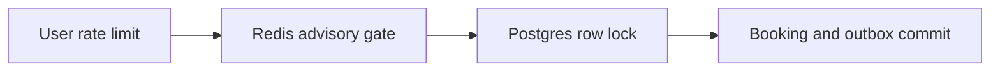

# Inventory gate

History: see [CHANGELOG.md](../CHANGELOG.md) or run `pnpm docs:history`

Area: Data · Status: ✅ built in repository; live AWS acceptance is separate

## 1. In one line

An advisory inventory gate rejects doomed traffic before row locks. Intent-owned debits settle/refund around Postgres and versioned reconciliation avoids overwriting concurrent work; Redis never confirms a booking.

## 2. Real-life comparison

Two clerks cannot promise the same last seat: one holds the ledger until the reservation is recorded.

## 3. Picture it

## 4. Where in our code

- Anchor: `apps/api/src/queries/inventory.ts` — `inventoryKeys`; follow the numbered comments at this boundary.
- Anchor: `apps/api/src/services/booking-inventory.ts` — `createGatedBooking`; follow the numbered comments at this boundary.
- Anchor: `apps/api/src/services/inventory-reconciliation.ts` — `reconcileEvent`; follow the numbered comments at this boundary.

`apps/api/src/services/booking-inventory.ts` debits an intent-owned reservation and falls back to Postgres on Redis failure. `services/inventory-reconciliation.ts` compares versions before correction so it does not overwrite in-flight work. `pnpm demo:sale` compares gated/ungated short loads and verifies replay at zero stock.

## 5. See it yourself

Run `pnpm demo:sale` and inspect the asserted outcome described above.

Failure thought experiment: Can reconciliation blindly SET database stock? No; compare-and-set against an observed version to avoid clobbering in-flight debits. Do not change a live stack to demonstrate it.

## 6. How it connects

Uses the [current system](../00-big-picture.md); gives a concrete decision to the [scenario](../guides/interview-scenarios.md#sale-day) and [explorer tour](../guides/infra-explorer.html?tour=sale-day).

## 7. Our settings and WHY

An advisory inventory gate rejects doomed traffic before row locks. Intent-owned debits settle/refund around Postgres and versioned reconciliation avoids overwriting concurrent work; Redis never confirms a booking. Fewer doomed buyers enter the hot-row queue.

## 8. Trade-offs

Unknown DB commit/refund and worker crashes can skew the hint; reconciliation repairs admission, not correctness. This is not a customer-visible timed seat hold.

## 9. Alternatives and when to choose them

10x: compare p95/p99 and lock waits. 100x: durable queue admission or partitioned seat rows, keeping DB constraints.

## 10. What breaks and how we notice

Can reconciliation blindly SET database stock? No; compare-and-set against an observed version to avoid clobbering in-flight debits.

## 13. Interview answers at 3 levels

- **Simple:** An advisory inventory gate rejects doomed traffic before row locks.
- **Senior:** One event row serializes buyers even with many API tasks. Rate limits bound callers; an advisory Redis inventory gate rejects obvious sold-out work before the database. All admitted buyers still run the same Postgres transaction. Redis failure, expiry or wrong counts must never create a confirmed seat by itself.
- **Lead:** 10x: compare p95/p99 and lock waits. 100x: durable queue admission or partitioned seat rows, keeping DB constraints.

## 14. Follow-up questions with answers

Can reconciliation blindly SET database stock? No; compare-and-set against an observed version to avoid clobbering in-flight debits.

Who is final seat authority? **Postgres transaction.**

## 15. Say it in 30 seconds

One event row serializes buyers even with many API tasks. Rate limits bound callers; an advisory Redis inventory gate rejects obvious sold-out work before the database. All admitted buyers still run the same Postgres transaction. Redis failure, expiry or wrong counts must never create a confirmed seat by itself.

## 16. Status and production work

Repository implementation and local evidence are described above. Live AWS/CI execution remains owner acceptance. 10x: compare p95/p99 and lock waits. 100x: durable queue admission or partitioned seat rows, keeping DB constraints.

## Where it appears in the story

- [app-story: 9b. A booking reaches its transaction](../app-story.md#9b-a-booking-reaches-its-transaction)
