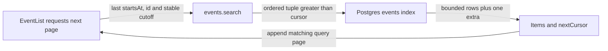

# Keyset pagination

History: see [CHANGELOG.md](../CHANGELOG.md) or run `pnpm docs:history`

Area: Data · Status: ✅ built in repository; live AWS acceptance is separate
<!-- interview-card: v2 -->

## 1. What is it?

Keyset pagination asks for rows after the last row already seen. Its cursor is a bookmark in a defined order, rather than a number of earlier rows to skip.

## 2. Why do we need it?

A MiniTickets visitor scrolling deep into events should not make Postgres repeatedly discard thousands of earlier rows. Equal start times also need a reliable tie-breaker so no event is skipped.

## 3. How does it work?

1. Fix the sort order and initial upcoming cutoff.
2. Fetch rows after the last time-and-ID pair.
3. Use one extra row to decide whether to return another cursor.

## 4. How do we use it in MiniTickets?

Event search orders by start time then ID. The cursor preserves timestamp precision and the traversal’s cutoff. Shared schemas validate it; the browser keeps pages under the matching search identity. A cursor is not a database snapshot.

## 5. Interview-ready answer

“MiniTickets uses a time-and-ID cursor to fetch each next event page without a growing offset. The ID handles equal timestamps, and the original upcoming cutoff stays stable across the traversal. It is efficient sequential navigation, not arbitrary page jumping or snapshot isolation: concurrent inserts and edits can still change later results.”

## 6. Important follow-up questions

- **Why is time alone insufficient?** Several events can share it; without ID, boundary rows may be skipped or repeated.
- **Why preserve database timestamp precision?** Rounding the cursor can move the boundary around rows that share a displayed millisecond.
- **Can users jump directly to page 200?** Not with this cursor alone; choose another navigation contract if that is required.
- **Does a stable cutoff freeze results?** No. It fixes the meaning of upcoming, while concurrent data changes remain possible.

## 7. Advanced details

Technical reference

### Current implementation

Current search fetches limit+1 with a bounded limit, orders `(starts_at,id)` ascending and compares the same tuple. Cursor startsAt uses Postgres microsecond formatting rather than JavaScript millisecond output; asOf persists the initial cutoff. Text input escapes LIKE wildcards. Historical demo evidence covers 10k rows, ties and complete traversal, not snapshot semantics or a production benchmark.

### Technical limits and diagnosis

SQL compares the same ascending starts_at/id tuple it orders by, with literal escaped text filters. The service returns only limit items and uses the extra row to decide nextCursor. The shared schema bounds input limits. Cursor timestamp precision remains separate from public date formatting.

A stable asOf fixes the upcoming cutoff, not a snapshot: concurrent inserts and updates can change later pages. ID resolves timestamp ties; rounding database microseconds into JavaScript milliseconds could move a boundary. Deep OFFSET discards growing prefixes, while keyset cannot jump directly to arbitrary page 200.

Migration 0008 provides traversal and trigram search indexes. GIN costs writes/storage and broad or short terms may favour a scan. Historical demo:search covers 10k isolated rows, plans and ties; it was not rerun or treated as production evidence. Inspect selectivity/buffers before retention, partitioning or relevance changes.

### Source anchors

- Anchor: `apps/api/src/queries/event-search.ts` — `searchPattern`; follow the numbered comments at this boundary.
- Anchor: `apps/api/src/services/event-search.ts` — `searchEvents`; follow the numbered comments at this boundary.

### Related reading

- [current system](../00-big-picture.md)
- [scenario](../guides/interview-scenarios.md#indexes-pagination)
- [explorer tour](../guides/infra-explorer.html?tour=search)
- [app-story: 1b. Search input, hydration and bounded rows](../app-story.md#1b-search-input-hydration-and-bounded-rows)

[Open this piece in the city explorer](../guides/infra-explorer.html?concept=keyset-pagination#chapter=24&piece=code-query).

## Where it appears in the story

- [app-story: 1b. Search input, hydration and bounded rows](../app-story.md#1b-search-input-hydration-and-bounded-rows)

