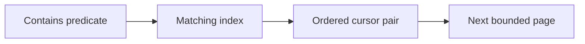

# Keyset pagination

History: see [CHANGELOG.md](../CHANGELOG.md) or run `pnpm docs:history`

Area: Data · Status: ✅ built in repository; live AWS acceptance is separate

## 1. In one line

A keyset cursor identifies the last ordered row. Ours carries microsecond startsAt, id and a stable upcoming cutoff; limit is bounded and one extra row detects the next page. It is not a database snapshot.

## 2. Real-life comparison

A catalogue with a bookmark: each question and position has its own identity, and only the visible page lies open.

## 3. Picture it

## 4. Where in our code

- Anchor: `apps/api/src/queries/event-search.ts` — `searchPattern`; follow the numbered comments at this boundary.
- Anchor: `apps/api/src/services/event-search.ts` — `searchEvents`; follow the numbered comments at this boundary.

`apps/api/src/queries/event-search.ts` escapes LIKE metacharacters and uses composite cursor boundaries. Migration `apps/api/drizzle/0008_lethal_amazoness.sql` adds search indexes. `pnpm demo:search` measures 10k rows, index plans and page boundaries including timestamp ties.

## 5. See it yourself

Run `pnpm demo:search` and inspect the asserted outcome described above.

Failure thought experiment: Why carry id with time? It breaks ties so rows sharing a timestamp are not skipped. Do not change a live stack to demonstrate it.

## 6. How it connects

Uses the [current system](../00-big-picture.md); gives a concrete decision to the [scenario](../guides/interview-scenarios.md#indexes-pagination) and [explorer tour](../guides/infra-explorer.html?tour=search).

## 7. Our settings and WHY

A keyset cursor identifies the last ordered row. Ours carries microsecond startsAt, id and a stable upcoming cutoff; limit is bounded and one extra row detects the next page. It is not a database snapshot. Deep OFFSET discards earlier rows repeatedly.

## 8. Trade-offs

GIN adds write/storage cost and short/unselective terms can favor a scan. Keyset cannot jump to arbitrary page 200; snapshot semantics need more design.

## 9. Alternatives and when to choose them

10x: inspect real selectivity and buffers. 100x: retention/partitioning or full-text relevance when product needs it.

## 10. What breaks and how we notice

Why carry id with time? It breaks ties so rows sharing a timestamp are not skipped.

## 13. Interview answers at 3 levels

- **Simple:** A keyset cursor identifies the last ordered row.
- **Senior:** Choose an index for the predicate and order. Trigram GIN helps contains search; B-tree on starts_at/id supports stable traversal. Keyset asks for rows after the last pair, avoiding a growing OFFSET scan. A stable cutoff prevents time drift but is not a database snapshot: inserts and edits can still change later pages.
- **Lead:** 10x: inspect real selectivity and buffers. 100x: retention/partitioning or full-text relevance when product needs it.

## 14. Follow-up questions with answers

Why carry id with time? It breaks ties so rows sharing a timestamp are not skipped.

Which cursor is stable for timestamp ties? **starts_at plus id.**

## 15. Say it in 30 seconds

Choose an index for the predicate and order. Trigram GIN helps contains search; B-tree on starts_at/id supports stable traversal. Keyset asks for rows after the last pair, avoiding a growing OFFSET scan. A stable cutoff prevents time drift but is not a database snapshot: inserts and edits can still change later pages.

## 16. Status and production work

Repository implementation and local evidence are described above. Live AWS/CI execution remains owner acceptance. 10x: inspect real selectivity and buffers. 100x: retention/partitioning or full-text relevance when product needs it.

## Where it appears in the story

- [app-story: 1b. Search input, hydration and bounded rows](../app-story.md#1b-search-input-hydration-and-bounded-rows)
