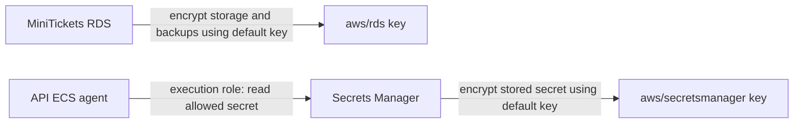

# KMS keys (AWS-managed)

History: see [CHANGELOG.md](../CHANGELOG.md) or run `pnpm docs:history`

Area: AWS Data · Status: 🟡 partial (AWS-managed keys only) · Step doc: [14 data](../../14-infra-data.md) (section 3.8)
<!-- interview-card: v2 -->

## 1. What is it?

Key Management Service, or KMS, manages keys used to encrypt stored data. AWS services can use those keys without giving the application the key material.

## 2. Why do we need it?

MiniTickets needs encrypted database storage and secrets without inventing a key vault. The managed service handles encryption while we control who may access the data through it.

## 3. How does it work?

1. A service uses its configured encryption key for stored data.
2. Access policies decide who may request the service operation.
3. The service handles encryption and decryption for authorized use.

## 4. How do we use it in MiniTickets?

We create no customer-managed KMS key. RDS and Secrets Manager use their default AWS-managed keys. Valkey encryption is enabled too, but its precise default key ownership was not verified in the old evidence.

## 5. Interview-ready answer

“MiniTickets relies on service-managed encryption instead of operating its own keys. KMS protects key material, while service permissions still decide who can read data. AWS-managed keys reduce administration. Customer-managed keys become useful when we need our own key policy, lifecycle control or supported cross-account sharing, with extra permission and recovery responsibilities.”

## 6. Important follow-up questions

- **Does encryption replace authorization?** No. An authorized read still returns decrypted data.
- **Why use a customer-managed key?** For deliberate policy, lifecycle or sharing requirements.
- **What if key permissions are wrong?** A service operation can fail even when networking and service permissions look correct.
- **What is envelope encryption?** A data key encrypts data; a protected master key encrypts that data key.

## 7. Advanced details

Technical reference

### Source anchors

- Anchor: `infra/src/data/postgres.ts` · `storageEncrypted: true`: encrypted with the default AWS-managed key for RDS (no `kmsKeyId` given).
- Anchor: `infra/src/compute/iam.ts` · comment at `executionSecrets`: why the execution role needs no `kms:Decrypt`.

### Keys and permissions

`infra/src/data/postgres.ts` → `createPostgres` sets storageEncrypted with no kmsKeyId, using the default aws/rds key. Secrets Manager uses aws/secretsmanager when no customer key is supplied. Our execution role needs scoped secretsmanager:GetSecretValue; no separate customer-key decrypt grant is configured for those current secrets. Authorization can still fail through service policies or explicit denies. Valkey enables at-rest encryption without naming a key; this card does not assert its default key ownership.

A customer-managed key adds policy, lifecycle and recovery responsibilities. Key policy and IAM decisions matter; missing kms:Decrypt can break a read through Secrets Manager. AWS-managed keys cannot be edited, disabled or shared like customer-managed keys. In particular, snapshots encrypted under aws/rds cannot be shared cross-account in that form. Envelope encryption protects data with a data key, then protects that key with a KMS key.

### Checks and alternatives

Use `aws kms list-aliases --profile ticketlite --query "Aliases[?starts_with(AliasName,'alias/aws/')].AliasName"` and `aws rds describe-db-instances --profile ticketlite --db-instance-identifier minitickets-dev-db --query "DBInstances[0].KmsKeyId"` to inspect metadata. This rewrite did not inspect live keys or values.

Customer-managed keys fit deliberate cross-account sharing, separation of duties, audit-policy or revocation requirements. Imported material and CloudHSM are alternatives for specific regulatory needs, not automatic production upgrades. No customer-managed key is built here. AWS-managed keys have no monthly key storage fee; requests/services can cost money. Historical $1/month customer-key examples were unverified snapshots, not current prices.

[AWS Secrets Manager encryption](https://docs.aws.amazon.com/secretsmanager/latest/userguide/security-encryption.html) explains service-mediated key use and its policy. [RDS encryption](https://docs.aws.amazon.com/AmazonRDS/latest/UserGuide/Overview.Encryption.html) documents the default key and snapshot-sharing limits.

### Preserved references

- [encryption at rest](encryption-at-rest.md)
- [Secrets Manager](secrets-manager.md)

[Open this piece in the city explorer](../guides/infra-explorer.html?concept=kms#chapter=6&piece=secrets).

## Where it appears in the story

- [Infra story: 6. Secrets Manager](../infra-story.md#6-secrets-manager)

