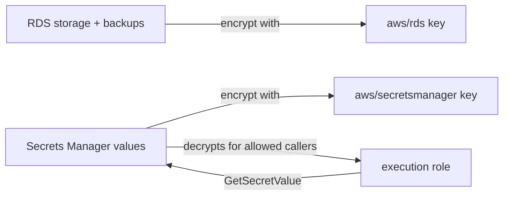

# KMS keys (AWS-managed)

History: see [CHANGELOG.md](../CHANGELOG.md) or run `pnpm docs:history`

Area: AWS Data · Status: 🟡 partial (AWS-managed keys only) · Step doc: [14 data](../../14-infra-data.md) (section 3.8)

## 1. In one line

**KMS** (Key Management Service) holds the encryption keys AWS services use; we rely on
**AWS-managed keys** that AWS creates for each service, and we create no keys of our own.

## 2. Real-life comparison

The bank keeps the master key to your safe-deposit box in its own key vault. You never see the key;
you only decide (through IAM) who may ask the bank to open the box.

## 3. Picture it



## 4. Where in our code

- Anchor: `infra/src/data/postgres.ts` · `storageEncrypted: true`: encrypted with the default AWS-managed key for RDS (no `kmsKeyId` given).
- Anchor: `infra/src/compute/iam.ts` · comment at `executionSecrets`: why the execution role needs no `kms:Decrypt`.

Step by step:

1. `storageEncrypted: true` without `kmsKeyId` → RDS uses its default AWS-managed key (`aws/rds`).
2. Both secrets give no `kmsKeyId` → Secrets Manager uses `aws/secretsmanager`.
3. Secrets Manager decrypts with that key for any caller allowed to read the secret, so the
   `read-secrets` policy needs only `secretsmanager:GetSecretValue`.
4. Valkey's `atRestEncryptionEnabled: true` also gives no key. Which key type ElastiCache uses by
   default (AWS-owned or AWS-managed) I have not verified.

## 5. See it yourself

```bash
aws kms list-aliases --profile ticketlite --query "Aliases[?starts_with(AliasName,'alias/aws/')].AliasName"
aws rds describe-db-instances --profile ticketlite --db-instance-identifier minitickets-dev-db --query "DBInstances[0].KmsKeyId"
```

The RDS key ARN should belong to the `alias/aws/rds` key.

## 6. How it connects

- **Uses ←** nothing we create.
- **Gives →** [encryption at rest](encryption-at-rest.md) for RDS and [Secrets Manager](secrets-manager.md).

## 7. Our settings and WHY

AWS-managed keys: free to use, no key policy to write, no extra IAM permission. Enough for one
account and no compliance rules.

## 8. Trade-offs

- **Pros:** zero work, nothing to rotate or protect.
- **Cons:** we cannot write the key policy, share the key with another account, or disable it. A
  snapshot encrypted with `aws/rds` cannot be shared with another account.

## 9. Alternatives and when to choose them

- **Customer-managed keys (CMKs):** cross-account sharing (snapshots, secrets), separation of duties,
  audits that need key policies, or the ability to revoke access by disabling the key. About $1 a
  month per key plus requests.
- **Imported key material / CloudHSM:** strict regulatory requirements.

## 10. What breaks, and how we'd notice

- With a CMK, a missing `kms:Decrypt` would give `AccessDenied` at task start. With AWS-managed keys
  this cannot happen.

## 11. Reach / Allowed / Password

**Allowed:** KMS decisions follow the key policy plus IAM. With AWS-managed keys, access is granted
through the service that uses the key.

## 12. Cost

AWS-managed keys: no monthly fee. Usage requests made by AWS services on our behalf are tiny for us
(not measured).

## 13. Interview answers at 3 levels

- **Simple:** KMS keeps the keys that encrypt our database and secrets.
- **Senior:** We use the AWS-managed keys `aws/rds` and `aws/secretsmanager`. That is why the execution
  role only needs `GetSecretValue`: Secrets Manager decrypts for any allowed reader.
- **Lead:** I'd move to customer-managed keys when we need cross-account sharing, crypto-shredding, or
  a key policy for separation of duties, and accept the cost and the extra permission work.

## 14. Follow-up questions interviewers ask

- *AWS-managed vs customer-managed key?* AWS creates and controls the first; you control the policy,
  rotation and lifecycle of the second.
- *What is envelope encryption?* Data is encrypted with a data key; the data key is encrypted with the
  KMS key.

## 15. Say it in 30 seconds

"We use AWS-managed KMS keys: `aws/rds` for the database storage and backups, `aws/secretsmanager`
for our two secrets. No key policies to write and no `kms:Decrypt` needed; customer-managed keys
would come with cross-account or compliance needs."

## 16. Status

🟡 partial. **To make it production-grade:** customer-managed keys where sharing, revocation or audit
require them.
