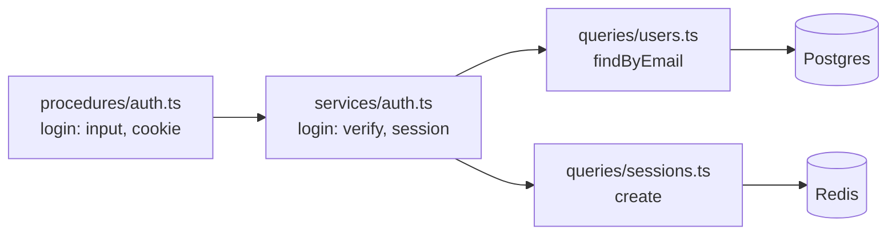

# Layered architecture: procedures → services → queries

History: see [CHANGELOG.md](../CHANGELOG.md) or run `pnpm docs:history`

Area: API · Status: ✅ built · Step doc: [02 errors](../../02-errors.md), [06 signup api](../../06-signup-api.md)

## 1. In one line

The api is split into three layers that each call only the one below: **procedures** (validate,
call a service), **services** (business rules, no HTTP or SQL), **queries** (the only code that
touches Postgres or Redis).

## 2. Real-life comparison

A restaurant: the waiter takes and checks the order (procedure), the chef decides how to cook it
(service), the storeroom keeper is the only one allowed in the storeroom (query). The waiter never
cooks; the chef never takes orders.

## 3. Picture it



## 4. Where in our code

- Anchor: `apps/api/src/procedures/auth.ts` · `authRouter`: "validate input, call a service, return. No logic here."
- Anchor: `apps/api/src/services/auth.ts` · `signup`, `login`, `logout`, `getCurrentUser`: "business logic. No HTTP and no SQL."
- Anchor: `apps/api/src/queries/users.ts` · `findByEmail`, `findById`, `create`: "the only code that talks to the database."
- Anchor: `apps/api/src/queries/events.ts` · `listUpcoming`: the only code that runs SQL for events; `services/events.ts` → `listUpcomingEvents` and `procedures/events.ts` → `eventsRouter` sit above it.

Step by step for login:

1. **Procedure** `auth.login`: `.input(LoginInput)` validates; calls `authService.login(input)`;
   sets the cookie (an HTTP job) with `ctx.res.setCookie`; `.output(PublicUserSchema)` filters.
2. **Service** `login`: finds the user, always runs one argon2 verify, throws `UnauthorizedError`
   on failure, creates a session. It never sees a request, a cookie or SQL.
3. **Queries**: `users.findByEmail` (Drizzle → SQL), `sessions.create` (Redis `SET … EX`).
4. Errors flow back up: queries translate driver errors (`23505` → `ConflictError`), services throw
   `AppError`s, `errorMapper` turns them into HTTP-style codes ([error-handling](error-handling.md)).

Files today:

| Layer | Files |
| ----- | ----- |
| procedures | `auth.ts`, `account.ts` |
| services | `auth.ts`, `account.ts` |
| queries | `users.ts`, `sessions.ts`, `health.ts` |

## 5. See it yourself

```bash
grep -rn "from \"drizzle-orm\"\|from \"../db\|redis" apps/api/src/services apps/api/src/procedures
# nothing: no SQL or Redis above the queries layer
grep -rln "ctx.res\|setCookie" apps/api/src/services
# nothing: services never touch HTTP
```

**Break it on purpose:** call `db.select()` inside `services/account.ts`. It works, which is the
point: the rule is a convention from `CLAUDE.md` (no lint rule yet), and only review catches it.

## 6. How it connects

- **Uses ←** [trpc-middleware](trpc-middleware.md) (procedures are built from `publicProcedure` /
  `protectedProcedure`).
- **Gives →** testable business logic; one place per data store ([sql-injection](sql-injection.md),
  [unique-constraint-race](unique-constraint-race.md)); a clear home for every new feature.

## 7. Our settings and WHY

Folder per layer, file per feature, no suffixes (`services/auth.ts`, not `auth.service.ts`). WHY:
the folder already says the layer; each layer has one job; services can be tested without HTTP.

## 8. Trade-offs

- **Pros:** obvious where code goes; swapping a data store touches only `queries/`; services are
  plain async functions.
- **Cons:** small features cross three files; a thin service (`getCurrentUser`) can feel like a
  pass-through.

## 9. Alternatives and when to choose them

- **Feature slices** (`features/auth/{procedure,service,query}.ts`): same layers, grouped by
  feature; nicer when there are many features.
- **Hexagonal / ports and adapters:** services depend on interfaces; worth it when stores really
  get swapped or heavily mocked.
- **Fat procedures:** fine for prototypes; hard to test and reuse later.

## 10. What breaks, and how we'd notice

- SQL in a service or HTTP in a service: works, but the layers blur. Code review today.
- A query that adds business rules: rules become hidden in data access. Same.

## 13. Interview answers at 3 levels

- **Simple:** Each part of the api has one job: check, decide, or fetch.
- **Senior:** Procedures validate and call services; services hold rules and throw `AppError`s
  with no HTTP or SQL; queries are the only code touching Postgres or Redis and translate driver
  errors. Login shows all three: cookie in the procedure, argon2 and session creation in the
  service, SQL and Redis in queries.
- **Lead:** Layering is about change cost: HTTP, business rules and storage change for different
  reasons. I'd enforce it with import rules as the team grows and consider feature-first folders
  when the number of features grows.

## 14. Follow-up questions interviewers ask

- *Where does the cookie get set, and why there?* In the procedure: it's an HTTP concern.
- *Where do you translate a unique violation?* In the query, so services never see Postgres codes.

## 15. Say it in 30 seconds

"Three layers: procedures validate input and call a service, services hold the business rules with
no HTTP or SQL, and queries are the only code that touches Postgres or Redis. In login, the cookie
is set in the procedure, the password check and session creation are in the service, and the SQL
and Redis calls are in queries."

## 16. Status

✅ built (as a convention). **To make it production-grade:** a lint rule (`no-restricted-imports`)
so services cannot import `db/` or `redis/`.

## Where it appears in the story

- [App story: 7. The procedure](../app-story.md#7-the-procedure)
