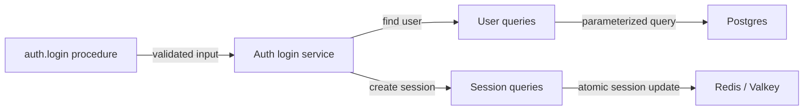

# Layered architecture: procedures → services → queries

History: see [CHANGELOG.md](../CHANGELOG.md) or run `pnpm docs:history`

Area: API · Status: ✅ built · Step doc: [02 errors](../../02-errors.md), [06 signup api](../../06-signup-api.md)
<!-- interview-card: v2 -->

## 1. What is it?

A layered API gives different jobs clear homes. Procedures handle the request boundary, services decide business rules, and queries or queue adapters perform external storage or messaging operations.

## 2. Why do we need it?

MiniTickets login needs input checks, password rules, a user lookup and a cookie. Mixing all of that in one handler makes changes and failure diagnosis harder.

## 3. How does it work?



1. Validate the incoming request at the procedure.
2. Apply business decisions in the service.
3. Call the data or message adapter and translate its result back upward.

## 4. How do we use it in MiniTickets?

Procedures set transport details such as cookies. Services hold auth and booking decisions. Queries are the data-store boundary; queue adapters publish messages. Folder names describe the layer, and each feature gets small focused files.

## 5. Interview-ready answer

“MiniTickets separates request handling, business decisions and external access. Procedures validate and call services; services avoid HTTP and SQL; queries or queue adapters own their respective operations. Login puts cookie handling, password decisions and storage in different places. The extra files cost some navigation, but keep change ownership and error translation clearer.”

## 6. Important follow-up questions

- **Where does a database error become a business error?** In the query adapter, so services do not depend on driver codes.
- **Where does the session cookie get set?** At the procedure boundary because it is an HTTP concern.
- **Can a service call the queue SDK directly?** No. It uses the queue adapter, just as storage uses queries.
- **Is this enforced automatically?** The main boundaries are repository conventions and review; stronger import rules are a future option.

## 7. Advanced details

<details>
<summary>Technical reference</summary>

### Current reading notes

Current layout also includes `queues/`: only service code calls the messaging adapter. Database initialization and infrastructure scripts have their own bootstrap responsibilities; business storage access stays in queries. The old auth/account file inventory below is an early example, not the complete current feature list. Session creation now uses indexed Lua operations, not just a bare SET.

### Implementation reference

- Anchor: `apps/api/src/procedures/auth.ts` · `authRouter`: "validate input, call a service, return. No logic here."
- Anchor: `apps/api/src/services/auth.ts` · `signup`, `login`, `logout`, `getCurrentUser`: "business logic. No HTTP and no SQL."
- Anchor: `apps/api/src/queries/users.ts` · `findByEmail`, `findById`, `create`: "the only code that talks to the database."
- Anchor: `apps/api/src/queries/events.ts` · `listUpcoming`: the only code that runs SQL for events; `apps/api/src/services/events.ts` → `listUpcomingEvents` and `apps/api/src/procedures/events.ts` → `eventsRouter` sit above it.

Step by step for login:

1. **Procedure** `auth.login`: `.input(LoginInput)` validates; calls `authService.login(input)`;
   sets the cookie (an HTTP job) with `ctx.res.setCookie`; `.output(PublicUserSchema)` filters.
2. **Service** `login`: finds the user, always runs one argon2 verify, throws `UnauthorizedError`
   on failure, creates a session. It never sees a request, a cookie or SQL.
3. **Queries**: `users.findByEmail` (Drizzle → SQL), `sessions.create` (Redis `SET … EX`).
4. Errors flow back up: queries translate driver errors (`23505` → `ConflictError`), services throw
   `AppError`s, `errorMapper` turns them into HTTP-style codes ([error-handling](error-handling.md)).

Files today:

| Layer | Files |
| ----- | ----- |
| procedures | `auth.ts`, `account.ts` |
| services | `auth.ts`, `account.ts` |
| queries | `users.ts`, `sessions.ts`, `health.ts` |

### Inspection and historical evidence

```bash
grep -rn "from \"drizzle-orm\"\|from \"../db\|redis" apps/api/src/services apps/api/src/procedures
# nothing: no SQL or Redis above the queries layer
grep -rln "ctx.res\|setCookie" apps/api/src/services
# nothing: services never touch HTTP
```

**Break it on purpose:** call `db.select()` inside `services/account.ts`. It works, which is the
point: the rule is a convention from `CLAUDE.md` (no lint rule yet), and only review catches it.

### Settings and reasoning

Folder per layer, file per feature, no suffixes (`services/auth.ts`, not `auth.service.ts`). WHY:
the folder already says the layer; each layer has one job; services can be tested without HTTP.

### Trade-offs

- **Pros:** obvious where code goes; swapping a data store touches only `queries/`; services are
  plain async functions.
- **Cons:** small features cross three files; a thin service (`getCurrentUser`) can feel like a
  pass-through.

### Alternatives and scaling

- **Feature slices** (`features/auth/{procedure,service,query}.ts`): same layers, grouped by
  feature; nicer when there are many features.
- **Hexagonal / ports and adapters:** services depend on interfaces; worth it when stores really
  get swapped or heavily mocked.
- **Fat procedures:** fine for prototypes; hard to test and reuse later.

### Failure diagnosis

- SQL in a service or HTTP in a service: works, but the layers blur. Code review today.
- A query that adds business rules: rules become hidden in data access. Same.

### Further questions

- *Where does the cookie get set, and why there?* In the procedure: it's an HTTP concern.
- *Where do you translate a unique violation?* In the query, so services never see Postgres codes.

### Status and remaining work

✅ built (as a convention). **To make it production-grade:** a lint rule (`no-restricted-imports`)
so services cannot import `db/` or `redis/`.

### Related reading

- [trpc-middleware](trpc-middleware.md)
- [sql-injection](sql-injection.md)
- [unique-constraint-race](unique-constraint-race.md)

[Open this piece in the city explorer](../guides/infra-explorer.html?concept=layered-api#chapter=24&piece=code-procedure).

## Where it appears in the story

- [App story: 7. The procedure](../app-story.md#7-the-procedure)

</details>
