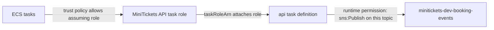

# Least privilege

History: see [CHANGELOG.md](../CHANGELOG.md) or run `pnpm docs:history`

Area: Auth & Security · Status: ✅ built in repository; live acceptance is separate
<!-- interview-card: v2 -->

## 1. What is it?

Least privilege means giving each person or program only the access its job needs. A working connection does not mean permission to use everything behind it.

## 2. Why do we need it?

A stolen web-container credential should not unlock MiniTickets database passwords or let an attacker send booking events. Separate, narrow permissions limit what one compromised component can do.

## 3. How does it work?

1. Identify who needs access and why.
2. Allow only the necessary actions on the intended resources.
3. Attach that permission to the actual workload and review it as responsibilities change.

## 4. How do we use it in MiniTickets?

API startup, API business work, web startup, email and tickets use different roles. Web startup can read the shared revalidation secret; it cannot fetch the API database credentials.

## 5. Interview-ready answer

“Least privilege limits the damage of mistakes and compromise. In MiniTickets I separate startup access from application work and give each worker only its own resources. I check who can assume a role, what actions it allows and where it is attached. Network reach and application authorization remain separate checks.”

## 6. Important follow-up questions

- **Does a narrow role help if it is unattached?** No. Check the role the running task actually uses.
- **Can every action name one resource?** No. Some APIs require a wildcard; explain it and narrow conditions where supported.
- **Why not one role for all workers?** One compromised worker would inherit unrelated powers.
- **What if a necessary call is denied?** Add the specific missing action/resource after checking the workload identity, rather than broadening everything.

## 7. Advanced details

Technical reference

### Source references

- Anchor: `infra/src/compute/iam.ts` · `executionSecrets`: `GetSecretValue` on named startup-secret ARNs, not `*` (DB/cache and revalidation when entry is enabled).
- Anchor: `infra/src/compute/web-iam.ts` · `createWebIamRole`: web's execution role reads only the revalidation secret; no task role.
- Anchor: `infra/src/security.ts` · `createSecurityGroups`: group-to-group rules, no egress for the data stores.
- Anchor: `.github/workflows/ci.yml` · `permissions: contents: read`: the CI token can only read.
- Anchor: `infra/src/jobs/worker-iam.ts` · `createWorkerRole`: the worker Lambda may read ONE queue, GetItem/PutItem on ONE table, send email only from `no-reply@` with our identities, write ONE log group (S1c).

`infra/src/cicd.ts` restricts OIDC subjects and PassRole. `infra/src/publish-policy.ts` includes ECR read/write actions needed by publish; `compute/iam.ts` separates API execution/application roles. Read the D1 Every IAM badge tour and runbook §3.11. Live deploy acceptance remains owner work.

### Configuration and design

Least privilege gives each runtime only its required actions/resources. API execution reads DB/cache/revalidation secrets; API application handles ECS Exec, booking SNS and scoped ticket/poster data; web execution reads only revalidation. Email and ticket roles have separate queue/table/object/secret scopes. A reachable AWS endpoint is not permission to invoke it.

### Checks and troubleshooting

Why did worker publish need BatchGetImage? Publishing tooling reads image manifests as well as uploading layers.

### Trade-offs and alternatives

Resource wildcards needed for APIs without resource scoping require conditions where supported. Broad deploy capability is dangerous; do not let old infrastructure runs apply.

10x: environment protection/expiry and policy review. 100x: separate accounts, policy-as-code and change approvals tied to exact SHA.

### Further technical context

A trust policy says who can assume a role; a permission policy says which actions/resources it can access; attachment says which runtime uses it. GitHub OIDC exchanges an approved repository/environment identity for short-lived AWS credentials. Task execution retrieves images/secrets; application roles authorize runtime AWS calls.

### Related reading

Uses the [current system](../00-big-picture.md); gives a concrete decision to the [scenario](../guides/interview-scenarios.md#iam-oidc) and [explorer tour](../guides/infra-explorer.html?tour=iam-badges).

[Open this piece in the city explorer](../guides/infra-explorer.html?concept=least-privilege#chapter=9&piece=iam).

## Where it appears in the story

- [Infra story: 5. IAM roles](../infra-story.md#5-iam-roles)

