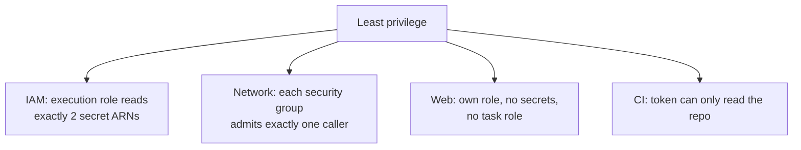

# Least privilege

History: see [CHANGELOG.md](../CHANGELOG.md) or run `pnpm docs:history`

Area: Auth & Security · Status: ✅ built · Step docs: [10 CI](../../10-ci.md), [13 security groups](../../13-infra-security-groups.md), [17 ECS api](../../17-infra-ecs-api.md), [18 ALB + web](../../18-infra-alb-web.md)

## 1. In one line

**Least privilege** means every role, rule and token gets only the permissions it needs, so a
mistake or a stolen credential can do as little damage as possible.

## 2. Real-life comparison

A hotel cleaner's key card opens only the rooms on their floor, only during their shift. Losing it
is annoying, not a disaster.

## 3. Picture it



## 4. Where in our code

- Anchor: `infra/src/compute/iam.ts` · `executionSecrets`: `GetSecretValue` on two exact ARNs, not `*`.
- Anchor: `infra/src/compute/web-iam.ts` · `createWebIamRole`: web's role cannot read any secret; no task role.
- Anchor: `infra/src/security.ts` · `createSecurityGroups`: group-to-group rules, no egress for the data stores.
- Anchor: `.github/workflows/ci.yml` · `permissions: contents: read`: the CI token can only read.
- Anchor: `infra/src/jobs/worker-iam.ts` · `createWorkerRole`: the worker Lambda may read ONE queue, GetItem/PutItem on ONE table, send email only from `no-reply@` with our identities, write ONE log group (S1c).

Step by step:

1. **IAM, api:** the execution role reads two secrets; the task role only has ECS Exec.
2. **IAM, web:** its own execution role with only the managed policy.
3. **Trust:** every role can be assumed only by `ecs-tasks.amazonaws.com` for our account.
4. **Network:** five groups, each door names one caller; db and redis groups have no egress.
5. **CI:** `permissions: contents: read` at the top of the workflow.
6. **Containers:** the api image runs as user `node`, not root (Phase 3 `container-hardening` card).

## 5. See it yourself

```bash
aws iam get-role-policy --profile ticketlite --role-name minitickets-dev-api-execution-role --policy-name read-secrets
aws iam list-role-policies --profile ticketlite --role-name minitickets-dev-web-execution-role   # []
```

**Break it on purpose (read-only):** use the IAM policy simulator from
[aws-foundations, chapter 3](../aws-foundations.md#3-the-three-questions-reach-allowed-password) with
any other secret ARN: `implicitDeny`.

## 6. How it connects

- **Uses ←** [execution-vs-task-role](execution-vs-task-role.md), [security-groups](security-groups.md).
- **Gives →** small blast radius everywhere; the theme of the security story in the
  [infra story](../infra-story.md).

## 7. Our settings and WHY

| Exception | Why |
| --------- | --- |
| `Resource: "*"` for `ssmmessages` | Those actions do not support resource-level permissions. |
| Open egress on alb, web, api | They call several destinations; listing all would be brittle in dev. |
| AWS-managed execution policy | Standard and small; maintained by AWS. |

## 8. Trade-offs

- **Pros:** limits damage from bugs and leaks; makes reviews concrete.
- **Cons:** more roles and rules to maintain; missing permissions appear at runtime as AccessDenied.

## 9. Alternatives and when to choose them

- **IAM Access Analyzer** to generate policies from real usage and flag unused permissions.
- **Permission boundaries / SCPs:** guardrails for many teams.
- **Tight egress** with VPC endpoints: production.

## 10. What breaks, and how we'd notice

- Too tight: `AccessDenied` or tasks that cannot start.
- Too loose: nothing visible until a breach; only reviews or analyzers catch it.

## 11. Reach / Allowed / Password

Applies to **Reach** (security groups) and **Allowed** (IAM).

## 12. Cost

Free.

## 13. Interview answers at 3 levels

- **Simple:** Give everything only the access it needs.
- **Senior:** The api execution role can read exactly two secret ARNs, the task role only ECS Exec,
  the web role nothing beyond pulling its image and writing logs. Security groups reference caller
  groups, the data stores have no egress, and the CI token is read-only.
- **Lead:** I treat least privilege as a review habit: policies generated from infrastructure outputs,
  wildcards justified in comments, Access Analyzer findings in the backlog, and OIDC instead of
  long-lived keys for CI.

## 14. Follow-up questions interviewers ask

- *Where did you have to use a wildcard?* `ssmmessages` for ECS Exec, because those actions have no
  resource ARNs.
- *How do you find unused permissions?* IAM Access Analyzer and last-accessed data.

## 15. Say it in 30 seconds

"Every identity gets exactly what it needs: the api's execution role reads two specific secrets, its
task role only allows ECS Exec, web has no secret access and no task role, security groups name one
caller per port, and CI's token is read-only."

## 16. Status

✅ built.

## Where it appears in the story

- [Infra story: 5. IAM roles](../infra-story.md#5-iam-roles)
